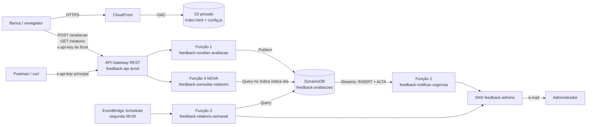

# Tech Challenge Fase 4 (PosTech) — Guia 2: relatório sob demanda e página web para a banca

**Complemento do guia principal (`guia-tech-challenge-fase4-clean-architecture.md`) · Data de referência: 29/10/2026**

> **O que este guia faz.** A aplicação que já está no ar continua igual. Este guia **acrescenta**:
> 1. **Relatório sob demanda:** um endpoint `GET /relatorio`, atendido por uma **4ª função** (`feedback-consultar-relatorio`), que devolve o relatório de qualquer período de até 31 dias. Ele **não envia e-mail**.
> 2. **Página web de testes para a banca** (S3 privado + CloudFront com HTTPS). Nela é possível enviar uma avaliação (descrição + nota), gerar o relatório com a **média das notas por dia** e baixar o relatório em **PDF**. A banca não tem acesso ao seu e-mail, e assim consegue ver o resultado na hora.
> 3. Uma **segunda chave de API** só para a página, com limite de **300 requisições/dia**.
> 4. **Deploy automatizado** com GitHub Actions para as 4 funções. A [seção 6](#6-deploy-automatizado-github-actions) substitui a seção 9 do guia principal.
>
> **O que NÃO muda:**
> - **A notificação continua só para avaliações críticas.** O enunciado pede *"notificações automáticas ao admin para problemas críticos"*. Mandar e-mail para todas as avaliações iria contra o pedido e tiraria o sentido da urgência.
> - **O relatório semanal por e-mail** (segunda às 08:00) continua igual. Por dentro, a Função 3 passa a reutilizar a consolidação da Função 4, mas o resultado é o mesmo.
>
> ⚠️ **O que foi testado de verdade e o que não foi**
> - **Testado:** todo o código Java das seções 1.1 a 1.5 foi aplicado numa **cópia** do projeto. Ele compilou com JDK 25 e as dependências reais do `pom.xml`, e os **7 testes novos passaram**. O `target/function.zip` foi gerado com a classe nova.
> - **Testado:** a página web (seção 3.1) rodou no Chromium contra uma API falsa, **em outra origem**, para exercitar o CORS. O envio, o relatório, a tabela por dia e o layout em largura de celular funcionaram.
> - **Não testado:** os passos no console da AWS (seções 2 a 4). Eles seguem a estrutura atual dos consoles, mas os nomes de botões mudam de vez em quando. Se algo não bater, procure o equivalente.

### Convenções usadas

| Símbolo | Significado |
|---|---|
| ▶ | Uma ação para você fazer (clicar, digitar) |
| 👀 | O que você deve ver na tela |
| ✅ | Como saber que deu certo |
| ⚠️ | Cuidado / pegadinha |
| `código` | Texto para digitar ou colar exatamente |

---

## Índice

0. [Visão geral](#0-visão-geral)
1. [Código Java](#1-código-java)
2. [AWS: a função nova e o endpoint `GET /relatorio`](#2-aws-a-função-nova-e-o-endpoint-get-relatorio)
3. [Página web: S3 + CloudFront + CORS](#3-página-web-s3--cloudfront--cors)
4. [Monitoramento da função nova](#4-monitoramento-da-função-nova)
5. [Postman: novos cenários](#5-postman-novos-cenários)
6. [Deploy automatizado (GitHub Actions)](#6-deploy-automatizado-github-actions)
7. [Vídeo e orientação para a banca](#7-vídeo-e-orientação-para-a-banca)
8. [Checklist](#8-checklist)
9. [Desligar tudo em 15/12/2026](#9-desligar-tudo-em-15122026)
10. [Problemas comuns e soluções](#10-problemas-comuns-e-soluções)

---

## 0. Visão geral

### 0.1 Por que mudar

| Situação atual | Limitação | O que este guia faz |
|---|---|---|
| Relatório só por e-mail, uma vez por semana | Ninguém além de você vê o relatório, e só às segundas | `GET /relatorio` gera o relatório de qualquer período, na hora |
| Testes só pelo Postman, com a sua chave | A banca precisaria montar o Postman e não vê os e-mails | Página web pública com formulário, relatório e PDF |
| Uma chave de API para tudo | Se a chave for exposta numa página, o limite de 1000/dia fica todo exposto | Chave própria da página, com limite de 300/dia, que pode ser revogada sozinha |

### 0.2 Arquitetura depois das mudanças



**Por que uma 4ª função, e não reaproveitar a Função 3:** a Função 3 é acionada pelo agendamento e **envia e-mail**. A nova é acionada por HTTP e **só lê**. Se fossem a mesma função, ela teria de entender dois formatos de evento e precisaria de permissão de SNS mesmo quando só consulta. Separadas, cada uma tem um único papel e uma role mínima. O pacote (`function.zip`) continua sendo um só.

**Por que o PDF é gerado no navegador:** uma biblioteca de PDF dentro da Lambda deixaria o pacote maior, a partida a frio mais lenta e aumentaria o custo. Na página, o botão **Baixar PDF** usa a impressão do navegador ("Salvar como PDF"), sem custo na nuvem e sem dependência nova.

**Por que o relatório da página não mostra o texto das avaliações:** a chave da página fica visível no código da página (é assim com qualquer página estática). Por isso o `GET /relatorio` devolve **só números agregados** (total, médias, contagens). O texto completo continua só no e-mail semanal do administrador.

### 0.3 O que muda no código (resumo)

| Camada | Arquivo | Mudança |
|---|---|---|
| `domain` | `PeriodoInvalidoException` | **Novo.** Erro de período inválido, que vira HTTP 400 |
| `domain` | `PeriodoRelatorio` | Limite de **31 dias** por período |
| `domain` | `RelatorioSemanal` | Novo método `mediaPorDia()` |
| `application` | `ConsultarRelatorioUseCase` | **Novo.** Consolida um período, sem enviar nada |
| `application` | `GerarRelatorioSemanalUseCase` | Passa a reutilizar o `ConsultarRelatorioUseCase` (comportamento igual) |
| `entrypoint` | `consultar/ConsultarRelatorioHandler` | **Novo.** Função 4, `GET /relatorio` |
| `entrypoint` | `http/RespostaApiGateway` | Header CORS quando `CORS_ORIGEM` está configurada |
| `infrastructure` | `ConfiguracaoCasosDeUso` | Ensina o Quarkus a criar o caso de uso novo |
| — | `application.properties` | Propriedade `app.cors-origem` |
| — | `frontend/` | **Novo.** `index.html` e `config.example.js` |

### 0.4 Nomes padronizados (use **exatamente** estes)

| Recurso | Nome |
|---|---|
| Função 4 | `feedback-consultar-relatorio` |
| `QUARKUS_LAMBDA_HANDLER` da Função 4 | `consultarRelatorio` |
| Role da Função 4 | `feedback-role-consultar` |
| Recurso da API | `/relatorio` (método `GET`) |
| Plano de uso da página | `feedback-plano-front` |
| Chave de API da página | `feedback-chave-front` |
| Bucket S3 | `feedback-front-SEU_ACCOUNT_ID` (nomes de bucket são únicos no mundo; o número da conta garante isso) |
| Distribuição CloudFront | `feedback-front` |
| Alarme novo | `feedback-erros-consultar` |

### 0.5 Custos e limites (por que não há risco para os créditos)

Toda chamada à API passa por um **plano de uso**. Somando os dois planos, o máximo possível é **1.300 requisições por dia** (1.000 do plano principal + 300 do plano da página). O cálculo abaixo considera esse máximo **todos os dias** de 29/10 a 15/12 (cerca de 61 mil requisições), o que na prática não vai acontecer:

| Serviço | Pior caso no período inteiro | Uso real esperado |
|---|---|---|
| API Gateway REST (US$ 3,50 por milhão) | ~US$ 0,21 | centavos |
| Lambda (4 funções, 1024 MB arm64) | dentro do nível gratuito (1 milhão de chamadas e 400 mil GB-s por mês) | US$ 0 |
| DynamoDB sob demanda | ~US$ 0,10 | centavos |
| SNS e-mail (se todas as avaliações fossem críticas) | ~US$ 1,20 | US$ 0 (1.000 e-mails grátis por mês) |
| S3 (2 arquivos, poucos KB) | centavos | US$ 0 |
| CloudFront | dentro do nível gratuito | US$ 0 |
| **Total** | **menos de US$ 2** | **centavos** |

O que limita o custo de cada peça:
- **Cota diária** em cada chave: acabou a cota, o API Gateway responde **429** sem chamar a função.
- **Limite de 31 dias** por relatório: cada relatório faz no máximo 31 consultas ao índice.
- **PDF no navegador:** a nuvem não processa PDF.
- **Bucket privado atrás do CloudFront:** ninguém acessa o S3 diretamente.
- O **AWS Budgets** que você já tem continua avisando ao primeiro gasto.

O risco real é de **incômodo**, não de dinheiro: alguém usar a página para mandar dezenas de notas 0 e encher o seu e-mail. O limite de 300/dia da chave da página limita isso. Se acontecer, desative só a chave da página (seção 10).

### 0.6 Ordem e calendário

| Quando | O quê |
|---|---|
| Até 01/11 | Seção 1 (código) no seu computador. **Não implante ainda.** |
| Até 01/11 | Seção 6.1 a 6.5: OIDC, role de deploy, secret e workflows (não implanta nada) |
| **Segunda 02/11, 08:00** | Deixe o relatório de ensaio sair com o código atual (seção 15.4 do guia principal) |
| 02/11 a 05/11 | Seções 2.1 e 2.2 (criar a Função 4), depois 6.6 (merge na `main` = deploy das 4 funções), depois o restante das seções 2, 3 e 4 |
| Até 06/11 | Seção 5 (Postman) e teste completo pela página |
| Até 16/11 | Gravar o vídeo (seção 7) |
| 17/11 | Entrega, com a URL da página no documento |
| Até 15/12 | Página no ar para a banca |
| 15/12 | Desligar tudo (seção 9) |

> ⚠️ O código novo também é implantado nas Funções 1 e 3, porque o pacote é um só. O comportamento delas não muda, mas implante **depois** do relatório de 02/11 para não arriscar o ensaio.

---

## 1. Código Java

Todos os caminhos abaixo são relativos a `src/main/java/br/com/techchallenge/feedback/`, salvo indicação.

### 1.1 Camada `domain`

**A) Novo arquivo `domain/PeriodoInvalidoException.java`**

```java
package br.com.techchallenge.feedback.domain;

/**
 * Erro de regra de negócio: o período pedido para um relatório não é válido
 * (início depois do fim ou mais dias do que o permitido).
 * A mensagem é escrita para ser mostrada ao usuário da API.
 *
 * Estende {@link IllegalArgumentException} para continuar compatível com quem
 * já tratava o erro "início depois do fim" por esse tipo.
 */
public class PeriodoInvalidoException extends IllegalArgumentException {

    private static final long serialVersionUID = 1L;

    /** @param mensagem motivo do erro, em português, pronto para ir na resposta HTTP 400 */
    public PeriodoInvalidoException(String mensagem) {
        super(mensagem);
    }
}
```

**B) Alterar `domain/PeriodoRelatorio.java`**

O arquivo completo, já alterado. Mudou o seguinte: o import de `ChronoUnit`, a constante `MAX_DIAS`, a exceção nova e a verificação de 31 dias no construtor.

```java
package br.com.techchallenge.feedback.domain;

import java.time.LocalDate;
import java.time.temporal.ChronoUnit;
import java.util.ArrayList;
import java.util.List;
import java.util.Objects;

/**
 * Intervalo de dias (inclusive) coberto por um relatório.
 *
 * @param inicio primeiro dia do período (inclusive)
 * @param fim    último dia do período (inclusive)
 */
public record PeriodoRelatorio(LocalDate inicio, LocalDate fim) {

    /** Quantidade de dias de um relatório semanal. */
    public static final int DIAS_DA_SEMANA = 7;

    /**
     * Maior período aceito, em dias. Cada dia é uma consulta ao banco,
     * então o limite também limita o custo de um relatório sob demanda.
     */
    public static final int MAX_DIAS = 31;

    /**
     * @throws NullPointerException     se {@code inicio} ou {@code fim} forem nulos
     * @throws PeriodoInvalidoException se {@code inicio} for depois de {@code fim}
     *                                  ou o período passar de {@value #MAX_DIAS} dias
     */
    public PeriodoRelatorio {
        Objects.requireNonNull(inicio, "inicio é obrigatório");
        Objects.requireNonNull(fim, "fim é obrigatório");
        if (inicio.isAfter(fim)) {
            throw new PeriodoInvalidoException("A data de início não pode ser depois da data de fim");
        }
        if (ChronoUnit.DAYS.between(inicio, fim) + 1 > MAX_DIAS) {
            throw new PeriodoInvalidoException("O período deve ter no máximo " + MAX_DIAS + " dias");
        }
    }

    /**
     * Semana do relatório a partir de "hoje".
     * Execução agendada (segunda): os 7 dias anteriores (segunda a domingo).
     * Demonstração (incluirHoje = true): os 6 dias anteriores + hoje.
     *
     * @param hoje        data local da execução
     * @param incluirHoje se {@code true}, o período termina hoje; senão, ontem
     * @return período de {@value #DIAS_DA_SEMANA} dias
     */
    public static PeriodoRelatorio semana(LocalDate hoje, boolean incluirHoje) {
        LocalDate fim = incluirHoje ? hoje : hoje.minusDays(1);
        return new PeriodoRelatorio(fim.minusDays(DIAS_DA_SEMANA - 1), fim);
    }

    /** @return todos os dias do período, em ordem crescente */
    public List<LocalDate> dias() {
        List<LocalDate> dias = new ArrayList<>();
        for (LocalDate d = inicio; !d.isAfter(fim); d = d.plusDays(1)) {
            dias.add(d);
        }
        return dias;
    }

    /**
     * @param dia data a verificar
     * @return {@code true} se a data está dentro do período (limites inclusive)
     */
    public boolean contem(LocalDate dia) {
        return !dia.isBefore(inicio) && !dia.isAfter(fim);
    }
}
```

> **Por que o limite fica no domínio:** é uma regra de negócio ("um relatório cobre no máximo 31 dias"). Ela vale para qualquer entrada, seja HTTP, agendamento ou teste. Também protege o custo, porque cada dia é uma consulta ao banco.

**C) Alterar `domain/RelatorioSemanal.java`**

▶ Acrescente o import `java.util.HashMap` (junto aos outros `java.util`):

```java
import java.util.HashMap;
```

▶ Acrescente este método **antes da última chave `}`** do arquivo:

```java
    /**
     * Média das notas de cada dia do período, na mesma ordem de {@link #porDia()}.
     * Dias sem avaliação ficam com {@code null}, para não confundir com média 0
     * (nota 0 é uma nota válida).
     *
     * @return média por dia; {@code null} nos dias sem avaliação
     */
    public Map<LocalDate, Double> mediaPorDia() {
        Map<LocalDate, Integer> somaPorDia = new HashMap<>();
        for (Avaliacao a : avaliacoes) {
            somaPorDia.merge(a.dia(), a.nota(), Integer::sum);
        }
        Map<LocalDate, Double> medias = new LinkedHashMap<>();
        porDia.forEach((dia, quantidade) ->
                medias.put(dia, quantidade == 0 ? null : (double) somaPorDia.get(dia) / quantidade));
        return Collections.unmodifiableMap(medias);
    }
```

> **Por que `null` e não `0`:** nota 0 é válida. Um dia com média 0 (só avaliações péssimas) é muito diferente de um dia sem avaliações. Na página, o dia sem avaliação aparece como "—".
>
> **Por que um método e não um campo novo do `record`:** um campo novo mudaria o construtor e quebraria quem já cria `RelatorioSemanal` (inclusive os testes do guia principal). O método calcula a partir de dados que o relatório já tem.

### 1.2 Camada `application`

**A) Novo arquivo `application/usecase/ConsultarRelatorioUseCase.java`**

```java
package br.com.techchallenge.feedback.application.usecase;

import java.time.Clock;
import java.time.LocalDate;
import java.time.ZoneId;
import java.util.ArrayList;
import java.util.List;
import java.util.Objects;

import br.com.techchallenge.feedback.application.port.AvaliacaoRepository;
import br.com.techchallenge.feedback.domain.Avaliacao;
import br.com.techchallenge.feedback.domain.PeriodoRelatorio;
import br.com.techchallenge.feedback.domain.RelatorioSemanal;

/**
 * CASO DE USO da Função 4: consolidar as avaliações de um período, SEM enviar nada.
 * Também é reutilizado pela Função 3, que consolida a semana e depois envia o e-mail.
 */
public class ConsultarRelatorioUseCase {

    private final AvaliacaoRepository repositorio;
    private final Clock relogio;
    private final ZoneId zona;

    /**
     * @param repositorio de onde as avaliações são lidas, dia a dia
     * @param relogio     fonte da data/hora atual (fixa nos testes)
     * @param zona        fuso usado para saber qual é o dia de "hoje"
     */
    public ConsultarRelatorioUseCase(AvaliacaoRepository repositorio, Clock relogio, ZoneId zona) {
        this.repositorio = Objects.requireNonNull(repositorio);
        this.relogio = Objects.requireNonNull(relogio);
        this.zona = Objects.requireNonNull(zona);
    }

    /**
     * Lê as avaliações de cada dia do período e consolida.
     *
     * @param periodo dias que o relatório cobre (já validado pelo domínio)
     * @return o relatório consolidado
     */
    public RelatorioSemanal executar(PeriodoRelatorio periodo) {
        List<Avaliacao> avaliacoes = new ArrayList<>();
        for (LocalDate dia : periodo.dias()) {
            avaliacoes.addAll(repositorio.buscarPorDia(dia));
        }
        return RelatorioSemanal.consolidar(avaliacoes, periodo);
    }

    /**
     * Período padrão da consulta sob demanda: os 6 dias anteriores + hoje,
     * para que uma avaliação recém-enviada já apareça no relatório.
     *
     * @return o relatório dos últimos 7 dias, incluindo hoje
     */
    public RelatorioSemanal ultimosSeteDias() {
        LocalDate hoje = LocalDate.ofInstant(relogio.instant(), zona);
        return executar(PeriodoRelatorio.semana(hoje, true));
    }
}
```

**B) Alterar `application/usecase/GerarRelatorioSemanalUseCase.java`**

Arquivo completo. O **construtor continua com os mesmos parâmetros**, então `ConfiguracaoCasosDeUso` e os testes do guia principal continuam funcionando. A única diferença é que o laço de consulta saiu daqui e passou a ser feito pelo `ConsultarRelatorioUseCase`.

```java
package br.com.techchallenge.feedback.application.usecase;

import java.time.Clock;
import java.time.LocalDate;
import java.time.ZoneId;
import java.util.Objects;

import br.com.techchallenge.feedback.application.formatacao.RelatorioFormatter;
import br.com.techchallenge.feedback.application.port.AvaliacaoRepository;
import br.com.techchallenge.feedback.application.port.NotificacaoGateway;
import br.com.techchallenge.feedback.domain.PeriodoRelatorio;
import br.com.techchallenge.feedback.domain.RelatorioSemanal;

/**
 * CASO DE USO da Função 3: consolidar a semana e enviar o relatório aos administradores.
 * A consolidação é a mesma da consulta sob demanda ({@link ConsultarRelatorioUseCase});
 * este caso de uso só acrescenta o envio do e-mail.
 */
public class GerarRelatorioSemanalUseCase {

    private final ConsultarRelatorioUseCase consulta;
    private final NotificacaoGateway notificacao;
    private final RelatorioFormatter formatador;
    private final Clock relogio;
    private final ZoneId zona;

    /**
     * @param repositorio de onde as avaliações são lidas, dia a dia
     * @param notificacao canal de envio do relatório
     * @param formatador  monta o texto do e-mail do relatório
     * @param relogio     fonte da data/hora atual (fixa nos testes)
     * @param zona        fuso usado para saber qual é o dia de "hoje"
     */
    public GerarRelatorioSemanalUseCase(AvaliacaoRepository repositorio, NotificacaoGateway notificacao,
                                        RelatorioFormatter formatador, Clock relogio, ZoneId zona) {
        this.consulta = new ConsultarRelatorioUseCase(repositorio, relogio, zona);
        this.notificacao = Objects.requireNonNull(notificacao);
        this.formatador = Objects.requireNonNull(formatador);
        this.relogio = Objects.requireNonNull(relogio);
        this.zona = Objects.requireNonNull(zona);
    }

    /**
     * Lê as avaliações do período, consolida e envia o relatório aos administradores.
     *
     * @param incluirHoje false = 7 dias anteriores (execução agendada);
     *                    true = 6 dias anteriores + hoje (demonstração)
     * @return o relatório enviado
     */
    public RelatorioSemanal executar(boolean incluirHoje) {
        LocalDate hoje = LocalDate.ofInstant(relogio.instant(), zona);
        PeriodoRelatorio periodo = PeriodoRelatorio.semana(hoje, incluirHoje);

        RelatorioSemanal relatorio = consulta.executar(periodo);
        notificacao.enviar(formatador.formatar(relatorio));
        return relatorio;
    }
}
```

> **Para a banca (SOLID/DRY):** a consolidação existe num lugar só. O caso de uso semanal é uma **composição**: consulta mais envio. Se a regra de consolidação mudar, muda nos dois fluxos ao mesmo tempo.

### 1.3 Camada `entrypoint`

**A) Nova pasta `entrypoint/lambda/consultar/` com `package-info.java`**

```java
/**
 * Função 4, {@code feedback-consultar-relatorio}: chamada pelo API Gateway em
 * {@code GET /relatorio}. Devolve o relatório de um período em JSON, sem enviar e-mail.
 */
package br.com.techchallenge.feedback.entrypoint.lambda.consultar;
```

**B) Novo arquivo `entrypoint/lambda/consultar/ConsultarRelatorioHandler.java`**

```java
package br.com.techchallenge.feedback.entrypoint.lambda.consultar;

import java.io.IOException;
import java.io.InputStream;
import java.io.OutputStream;
import java.time.LocalDate;
import java.time.format.DateTimeParseException;
import java.util.Map;

import org.jboss.logging.Logger;

import com.amazonaws.services.lambda.runtime.Context;
import com.amazonaws.services.lambda.runtime.RequestStreamHandler;
import com.fasterxml.jackson.databind.JsonNode;
import com.fasterxml.jackson.databind.ObjectMapper;
import com.fasterxml.jackson.databind.node.ArrayNode;
import com.fasterxml.jackson.databind.node.ObjectNode;

import br.com.techchallenge.feedback.application.usecase.ConsultarRelatorioUseCase;
import br.com.techchallenge.feedback.domain.PeriodoInvalidoException;
import br.com.techchallenge.feedback.domain.PeriodoRelatorio;
import br.com.techchallenge.feedback.domain.RelatorioSemanal;
import br.com.techchallenge.feedback.entrypoint.lambda.http.RespostaApiGateway;
import jakarta.inject.Inject;
import jakarta.inject.Named;

/**
 * Adaptador HTTP da Função 4: traduz {@code GET /relatorio?inicio=aaaa-mm-dd&fim=aaaa-mm-dd}
 * em uma chamada ao caso de uso e devolve o relatório em JSON.
 *
 * Por privacidade, a resposta tem SÓ números agregados (total, médias e contagens);
 * o texto das avaliações não sai por este endpoint.
 */
@Named("consultarRelatorio")
public class ConsultarRelatorioHandler implements RequestStreamHandler {

    private static final Logger LOG = Logger.getLogger(ConsultarRelatorioHandler.class);

    private final ConsultarRelatorioUseCase consultarRelatorio;
    private final ObjectMapper mapper;

    /**
     * @param consultarRelatorio caso de uso que consolida o período
     * @param mapper             conversor JSON
     */
    @Inject
    public ConsultarRelatorioHandler(ConsultarRelatorioUseCase consultarRelatorio, ObjectMapper mapper) {
        this.consultarRelatorio = consultarRelatorio;
        this.mapper = mapper;
    }

    /**
     * Sem parâmetros: últimos 7 dias, incluindo hoje. Com {@code inicio} e {@code fim}: o período
     * pedido (até {@value PeriodoRelatorio#MAX_DIAS} dias).
     */
    @Override
    public void handleRequest(InputStream entrada, OutputStream saida, Context contexto) throws IOException {
        try {
            // Sem query string, o API Gateway manda "queryStringParameters": null.
            JsonNode parametros = mapper.readTree(entrada).path("queryStringParameters");
            String inicio = textoOuNulo(parametros.get("inicio"));
            String fim = textoOuNulo(parametros.get("fim"));

            RelatorioSemanal relatorio;
            if (inicio == null && fim == null) {
                relatorio = consultarRelatorio.ultimosSeteDias();
            } else if (inicio == null || fim == null) {
                RespostaApiGateway.erro(mapper, saida, 400,
                        "Informe 'inicio' e 'fim' juntos (formato aaaa-mm-dd) ou nenhum dos dois");
                return;
            } else {
                relatorio = consultarRelatorio.executar(
                        new PeriodoRelatorio(LocalDate.parse(inicio), LocalDate.parse(fim)));
            }

            LOG.info("Relatório consultado: " + relatorio.periodo().inicio() + " a " + relatorio.periodo().fim()
                    + ", " + relatorio.total() + " avaliações");
            RespostaApiGateway.escrever(mapper, saida, 200, paraJson(relatorio));

        } catch (DateTimeParseException e) {
            RespostaApiGateway.erro(mapper, saida, 400, "As datas devem estar no formato aaaa-mm-dd");
        } catch (PeriodoInvalidoException e) {
            RespostaApiGateway.erro(mapper, saida, 400, e.getMessage());
        } catch (Exception e) {
            LOG.error("Erro inesperado ao consultar relatório", e);
            RespostaApiGateway.erro(mapper, saida, 500, "Erro interno ao gerar o relatório");
        }
    }

    private ObjectNode paraJson(RelatorioSemanal r) {
        ObjectNode corpo = mapper.createObjectNode();
        corpo.put("inicio", r.periodo().inicio().toString());
        corpo.put("fim", r.periodo().fim().toString());
        corpo.put("total", r.total());
        corpo.put("media", arredondar(r.media()));

        ObjectNode porUrgencia = corpo.putObject("porUrgencia");
        r.porUrgencia().forEach((urgencia, quantidade) -> porUrgencia.put(urgencia.name(), quantidade));

        ArrayNode porDia = corpo.putArray("porDia");
        Map<LocalDate, Double> mediaPorDia = r.mediaPorDia();
        r.porDia().forEach((dia, quantidade) -> {
            ObjectNode item = porDia.addObject();
            item.put("dia", dia.toString());
            item.put("quantidade", quantidade);
            Double media = mediaPorDia.get(dia);
            if (media == null) {
                item.putNull("media");
            } else {
                item.put("media", arredondar(media));
            }
        });
        return corpo;
    }

    private static double arredondar(double valor) {
        return Math.round(valor * 100) / 100.0;
    }

    private static String textoOuNulo(JsonNode campo) {
        return (campo != null && campo.isTextual() && !campo.asText().isBlank()) ? campo.asText().trim() : null;
    }
}
```

**Contrato do endpoint**

```http
GET /prod/relatorio?inicio=2026-11-02&fim=2026-11-08
x-api-key: <chave>
```

| Status | Quando | Corpo |
|---|---|---|
| **200** | Período válido, ou nenhum parâmetro (últimos 7 dias incluindo hoje) | JSON abaixo |
| **400** | Só um dos parâmetros; data fora do formato `aaaa-mm-dd`; início depois do fim; mais de 31 dias | `{"erro": "<motivo>"}` |
| **403** | Sem `x-api-key` ou chave inválida (API Gateway) | `{"message": "Forbidden"}` |
| **429** | Limite de taxa ou cota excedido (API Gateway) | `{"message": "..."}` |
| **500** | Erro inesperado | `{"erro": "Erro interno ao gerar o relatório"}` |

```json
{
  "inicio": "2026-11-02",
  "fim": "2026-11-08",
  "total": 21,
  "media": 6.57,
  "porUrgencia": { "ALTA": 3, "MEDIA": 5, "BAIXA": 13 },
  "porDia": [
    { "dia": "2026-11-02", "quantidade": 3, "media": 6.33 },
    { "dia": "2026-11-03", "quantidade": 0, "media": null }
  ]
}
```

**C) Alterar `entrypoint/lambda/http/RespostaApiGateway.java`**

Arquivo completo. As mudanças são os imports `Optional` e `ConfigProvider`, a constante `ORIGEM_CORS` e o bloco de headers dentro de `escrever`.

```java
package br.com.techchallenge.feedback.entrypoint.lambda.http;

import java.io.IOException;
import java.io.OutputStream;
import java.util.Optional;

import org.eclipse.microprofile.config.ConfigProvider;

import com.fasterxml.jackson.databind.ObjectMapper;
import com.fasterxml.jackson.databind.node.ObjectNode;

/**
 * Conhece o formato de resposta que o API Gateway (integração proxy) espera:
 * {@code {"statusCode": ..., "headers": {...}, "body": "<json em texto>"}}.
 *
 * Quando {@code app.cors-origem} está configurada, toda resposta leva o header
 * {@code Access-Control-Allow-Origin}, para que a página web de testes possa ler a resposta.
 */
public final class RespostaApiGateway {

    /**
     * Origem da página web autorizada a ler as respostas (CORS), ex.: {@code https://dxxxx.cloudfront.net}.
     * Vazia = header não enviado (Postman e curl não precisam dele).
     */
    private static final Optional<String> ORIGEM_CORS =
            ConfigProvider.getConfig().getOptionalValue("app.cors-origem", String.class);

    private RespostaApiGateway() {
    }

    /**
     * Escreve uma resposta com corpo JSON.
     *
     * @param mapper conversor JSON
     * @param saida  stream de saída da Lambda
     * @param status código HTTP (ex.: 201, 400, 500)
     * @param corpo  objeto JSON que vai no {@code body}
     * @throws IOException se não for possível escrever na saída
     */
    public static void escrever(ObjectMapper mapper, OutputStream saida, int status, ObjectNode corpo)
            throws IOException {
        ObjectNode resposta = mapper.createObjectNode();
        resposta.put("statusCode", status);
        ObjectNode headers = resposta.putObject("headers");
        headers.put("Content-Type", "application/json; charset=utf-8");
        ORIGEM_CORS.ifPresent(origem -> headers.put("Access-Control-Allow-Origin", origem).put("Vary", "Origin"));
        resposta.put("body", mapper.writeValueAsString(corpo));
        mapper.writeValue(saida, resposta);
    }

    /**
     * Escreve uma resposta de erro no formato {@code {"erro": "<mensagem>"}}.
     *
     * @param mapper   conversor JSON
     * @param saida    stream de saída da Lambda
     * @param status   código HTTP de erro
     * @param mensagem motivo, em português, para quem chamou a API
     * @throws IOException se não for possível escrever na saída
     */
    public static void erro(ObjectMapper mapper, OutputStream saida, int status, String mensagem)
            throws IOException {
        ObjectNode corpo = mapper.createObjectNode();
        corpo.put("erro", mensagem);
        escrever(mapper, saida, status, corpo);
    }
}
```

> **Por que a Lambda precisa mandar o header CORS:** com *Lambda proxy integration*, o API Gateway repassa a resposta da função **sem alterar**. O botão "Enable CORS" do console cuida só da pré-verificação (`OPTIONS`) e das respostas de erro do próprio Gateway (403, 429). As respostas 200, 201, 400 e 500 vêm da função, então é ela que precisa incluir o `Access-Control-Allow-Origin`.
>
> **Por que a origem exata e não `*`:** com `*`, qualquer site poderia usar a sua API no navegador. Com a URL do CloudFront, só a sua página pode. Postman e curl não usam CORS, então continuam funcionando normalmente.

### 1.4 Configuração

**A) `infrastructure/config/ConfiguracaoCasosDeUso.java`**

▶ Acrescente o import (em ordem alfabética, antes de `GerarRelatorioSemanalUseCase`):

```java
import br.com.techchallenge.feedback.application.usecase.ConsultarRelatorioUseCase;
```

▶ Acrescente este método **antes da última chave `}`** da classe:

```java
    /** @return caso de uso da Função 4, ligado ao DynamoDB (só leitura, sem SNS) */
    @Produces
    @Singleton
    ConsultarRelatorioUseCase consultarRelatorio(AvaliacaoRepository repositorio, Clock relogio, ZoneId zona) {
        return new ConsultarRelatorioUseCase(repositorio, relogio, zona);
    }
```

**B) `src/main/resources/application.properties`**

▶ Arquivo completo:

```properties
# --- Qual função Lambda este pacote executa -----------------------------------
# Padrão para testes locais. Na AWS, cada função define a variável de ambiente
# QUARKUS_LAMBDA_HANDLER (receberAvaliacao, notificarUrgencia, relatorioSemanal ou
# consultarRelatorio), que tem prioridade sobre esta linha.
quarkus.lambda.handler=receberAvaliacao

# --- Clientes AWS (cliente HTTP leve = partida a frio mais rápida) -------------
quarkus.dynamodb.sync-client.type=url
quarkus.sns.sync-client.type=url

# --- Configurações da aplicação (vêm de variáveis de ambiente da função) -------
app.tabela=${TABELA_AVALIACOES:feedback-avaliacoes}
app.topico-arn=${TOPICO_ARN:nao-configurado}
app.zona=${ZONA:America/Sao_Paulo}
# Origem da página web de testes (CORS). Vazia = sem header CORS.
app.cors-origem=${CORS_ORIGEM:}
```

> Em MicroProfile Config, um valor vazio conta como "não configurado". Sem a variável `CORS_ORIGEM`, a resposta sai sem header CORS, que é o comportamento de hoje.

**C) `.gitignore` (raiz do projeto)**

▶ Acrescente ao final, para a chave da página nunca ir para o GitHub:

```gitignore
# Configuração da página web (contém a chave de API do front)
frontend/config.js
```

### 1.5 Testes (opcional)

> Testes automatizados **não são requisito** do enunciado, e o repositório hoje não tem testes. **Pode pular esta seção** e ir direto para a 1.6. Os testes abaixo ficam aqui só como referência, caso você queira usá-los para conferir o código novo localmente.
>
> Se for usá-los: eles ficam em `src/test/java/br/com/techchallenge/feedback/` e dependem da classe `application/fakes/RepositorioEmMemoria.java` da **seção 5.10 A do guia principal**. Sem ela, a compilação dos testes falha.

**A) `domain/RelatorioSemanalMediaPorDiaTest.java`**

```java
package br.com.techchallenge.feedback.domain;

import static org.junit.jupiter.api.Assertions.assertEquals;
import static org.junit.jupiter.api.Assertions.assertNull;
import static org.junit.jupiter.api.Assertions.assertThrows;

import java.time.Instant;
import java.time.LocalDate;
import java.time.ZoneId;
import java.util.List;
import java.util.Map;

import org.junit.jupiter.api.Test;

class RelatorioSemanalMediaPorDiaTest {

    private static final ZoneId SP = ZoneId.of("America/Sao_Paulo");

    private static Avaliacao avaliacao(String id, int nota, String instante) {
        return Avaliacao.nova(id, "Aula " + id, nota, Instant.parse(instante), SP);
    }

    @Test
    void calculaMediaDeCadaDiaENuloNosDiasSemAvaliacao() {
        PeriodoRelatorio periodo = new PeriodoRelatorio(LocalDate.of(2026, 11, 2), LocalDate.of(2026, 11, 4));
        RelatorioSemanal relatorio = RelatorioSemanal.consolidar(List.of(
                avaliacao("a", 9, "2026-11-02T13:00:00Z"),
                avaliacao("b", 4, "2026-11-02T14:00:00Z"),
                avaliacao("c", 0, "2026-11-04T13:00:00Z")), periodo);

        Map<LocalDate, Double> medias = relatorio.mediaPorDia();

        assertEquals(6.5, medias.get(LocalDate.of(2026, 11, 2)));
        assertNull(medias.get(LocalDate.of(2026, 11, 3)));
        assertEquals(0.0, medias.get(LocalDate.of(2026, 11, 4)));
        assertEquals(List.copyOf(relatorio.porDia().keySet()), List.copyOf(medias.keySet()));
    }

    @Test
    void periodoAceitaAte31DiasERecusaMais() {
        LocalDate inicio = LocalDate.of(2026, 11, 1);
        assertEquals(31, new PeriodoRelatorio(inicio, inicio.plusDays(30)).dias().size());
        assertThrows(PeriodoInvalidoException.class, () -> new PeriodoRelatorio(inicio, inicio.plusDays(31)));
        assertThrows(PeriodoInvalidoException.class, () -> new PeriodoRelatorio(inicio, inicio.minusDays(1)));
    }
}
```

**B) `application/usecase/ConsultarRelatorioUseCaseTest.java`**

```java
package br.com.techchallenge.feedback.application.usecase;

import static org.junit.jupiter.api.Assertions.assertEquals;

import java.time.Clock;
import java.time.Instant;
import java.time.LocalDate;
import java.time.ZoneId;
import java.time.ZoneOffset;

import org.junit.jupiter.api.Test;

import br.com.techchallenge.feedback.application.fakes.RepositorioEmMemoria;
import br.com.techchallenge.feedback.domain.Avaliacao;
import br.com.techchallenge.feedback.domain.PeriodoRelatorio;
import br.com.techchallenge.feedback.domain.RelatorioSemanal;

class ConsultarRelatorioUseCaseTest {

    private static final ZoneId SP = ZoneId.of("America/Sao_Paulo");

    private final RepositorioEmMemoria repositorio = new RepositorioEmMemoria();
    // "Agora" = quarta 04/11/2026 10:00 em São Paulo
    private final ConsultarRelatorioUseCase useCase = new ConsultarRelatorioUseCase(repositorio,
            Clock.fixed(Instant.parse("2026-11-04T13:00:00Z"), ZoneOffset.UTC), SP);

    @Test
    void consultaCadaDiaDoPeriodoPedido() {
        repositorio.salvar(Avaliacao.nova("a", "Boa", 8, Instant.parse("2026-11-02T13:00:00Z"), SP));
        repositorio.salvar(Avaliacao.nova("b", "Ruim", 2, Instant.parse("2026-11-03T13:00:00Z"), SP));

        RelatorioSemanal relatorio = useCase.executar(
                new PeriodoRelatorio(LocalDate.of(2026, 11, 2), LocalDate.of(2026, 11, 3)));

        assertEquals(2, relatorio.total());
        assertEquals(5.0, relatorio.media());
        assertEquals(2, repositorio.diasConsultados.size());
    }

    @Test
    void ultimosSeteDiasIncluiHojeParaMostrarAvaliacaoRecemEnviada() {
        repositorio.salvar(Avaliacao.nova("hoje", "Agora há pouco", 10, Instant.parse("2026-11-04T12:59:00Z"), SP));

        RelatorioSemanal relatorio = useCase.ultimosSeteDias();

        assertEquals(LocalDate.of(2026, 10, 29), relatorio.periodo().inicio());
        assertEquals(LocalDate.of(2026, 11, 4), relatorio.periodo().fim());
        assertEquals(1, relatorio.total());
    }
}
```

**C) `entrypoint/lambda/consultar/ConsultarRelatorioHandlerTest.java`**

```java
package br.com.techchallenge.feedback.entrypoint.lambda.consultar;

import static org.junit.jupiter.api.Assertions.assertEquals;
import static org.junit.jupiter.api.Assertions.assertFalse;
import static org.junit.jupiter.api.Assertions.assertTrue;

import java.io.ByteArrayInputStream;
import java.io.ByteArrayOutputStream;
import java.io.IOException;
import java.nio.charset.StandardCharsets;
import java.time.Clock;
import java.time.Instant;
import java.time.ZoneId;
import java.time.ZoneOffset;

import org.junit.jupiter.api.Test;

import com.fasterxml.jackson.databind.JsonNode;
import com.fasterxml.jackson.databind.ObjectMapper;

import br.com.techchallenge.feedback.application.fakes.RepositorioEmMemoria;
import br.com.techchallenge.feedback.application.usecase.ConsultarRelatorioUseCase;
import br.com.techchallenge.feedback.domain.Avaliacao;

/** Testa o adaptador HTTP de ponta a ponta, com o caso de uso real e o repositório falso. */
class ConsultarRelatorioHandlerTest {

    private static final ZoneId SP = ZoneId.of("America/Sao_Paulo");

    private final ObjectMapper mapper = new ObjectMapper();
    private final RepositorioEmMemoria repositorio = new RepositorioEmMemoria();
    private final ConsultarRelatorioHandler handler = new ConsultarRelatorioHandler(
            new ConsultarRelatorioUseCase(repositorio,
                    Clock.fixed(Instant.parse("2026-11-04T13:00:00Z"), ZoneOffset.UTC), SP),
            mapper);

    /** Simula o evento do API Gateway; {@code queryString} null = sem parâmetros. */
    private JsonNode chamar(String queryString) throws IOException {
        String evento = "{\"queryStringParameters\": " + (queryString == null ? "null" : queryString) + "}";
        ByteArrayOutputStream saida = new ByteArrayOutputStream();
        handler.handleRequest(new ByteArrayInputStream(evento.getBytes(StandardCharsets.UTF_8)), saida, null);
        return mapper.readTree(saida.toByteArray());
    }

    @Test
    void periodoValidoDevolve200SoComNumerosAgregados() throws IOException {
        repositorio.salvar(Avaliacao.nova("a", "Texto que não pode vazar", 9, Instant.parse("2026-11-02T13:00:00Z"), SP));
        repositorio.salvar(Avaliacao.nova("b", "Outro texto", 2, Instant.parse("2026-11-02T14:00:00Z"), SP));

        JsonNode resposta = chamar("{\"inicio\":\"2026-11-02\",\"fim\":\"2026-11-03\"}");

        assertEquals(200, resposta.get("statusCode").asInt());
        String body = resposta.get("body").asText();
        JsonNode corpo = mapper.readTree(body);
        assertEquals(2, corpo.get("total").asInt());
        assertEquals(5.5, corpo.get("media").asDouble());
        assertEquals(1, corpo.get("porUrgencia").get("ALTA").asInt());
        assertEquals(5.5, corpo.get("porDia").get(0).get("media").asDouble());
        assertTrue(corpo.get("porDia").get(1).get("media").isNull());
        assertFalse(body.contains("Texto que não pode vazar"));
    }

    @Test
    void semParametrosUsaOsUltimosSeteDias() throws IOException {
        JsonNode corpo = mapper.readTree(chamar(null).get("body").asText());

        assertEquals("2026-10-29", corpo.get("inicio").asText());
        assertEquals("2026-11-04", corpo.get("fim").asText());
        assertEquals(7, corpo.get("porDia").size());
    }

    @Test
    void parametrosInvalidosDevolvem400() throws IOException {
        assertEquals(400, chamar("{\"inicio\":\"2026-11-02\"}").get("statusCode").asInt());
        assertEquals(400, chamar("{\"inicio\":\"02/11/2026\",\"fim\":\"2026-11-03\"}").get("statusCode").asInt());
        assertEquals(400, chamar("{\"inicio\":\"2026-11-05\",\"fim\":\"2026-11-03\"}").get("statusCode").asInt());
        assertEquals(400, chamar("{\"inicio\":\"2026-10-01\",\"fim\":\"2026-11-03\"}").get("statusCode").asInt());
    }
}
```

> O teste `periodoValidoDevolve200SoComNumerosAgregados` confere que o texto das avaliações **não aparece** na resposta. É a garantia automática da decisão de privacidade da seção 0.2.

### 1.6 Compilar, testar e gerar o pacote

```bash
./mvnw clean package
```

✅ **Pronto quando:** `BUILD SUCCESS` e `target/function.zip` atualizado (cerca de 16 MB).

▶ Conferir que a classe nova está no pacote:

```bash
unzip -l target/function.zip | grep ConsultarRelatorioHandler
```

---

## 2. AWS: a função nova e o endpoint `GET /relatorio`

Sempre na região **`us-east-1`**.

### 2.1 Role da Função 4 (`feedback-role-consultar`)

1. ▶ **IAM** → **Roles** → **Create role** → **AWS service** → **Lambda** → **Next**.
2. ▶ Marque `AWSLambdaBasicExecutionRole` e `AWSXRayDaemonWriteAccess` → **Next**.
3. ▶ **Role name**: `feedback-role-consultar` → **Create role**.
4. ▶ Abra a role → **Add permissions** ▾ → **Create inline policy** → aba **JSON** → cole (**troque `SEU_ACCOUNT_ID`**):

```json
{
  "Version": "2012-10-17",
  "Statement": [
    {
      "Sid": "ConsultarIndicePorDia",
      "Effect": "Allow",
      "Action": "dynamodb:Query",
      "Resource": "arn:aws:dynamodb:us-east-1:SEU_ACCOUNT_ID:table/feedback-avaliacoes/index/indice-dia"
    }
  ]
}
```

5. ▶ **Next** → nome `permissao-consultar` → **Create policy**.

> **Para a banca:** é a role mais restrita do projeto. A função só consegue fazer `Query` no índice: não grava, não apaga, não faz `Scan` e **não envia e-mail** (não tem `sns:Publish`). Mesmo que alguém abusasse do endpoint, ele não conseguiria disparar e-mails.

### 2.2 Criar a Função 4 (`feedback-consultar-relatorio`)

▶ Repita a seção **6.4 A) a F)** do guia principal com estes valores:

| Campo | Valor |
|---|---|
| Function name | `feedback-consultar-relatorio` |
| Runtime / Arquitetura | Java 25 / arm64 |
| Custom execution role | `feedback-role-consultar` |
| Código | o `target/function.zip` **novo** (seção 1.6) |
| Handler | `io.quarkus.amazon.lambda.runtime.QuarkusStreamHandler::handleRequest` |
| Memória / Timeout | 1024 MB / 30 s |
| Active tracing (X-Ray) | ligado |

**Variáveis de ambiente:**

| Key | Value |
|---|---|
| `QUARKUS_LAMBDA_HANDLER` | `consultarRelatorio` |
| `TABELA_AVALIACOES` | `feedback-avaliacoes` |
| `JAVA_TOOL_OPTIONS` | `-XX:+TieredCompilation -XX:TieredStopAtLevel=1` |
| `CORS_ORIGEM` | *(deixe para a seção 3.4, quando a URL do CloudFront existir)* |

### 2.3 Atualizar o código das 3 funções existentes

O pacote é um só. Para manter tudo na mesma versão (e para a Função 1 ganhar o header CORS):

▶ Em cada uma das funções `feedback-receber-avaliacao`, `feedback-notificar-urgencia` e `feedback-relatorio-semanal`: aba **Code** → **Update** ▾ → upload do `.zip` → `target/function.zip` → **Save**.

> **Se você seguiu a seção 6, pule este passo:** o merge na `main` (6.6) atualiza as 4 funções de uma vez. O upload manual só é necessário se o pipeline ainda não estiver pronto.

### 2.4 Testar a Função 4 direto no console

1. ▶ `feedback-consultar-relatorio` → aba **Test** → **Create new event** → nome `relatorio-periodo` → cole (ajuste as datas para dias com avaliações):

```json
{ "queryStringParameters": { "inicio": "2026-10-30", "fim": "2026-11-05" } }
```

2. ▶ **Test**. 👀 `succeeded`, `"statusCode": 200` e, no `body`, `total`, `media`, `porUrgencia` e `porDia`.
3. ▶ Crie também o evento `relatorio-padrao` com `{ "queryStringParameters": null }`. 👀 Período = últimos 7 dias, incluindo hoje.
4. ▶ Evento `relatorio-invalido` com `{ "queryStringParameters": { "inicio": "2026-10-01", "fim": "2026-11-05" } }`. 👀 `"statusCode": 400` e a mensagem "no máximo 31 dias".

▶ Teste rápido de regressão da **Função 3**: aba **Test** → `{ "incluirHoje": true }` → o e-mail do relatório chega igual ao de antes.

> Se der `AccessDeniedException` na Função 4, a política da seção 2.1 está com o ARN do índice errado. Se der `Unable to find handler`, o zip enviado é o antigo ou a variável `QUARKUS_LAMBDA_HANDLER` está diferente de `consultarRelatorio`.

### 2.5 API Gateway: recurso `/relatorio` com método GET

1. ▶ **API Gateway** → `feedback-api` → **Resources** → selecione a raiz `/` → **Create resource**.
2. ▶ **Resource name**: `relatorio` · CORS **desmarcado** (será configurado na seção 3.4) → **Create resource**.
3. ▶ Selecione `/relatorio` → **Create method**:
   - **Method type**: **GET**
   - **Integration type**: **Lambda function**
   - **Lambda proxy integration**: ligado ✅
   - **Lambda function**: `feedback-consultar-relatorio`
   - **Method request settings** → **API key required** ✅
   - *(Opcional, documenta a API)* **URL query string parameters** → **Add query string**: `inicio` e `fim`, ambos **não** obrigatórios
4. ▶ **Create method** (confirme a permissão para o API Gateway chamar a função).
5. ▶ **Deploy API** → stage `prod` → **Deploy**.

▶ Teste com a chave **principal** (a do Postman):

```bash
curl -i "https://SEU_API_ID.execute-api.us-east-1.amazonaws.com/prod/relatorio?inicio=2026-10-30&fim=2026-11-05" \
  -H "x-api-key: SUA_CHAVE_PRINCIPAL"
```

✅ **Pronto quando** a resposta é `HTTP/2 200` com o JSON do relatório, e sem o header `x-api-key` a resposta é **403**.

### 2.6 Plano de uso e chave só para a página

1. ▶ API Gateway → **Usage plans** → **Create usage plan**:
   - **Name**: `feedback-plano-front`
   - **Throttling**: **Rate** `2` · **Burst** `5`
   - **Quota**: `300` requests por **Day**
2. ▶ **Associated stages** → **Add stage** → `feedback-api` · `prod`.
3. ▶ **Associated API keys** → **Add API key** → **Create and add new key** → **Name**: `feedback-chave-front` → **Auto generate** → **Save**.
4. ▶ Menu **API keys** → `feedback-chave-front` → **Show** → copie o valor. Ele vai para o `config.js` da seção 3.

> **Por que um plano separado:** a chave da página **ficará visível** para quem abrir o código-fonte da página. É inevitável numa página estática. Com plano próprio:
> - o pior uso indevido possível é de 300 requisições/dia e 2 por segundo;
> - a chave principal (Postman e vídeo) continua secreta e com o seu próprio limite;
> - se houver abuso, você desativa só esta chave (seção 10) e o resto continua funcionando.
>
> ⚠️ A cota reinicia à **00:00 UTC** (21:00 em Brasília). Dá para mudar o valor a qualquer momento em **Usage plans** → `feedback-plano-front` → **Edit**, sem novo deploy.

---

## 3. Página web: S3 + CloudFront + CORS

**Por que S3 privado + CloudFront** (e não o "Static website hosting" do S3):
- O endpoint de site do S3 é **só HTTP** e exige deixar o bucket **público**.
- Com o CloudFront, a página tem **HTTPS**, e o bucket continua **privado**: só o CloudFront lê os arquivos, por meio do *Origin Access Control* (OAC).
- O nível gratuito do CloudFront cobre com folga o uso de uma banca.

### 3.1 Os arquivos da página

▶ Na raiz do projeto, crie a pasta `frontend/` com os dois arquivos abaixo.

**A) `frontend/index.html`**: página completa, sem nenhuma biblioteca externa.

```html
<!doctype html>
<html lang="pt-BR">
<head>
  <meta charset="utf-8">
  <meta name="viewport" content="width=device-width, initial-scale=1">
  <title>Feedback de Aulas</title>
  <!-- URL da API e chave do front: ficam em config.js (fora do Git) -->
  <script src="config.js"></script>
  <style>
    :root {
      --fundo: #f4f6f9; --cartao: #ffffff; --texto: #1f2933; --suave: #616e7c; --borda: #d9e2ec;
      --primaria: #1f5eff; --alta: #c62828; --media: #b26a00; --baixa: #2e7d32;
    }
    * { box-sizing: border-box; }
    body { margin: 0; font-family: system-ui, -apple-system, "Segoe UI", Roboto, sans-serif;
           background: var(--fundo); color: var(--texto); line-height: 1.5; }
    header { background: #102a43; color: #fff; padding: 24px 16px; }
    header h1 { margin: 0; font-size: 1.5rem; }
    header p { margin: 4px 0 0; opacity: .8; }
    main { max-width: 860px; margin: 0 auto; padding: 16px; }
    .cartao { background: var(--cartao); border: 1px solid var(--borda); border-radius: 12px;
              padding: 20px; margin-bottom: 16px; }
    h2 { margin-top: 0; font-size: 1.15rem; }
    label { display: block; font-weight: 600; margin: 12px 0 4px; }
    textarea { resize: vertical; }
    textarea, input[type=date] { width: 100%; padding: 10px; border: 1px solid var(--borda);
              border-radius: 8px; font: inherit; }
    input[type=range] { width: 100%; }
    .dica { color: var(--suave); font-size: .875rem; }
    .escala { display: flex; justify-content: space-between; color: var(--suave); font-size: .8rem; }
    .linha { display: flex; flex-wrap: wrap; gap: 12px; align-items: flex-end; }
    .linha label { flex: 1 1 160px; margin: 0; }
    button { background: var(--primaria); color: #fff; border: 0; border-radius: 8px; padding: 10px 18px;
             font: inherit; font-weight: 600; cursor: pointer; margin-top: 12px; }
    button.secundario { background: #fff; color: var(--primaria); border: 1px solid var(--primaria); }
    button:disabled { opacity: .5; cursor: wait; }
    .mensagem { margin-top: 12px; padding: 12px; border-radius: 8px; background: #e8f5e9; }
    .mensagem.erro { background: #fdecea; color: var(--alta); }
    .numeros { display: grid; grid-template-columns: repeat(auto-fit, minmax(120px, 1fr)); gap: 12px; margin: 16px 0; }
    .numeros div { border: 1px solid var(--borda); border-radius: 10px; padding: 12px; text-align: center; }
    .numeros span { display: block; font-size: 1.6rem; font-weight: 700; }
    .numeros small { color: var(--suave); }
    .ALTA span { color: var(--alta); } .MEDIA span { color: var(--media); } .BAIXA span { color: var(--baixa); }
    .rolagem { overflow-x: auto; }
    table { width: 100%; border-collapse: collapse; }
    th, td { text-align: left; padding: 8px 6px; border-bottom: 1px solid var(--borda); }
    td.num { text-align: right; white-space: nowrap; }
    .trilho { background: #edf0f4; border-radius: 4px; height: 12px; min-width: 60px; }
    .barra { height: 12px; border-radius: 4px; }
    .so-impressao { display: none; }
    .linha .aviso-frio { flex-basis: 100%; margin: 0; }
    .fluxo { list-style: none; padding: 0; margin: 0; display: grid; gap: 8px; }
    .fluxo li { border: 1px solid var(--borda); border-left: 4px solid var(--primaria); border-radius: 8px; padding: 10px 12px; }
    .fluxo strong { display: block; }
    .regra { margin-top: 16px; }
    .regra td:first-child { white-space: nowrap; }
    footer { max-width: 860px; margin: 0 auto; padding: 8px 16px 32px; color: var(--suave); font-size: .875rem; }
    footer a { color: var(--primaria); }
    @media print {
      body { background: #fff; }
      header, footer, .nao-imprimir { display: none !important; }
      .so-impressao { display: block; }
      main { max-width: none; padding: 0; }
      .cartao { border: 0; padding: 0; }
      .barra, .trilho { -webkit-print-color-adjust: exact; print-color-adjust: exact; }
    }
  </style>
</head>
<body>
<header>
  <h1>Plataforma de Feedback de Aulas</h1>
  <p>Tech Challenge Fase 4 · página de testes</p>
</header>

<main>
  <div id="erro-config" class="mensagem erro" hidden>
    Configuração ausente: o arquivo config.js não foi encontrado ou está incompleto.
  </div>

  <section class="cartao nao-imprimir" aria-labelledby="t-avaliar">
    <h2 id="t-avaliar">1. Enviar uma avaliação</h2>
    <form id="form-avaliacao">
      <label for="descricao">Descrição</label>
      <textarea id="descricao" rows="4" maxlength="1000" required
                placeholder="Como foi a aula? O que pode melhorar?"></textarea>
      <div class="dica"><span id="contador">0</span>/1000 caracteres</div>

      <label for="nota">Nota: <output id="nota-valor" for="nota">5</output></label>
      <input type="range" id="nota" min="0" max="10" step="1" value="5">
      <div class="escala"><span>0 (crítica)</span><span>10 (excelente)</span></div>
      <p class="dica">Notas de 0 a 3 são críticas: o administrador recebe um e-mail na hora.</p>

      <button type="submit" id="btn-enviar">Enviar avaliação</button>
      <p class="dica aviso-frio" hidden>A primeira chamada pode levar alguns segundos: é a partida a frio do Java no AWS Lambda.</p>
    </form>
    <div id="resultado-avaliacao" class="mensagem" role="status" hidden></div>
  </section>

  <section class="cartao" aria-labelledby="t-relatorio">
    <h2 id="t-relatorio" class="nao-imprimir">2. Gerar relatório</h2>
    <form id="form-relatorio" class="linha nao-imprimir">
      <label>Início <input type="date" id="inicio" required></label>
      <label>Fim <input type="date" id="fim" required></label>
      <button type="submit" id="btn-relatorio">Gerar relatório</button>
      <button type="button" id="btn-pdf" class="secundario" disabled>Baixar PDF</button>
      <p class="dica aviso-frio" hidden>A primeira chamada pode levar alguns segundos: é a partida a frio do Java no AWS Lambda.</p>
    </form>
    <p class="dica nao-imprimir">Até 31 dias por consulta. O relatório mostra só números agregados:
      o texto das avaliações não é exposto.</p>
    <div id="erro-relatorio" class="mensagem erro" role="alert" hidden></div>

    <div id="relatorio" hidden>
      <h2 class="so-impressao">Relatório de feedbacks das aulas</h2>
      <p id="rel-periodo"></p>
      <div class="numeros">
        <div><span id="rel-total"></span><small>avaliações</small></div>
        <div><span id="rel-media"></span><small>média geral</small></div>
        <div class="ALTA"><span id="rel-ALTA"></span><small>urgência ALTA</small></div>
        <div class="MEDIA"><span id="rel-MEDIA"></span><small>urgência MEDIA</small></div>
        <div class="BAIXA"><span id="rel-BAIXA"></span><small>urgência BAIXA</small></div>
      </div>
      <div class="rolagem">
        <table>
          <thead>
            <tr><th>Data</th><th class="num">Qtd.</th><th class="num">Média</th><th>0 a 10</th></tr>
          </thead>
          <tbody id="rel-dias"></tbody>
        </table>
      </div>
      <p class="dica" id="rel-gerado"></p>
    </div>
  </section>

  <section class="cartao nao-imprimir" aria-labelledby="t-como">
    <h2 id="t-como">Como funciona</h2>
    <ol class="fluxo">
      <li><strong>1. Esta página</strong>Arquivos estáticos num bucket S3 privado, entregues pelo CloudFront com HTTPS.</li>
      <li><strong>2. API Gateway</strong>Confere a chave de API e o limite de uso desta página (300 requisições por dia).</li>
      <li><strong>3. AWS Lambda</strong><code>POST /avaliacao</code> valida, calcula a urgência e grava. <code>GET /relatorio</code> consolida o período.</li>
      <li><strong>4. DynamoDB</strong>Guarda as avaliações. Os relatórios consultam um índice por dia, sem varrer a tabela.</li>
      <li><strong>5. Alerta crítico</strong>Cada avaliação nova com urgência ALTA aciona outra função, que avisa o administrador por e-mail (SNS).</li>
      <li><strong>6. Relatório semanal</strong>Toda segunda às 08:00 (Brasília), o EventBridge Scheduler dispara o envio do relatório por e-mail.</li>
    </ol>
    <table class="regra">
      <thead><tr><th>Nota</th><th>Urgência</th><th>O que acontece</th></tr></thead>
      <tbody>
        <tr><td>0 a 3</td><td>ALTA</td><td>E-mail imediato ao administrador + relatórios</td></tr>
        <tr><td>4 a 6</td><td>MEDIA</td><td>Só nos relatórios</td></tr>
        <tr><td>7 a 10</td><td>BAIXA</td><td>Só nos relatórios</td></tr>
      </tbody>
    </table>
  </section>
</main>

<footer>
  Tech Challenge Fase 4 · PosTech ·
  <a href="https://github.com/tech-challenge-fase4/feedback-platform" target="_blank" rel="noopener">Código no GitHub</a> ·
  <a href="https://github.com/tech-challenge-fase4/feedback-platform/blob/main/docs/entrega-tech-challenge-fase4.md" target="_blank" rel="noopener">Documentação</a>
</footer>

<script>
  "use strict";

  const cfg = window.FEEDBACK_CONFIG;
  const $ = (id) => document.getElementById(id);
  const numero = (valor) => valor.toLocaleString("pt-BR", { minimumFractionDigits: 2, maximumFractionDigits: 2 });
  const dataBr = (iso) => iso.split("-").reverse().join("/");           // "2026-11-02" -> "02/11/2026"
  const isoLocal = (d) => new Date(d.getTime() - d.getTimezoneOffset() * 60000).toISOString().slice(0, 10);
  const corDaNota = (n) => n <= 3 ? "var(--alta)" : n <= 6 ? "var(--media)" : "var(--baixa)";

  if (!cfg || !cfg.apiUrl || !cfg.apiKey) {
    $("erro-config").hidden = false;
  }

  /** Chama a API e devolve o JSON; em caso de erro, lança uma mensagem pronta para a tela. */
  async function chamarApi(metodo, caminho, corpo) {
    let resposta;
    try {
      resposta = await fetch(cfg.apiUrl + caminho, {
        method: metodo,
        headers: { "Content-Type": "application/json", "x-api-key": cfg.apiKey },
        body: corpo ? JSON.stringify(corpo) : undefined
      });
    } catch (e) {
      throw new Error("Não foi possível falar com a API (conexão ou CORS). Tente novamente.");
    }
    const dados = await resposta.json().catch(() => ({}));
    if (resposta.ok) return dados;
    if (resposta.status === 403) throw new Error("Acesso negado: chave de API ausente ou inválida.");
    if (resposta.status === 429) throw new Error("Limite de uso atingido (muitas requisições seguidas ou o limite diário). Aguarde e tente de novo.");
    if (resposta.status >= 500) throw new Error("Erro interno no servidor. Tente novamente em instantes.");
    throw new Error(dados.erro || dados.message || "Requisição inválida (HTTP " + resposta.status + ").");
  }

  function mostrar(caixa, texto, ehErro) {
    caixa.textContent = texto;
    caixa.classList.toggle("erro", ehErro);
    caixa.hidden = false;
  }

  /** Desabilita o botão durante a chamada; se passar de 3 s, explica a partida a frio. */
  function ocupado(botao, sim, texto) {
    const aviso = botao.form.querySelector(".aviso-frio");
    if (sim) {
      botao.dataset.original = botao.textContent;
      botao.textContent = texto;
      botao.timerFrio = setTimeout(() => { aviso.hidden = false; }, 3000);
    } else {
      botao.textContent = botao.dataset.original;
      clearTimeout(botao.timerFrio);
      aviso.hidden = true;
    }
    botao.disabled = sim;
  }

  // ---- 1. Enviar avaliação --------------------------------------------------
  $("descricao").addEventListener("input", () => { $("contador").textContent = $("descricao").value.length; });
  $("nota").addEventListener("input", () => { $("nota-valor").textContent = $("nota").value; });

  $("form-avaliacao").addEventListener("submit", async (evento) => {
    evento.preventDefault();
    const caixa = $("resultado-avaliacao");
    const descricao = $("descricao").value.trim();
    if (!descricao) { mostrar(caixa, "Escreva uma descrição.", true); return; }

    ocupado($("btn-enviar"), true, "Enviando…");
    try {
      const r = await chamarApi("POST", "/avaliacao", { descricao: descricao, nota: Number($("nota").value) });
      mostrar(caixa, "Avaliação registrada com urgência " + r.urgencia + "."
        + (r.urgencia === "ALTA" ? " O administrador foi avisado por e-mail." : "")
        + " Gere o relatório abaixo para vê-la refletida.", false);
      $("descricao").value = "";
      $("contador").textContent = "0";
    } catch (e) {
      mostrar(caixa, e.message, true);
    } finally {
      ocupado($("btn-enviar"), false);
    }
  });

  // ---- 2. Gerar relatório ---------------------------------------------------
  const hoje = new Date();
  $("fim").value = isoLocal(hoje);
  $("inicio").value = isoLocal(new Date(hoje.getFullYear(), hoje.getMonth(), hoje.getDate() - 6));

  $("form-relatorio").addEventListener("submit", async (evento) => {
    evento.preventDefault();
    const erro = $("erro-relatorio");
    erro.hidden = true;
    const inicio = $("inicio").value;
    const fim = $("fim").value;
    // Mesmas regras do servidor, verificadas antes para não gastar a cota à toa.
    const dias = (Date.parse(fim) - Date.parse(inicio)) / 86400000 + 1;
    if (dias < 1) { mostrar(erro, "A data de início não pode ser depois da data de fim.", true); return; }
    if (dias > 31) { mostrar(erro, "O período deve ter no máximo 31 dias.", true); return; }

    ocupado($("btn-relatorio"), true, "Gerando…");
    try {
      desenhar(await chamarApi("GET", "/relatorio?inicio=" + inicio + "&fim=" + fim));
    } catch (e) {
      mostrar(erro, e.message, true);
    } finally {
      ocupado($("btn-relatorio"), false);
    }
  });

  function desenhar(r) {
    $("rel-periodo").textContent = "Período: " + dataBr(r.inicio) + " a " + dataBr(r.fim);
    $("rel-total").textContent = r.total;
    $("rel-media").textContent = r.total > 0 ? numero(r.media) : "—";
    ["ALTA", "MEDIA", "BAIXA"].forEach((u) => { $("rel-" + u).textContent = r.porUrgencia[u]; });

    const corpo = $("rel-dias");
    corpo.replaceChildren();
    r.porDia.forEach((d) => {
      const linha = corpo.insertRow();
      linha.insertCell().textContent = dataBr(d.dia);
      const qtd = linha.insertCell(); qtd.className = "num"; qtd.textContent = d.quantidade;
      const med = linha.insertCell(); med.className = "num"; med.textContent = d.media === null ? "—" : numero(d.media);
      const trilho = document.createElement("div"); trilho.className = "trilho";
      if (d.media !== null) {
        const barra = document.createElement("div"); barra.className = "barra";
        barra.style.width = (d.media * 10) + "%";
        barra.style.background = corDaNota(d.media);
        trilho.appendChild(barra);
      }
      linha.insertCell().appendChild(trilho);
    });

    $("rel-gerado").textContent = "Gerado em " + new Date().toLocaleString("pt-BR")
      + " a partir dos dados gravados no DynamoDB.";
    $("relatorio").hidden = false;
    $("btn-pdf").disabled = false;
    $("btn-pdf").dataset.arquivo = "relatorio-feedbacks-" + r.inicio + "-a-" + r.fim;
  }

  // ---- PDF: impressão do navegador ("Salvar como PDF"), sem custo na nuvem ---
  $("btn-pdf").addEventListener("click", () => {
    const tituloOriginal = document.title;
    document.title = $("btn-pdf").dataset.arquivo;   // vira o nome sugerido do arquivo PDF
    window.addEventListener("afterprint", () => { document.title = tituloOriginal; }, { once: true });
    window.print();
  });
</script>
</body>
</html>
```

**B) `frontend/config.example.js`**: modelo que vai para o Git, sem a chave.

```javascript
// Copie este arquivo para "config.js" (que NÃO vai para o Git) e preencha os valores.
// O config.js é enviado só para o bucket S3, junto com o index.html.
window.FEEDBACK_CONFIG = {
  // Invoke URL do stage prod, SEM barra no final
  apiUrl: "https://SEU_API_ID.execute-api.us-east-1.amazonaws.com/prod",
  // Valor da chave feedback-chave-front (plano feedback-plano-front: 300 req/dia)
  apiKey: "COLE_AQUI_A_CHAVE_DO_FRONT"
};
```

**C) `frontend/config.js`**: **não vai para o Git** (seção 1.4 C).

▶ Copie o `config.example.js` para `config.js` e preencha os dois valores:
- `apiUrl`: a Invoke URL do stage `prod`, **sem barra no final**;
- `apiKey`: o valor da chave `feedback-chave-front` (seção 2.6).

**O que a página faz:**

| Parte | Comportamento |
|---|---|
| Enviar avaliação | Descrição (até 1000 caracteres, com contador) e nota de 0 a 10. Chama `POST /avaliacao` e mostra a urgência calculada. Se for ALTA, avisa que o administrador recebeu um e-mail |
| Gerar relatório | Período com padrão nos últimos 7 dias, incluindo hoje. Valida no navegador o limite de 31 dias, para não gastar a cota à toa. Mostra total, média geral, contagem por urgência e uma tabela por dia com quantidade, média e uma barra colorida pela faixa de urgência |
| Baixar PDF | Abre a impressão do navegador. O formulário fica oculto e o nome sugerido do arquivo é `relatorio-feedbacks-<inicio>-a-<fim>`. Escolha **Salvar como PDF** |
| Erros | Mensagens claras para 400 (motivo vindo da API), 403 (chave), 429 (limite atingido), 5xx e falha de rede ou CORS |
| Partida a frio | Se a chamada passar de 3 s, a página explica que é a partida a frio do Java no Lambda, para ninguém achar que travou |
| Como funciona | Seção com o fluxo da solução (página → API Gateway → Lambda → DynamoDB → SNS / Scheduler) e a regra de urgência, para quem abrir a página entender sem ler o documento. Não aparece no PDF |
| Rodapé | Links para o repositório no GitHub e para o documento de entrega |
| Segurança | Todo texto vindo da API é inserido com `textContent` (nunca `innerHTML`), o que impede injeção de HTML ou script. Os botões ficam desabilitados durante a chamada, evitando envio duplo |
| Navegador | Recomendado: **Google Chrome atualizado** (computador ou celular). Só usa recursos padrão da web, então deve funcionar também em Edge, Firefox e Safari atuais |

### 3.2 Bucket S3 privado

1. ▶ **S3** → **Create bucket**.
2. ▶ Preencha:
   - **Bucket type**: **General purpose**
   - **Bucket name**: `feedback-front-SEU_ACCOUNT_ID`
   - **AWS Region**: `us-east-1`
   - **Object Ownership**: **ACLs disabled**
   - **Block all public access**: **marcado** ✅ *(o bucket continua privado)*
   - **Bucket Versioning**: Disable · **Default encryption**: SSE-S3 (padrão)
3. ▶ **Create bucket**.
4. ▶ Abra o bucket → **Upload** → **Add files** → selecione `frontend/index.html` e `frontend/config.js` → **Upload**.

> ⚠️ **Não** ligue *Static website hosting* nem desmarque o bloqueio de acesso público. Quem entrega os arquivos é o CloudFront.

### 3.3 Distribuição CloudFront

1. ▶ **CloudFront** → **Create distribution**.
2. 👀 O assistente atual tem várias etapas. Os nomes podem variar um pouco:
   - **Plano de preço** (se aparecer): escolha o plano **Free** (US$ 0/mês). Se não houver essa etapa, a distribuição é cobrada por uso e o nível gratuito cobre este projeto.
   - **Distribution name**: `feedback-front` · **Distribution type**: *Single website or app*.
   - **Origin type**: **Amazon S3** → **Browse S3** → `feedback-front-SEU_ACCOUNT_ID`.
   - **Origin settings**: mantenha a opção recomendada que **permite ao CloudFront acessar o bucket privado** (*Allow private S3 bucket access to CloudFront* / *Origin access control settings*). Ela cria o OAC e **atualiza a política do bucket** sozinha.
   - **Cache settings**: as recomendadas (*CachingOptimized*). **Viewer protocol policy**: *Redirect HTTP to HTTPS*.
   - **Web Application Firewall (WAF)**: no plano Free, deixe como vier. Na cobrança por uso, escolha **Do not enable security protections** (o WAF é pago à parte).
   - **Default root object**: `index.html`.
3. ▶ **Create distribution**. 👀 **Status** *Deploying*, que vira *Enabled* em alguns minutos.
4. ▶ Copie o **Distribution domain name**, algo como `d1abcdefgh2ijk.cloudfront.net`.
5. ▶ Confira em **General** → **Settings** que o **Default root object** é `index.html`. Se estiver vazio: **Edit** → `index.html` → **Save changes**.

▶ **Conferir a política do bucket:** S3 → bucket → **Permissions** → **Bucket policy**. Deve existir algo como o JSON abaixo. Se estiver vazio, cole-o, trocando `SEU_ACCOUNT_ID` e `SEU_DISTRIBUTION_ID` (o ID aparece na lista do CloudFront, ex.: `E2ABC3DEF4GHIJ`):

```json
{
  "Version": "2012-10-17",
  "Statement": [
    {
      "Sid": "PermitirSomenteCloudFront",
      "Effect": "Allow",
      "Principal": { "Service": "cloudfront.amazonaws.com" },
      "Action": "s3:GetObject",
      "Resource": "arn:aws:s3:::feedback-front-SEU_ACCOUNT_ID/*",
      "Condition": {
        "StringEquals": {
          "AWS:SourceArn": "arn:aws:cloudfront::SEU_ACCOUNT_ID:distribution/SEU_DISTRIBUTION_ID"
        }
      }
    }
  ]
}
```

▶ Abra `https://d1abcdefgh2ijk.cloudfront.net` no navegador. 👀 A página carrega com o cadeado de HTTPS. Os botões ainda falham, porque o CORS é configurado no próximo passo.

✅ **Prova de que o bucket é privado:** abra o endereço direto do objeto (S3 → `index.html` → **Object URL**). 👀 Deve dar **AccessDenied**. Bom ponto para mostrar no vídeo.

### 3.4 CORS: liberar a API só para a página

**A) Variável de ambiente nas Funções 1 e 4**

▶ Em `feedback-receber-avaliacao` **e** em `feedback-consultar-relatorio`: **Configuration** → **Environment variables** → **Edit** → **Add environment variable**:

| Key | Value |
|---|---|
| `CORS_ORIGEM` | `https://d1abcdefgh2ijk.cloudfront.net` |

> ⚠️ Use exatamente `https://` + o domínio, **sem barra no final** e sem `/index.html`. O navegador compara a origem caractere por caractere.

**B) Enable CORS no API Gateway**

Faça isto em `/avaliacao` e depois em `/relatorio`:

1. ▶ **API Gateway** → `feedback-api` → **Resources** → selecione o recurso → **Enable CORS**.
2. ▶ Preencha:
   - **Gateway responses**: marque **Default 4XX** e **Default 5XX**. Isso faz os erros 403 e 429 do próprio Gateway também chegarem à página com uma mensagem legível.
   - **Access-Control-Allow-Methods**: em `/avaliacao`, marque `POST` e `OPTIONS`; em `/relatorio`, `GET` e `OPTIONS`.
   - **Access-Control-Allow-Headers**: deixe o padrão. Ele já inclui `Content-Type` e `X-Api-Key`.
   - **Access-Control-Allow-Origin**: troque `*` por `https://d1abcdefgh2ijk.cloudfront.net`.
3. ▶ **Save**. 👀 Aparece o método **OPTIONS** no recurso.
4. ▶ Clique no método **OPTIONS** e confira que **API key required** está **False**. O navegador não manda a chave na pré-verificação; se ela for exigida, tudo falha com 403.

▶ Depois dos dois recursos: **Deploy API** → stage `prod` → **Deploy**.

### 3.5 Teste final pela página

1. ▶ Abra `https://d1abcdefgh2ijk.cloudfront.net`.
2. ▶ Envie uma avaliação com nota 9. 👀 "Avaliação registrada com urgência BAIXA."
3. ▶ Envie uma avaliação com nota 1. 👀 Aviso de urgência ALTA, e o e-mail **[URGENTE]** chega na sua caixa.
4. ▶ **Gerar relatório** (período padrão). 👀 As duas avaliações aparecem nos totais e na linha de hoje.
5. ▶ **Baixar PDF** → destino **Salvar como PDF** → abra o arquivo. 👀 Título, período, números e tabela, sem os formulários.
6. ▶ Escolha um período de 40 dias. 👀 Mensagem de limite, sem chamar a API.
7. ▶ Abra no **celular**. 👀 Layout em uma coluna, sem rolagem lateral.
8. ▶ Confira no **Google Chrome** do computador e do celular, que é o navegador recomendado à banca no documento de entrega. Se tiver tempo, abra também no Edge ou no Firefox.

> **Atualizou o `index.html` ou o `config.js`?** Envie de novo ao bucket e depois: CloudFront → distribuição → **Invalidations** → **Create invalidation** → `/*`. Sem isso, o CloudFront pode continuar entregando a versão antiga por até 24 h. As primeiras 1.000 invalidações por mês são gratuitas.

---

## 4. Monitoramento da função nova

1. **Retenção de logs:** depois da primeira execução, **CloudWatch** → **Log groups** → `/aws/lambda/feedback-consultar-relatorio` → **Actions** → **Edit retention setting** → **1 month (30 days)**.
2. **Alarme:** repita a seção 8.4 do guia principal para a Função 4:
   - **Nome**: `feedback-erros-consultar`
   - **Métrica**: Lambda → `Errors` da função `feedback-consultar-relatorio`, *Sum*, período de 5 minutos
   - **Condição**: `>= 1`
   - **Ação**: SNS `feedback-admins`
3. **Painel `feedback-painel`:** edite os widgets de Lambda (invocações, erros e duração) e acrescente a métrica de `feedback-consultar-relatorio`. **Save dashboard**.
4. **X-Ray:** o rastreamento já foi ligado na seção 2.2. Depois de usar a página, **X-Ray** → **Trace map** mostra API Gateway → Função 4 → DynamoDB.

> O CloudWatch permite 10 alarmes gratuitos por mês. Com este, o projeto passa a ter 5.

---

## 5. Postman: novos cenários

▶ Na collection, crie a pasta **Relatório sob demanda**. Todas as requisições são `GET`, com o header `x-api-key: {{apiKey}}` (menos a de 403):

| Nome | URL | Esperado |
|---|---|---|
| Relatório padrão (últimos 7 dias) | `{{baseUrl}}/relatorio` | 200 |
| Relatório do período do plano | `{{baseUrl}}/relatorio?inicio=2026-10-30&fim=2026-11-15` | 200, total 51 se o plano foi seguido à risca |
| Só um parâmetro → 400 | `{{baseUrl}}/relatorio?inicio=2026-11-02` | 400 |
| Data em formato errado → 400 | `{{baseUrl}}/relatorio?inicio=02/11/2026&fim=2026-11-08` | 400 |
| Início depois do fim → 400 | `{{baseUrl}}/relatorio?inicio=2026-11-08&fim=2026-11-02` | 400 |
| Mais de 31 dias → 400 | `{{baseUrl}}/relatorio?inicio=2026-10-01&fim=2026-11-15` | 400 |
| Sem a API key → 403 | `{{baseUrl}}/relatorio` (sem header) | 403 |

▶ Aba **Scripts** → **Post-response** das requisições 200:

```javascript
pm.test("Status 200", () => pm.response.to.have.status(200));
pm.test("Só números agregados", () => {
  const r = pm.response.json();
  pm.expect(r).to.have.all.keys("inicio", "fim", "total", "media", "porUrgencia", "porDia");
  r.porDia.forEach(d => pm.expect(d).to.have.all.keys("dia", "quantidade", "media"));
});
```

▶ Nas requisições 400:

```javascript
pm.test("Status 400 com motivo", () => {
  pm.response.to.have.status(400);
  pm.expect(pm.response.json().erro).to.be.a("string");
});
```

▶ Exporte a collection (**...** → **Export** → v2.1) por cima de `postman/feedback-platform-plano-execucao.postman_collection.json`.

> O 1º item da tabela é o mesmo número que o e-mail semanal mostra. É uma boa forma de conferir que os dois fluxos usam a mesma consolidação.

---

## 6. Deploy automatizado (GitHub Actions)

Esta seção **substitui a seção 9 do guia principal** e já considera a 4ª função. No fim, a cada push na branch `main`, o GitHub compila o projeto e atualiza **as 4 funções Lambda** sozinho. Isso atende o requisito *"deploy automatizado dos componentes atualizáveis (ex.: funções)"*.

> **O que o pipeline faz e o que não faz:** ele atualiza o **código** das funções. Os recursos (funções, tabela, API, tópico etc.) continuam sendo criados uma vez pelo console. Por isso a Função 4 precisa **existir** antes do primeiro deploy (seção 2.2); senão o passo de deploy falha nela com `ResourceNotFoundException`.

### 6.0 Ordem e calendário

| Quando | Passo | Afeta o sistema no ar? |
|---|---|---|
| Agora | 6.1 a 6.3: OIDC, role de deploy e secret no GitHub | Não |
| Agora | 6.4 e 6.5: criar o `deploy.yml` e ajustar o `ci.yml` **na sua branch de trabalho** | Não: o deploy só dispara na `main` |
| Depois de **02/11, 08:00** | Seções 2.1 e 2.2: role e Função 4 criadas no console | Só cria a Função 4 |
| Logo em seguida | 6.6: pull request da sua branch para a `main` → merge → deploy das 4 funções | Sim: o código novo vai para a AWS |
| Antes de gravar | 6.8: prova do deploy automático para o vídeo | Sim (mudança pequena) |

> Com essa ordem, o **upload manual da seção 2.3 não é necessário**: o próprio pipeline atualiza as 3 funções antigas e a nova de uma vez.

### 6.1 AWS: provedor de identidade do GitHub (OIDC)

Com OIDC, a AWS **confia no GitHub** para este repositório e esta branch, e nenhuma chave de acesso da AWS fica guardada no GitHub.

1. ▶ Console AWS (região não importa, o IAM é global) → busque **IAM** → menu esquerdo **Identity providers**.
2. 👀 Se já existir um provedor `token.actions.githubusercontent.com` na lista, **pule para a 6.2**. A conta só aceita um provedor com essa URL.
3. ▶ **Add provider**.
4. ▶ Preencha:
   - **Provider type**: **OpenID Connect**
   - **Provider URL**: `https://token.actions.githubusercontent.com`
   - **Audience**: `sts.amazonaws.com`
   - Se aparecer o botão **Get thumbprint**, clique nele. Nas versões atuais do console ele não aparece mais, e não faz falta.
5. ▶ **Add provider**.

✅ **Pronto quando** `token.actions.githubusercontent.com` aparece em **Identity providers**.

### 6.2 AWS: role de deploy (`github-actions-deploy-feedback`)

**A) Criar a role**

1. ▶ IAM → **Roles** → **Create role**.
2. ▶ **Trusted entity type**: **Web identity**.
3. ▶ Preencha:
   - **Identity provider**: `token.actions.githubusercontent.com`
   - **Audience**: `sts.amazonaws.com`
   - **GitHub organization**: `tech-challenge-fase4`
   - **GitHub repository**: `feedback-platform`
   - **GitHub branch**: `main`

   > ⚠️ **Diferença em relação ao guia principal:** lá dizia "seu usuário" em *GitHub organization*. O repositório está na **organização** `tech-challenge-fase4`, então é esse o valor. O **dono** do repositório aparece no começo da URL: `github.com/tech-challenge-fase4/feedback-platform`.

4. ▶ **Next**. 👀 Tela **Add permissions**: **não marque nada** → **Next**.
5. ▶ **Role name**: `github-actions-deploy-feedback` · **Description**: `Deploy do codigo das funcoes feedback-* pelo GitHub Actions` → **Create role**.

**B) Conferir a relação de confiança**

6. ▶ Abra a role → aba **Trust relationships**. 👀 Deve estar assim (com o número da sua conta):

```json
{
  "Version": "2012-10-17",
  "Statement": [
    {
      "Effect": "Allow",
      "Principal": {
        "Federated": "arn:aws:iam::SEU_ACCOUNT_ID:oidc-provider/token.actions.githubusercontent.com"
      },
      "Action": "sts:AssumeRoleWithWebIdentity",
      "Condition": {
        "StringEquals": {
          "token.actions.githubusercontent.com:aud": "sts.amazonaws.com"
        },
        "StringLike": {
          "token.actions.githubusercontent.com:sub": "repo:tech-challenge-fase4/feedback-platform:ref:refs/heads/main"
        }
      }
    }
  ]
}
```

7. ▶ Se algo estiver diferente (principalmente a linha `:sub`): **Edit trust policy** → cole o JSON acima trocando `SEU_ACCOUNT_ID` → **Update policy**.

> **Para a banca:** a condição `:sub` faz com que **só a branch `main` deste repositório** consiga assumir a role. Um fork, outro repositório ou outra branch (como a sua branch de trabalho) não conseguem.

**C) Permissão mínima: só atualizar o código das funções `feedback-*`**

8. ▶ Aba **Permissions** → **Add permissions** ▾ → **Create inline policy** → aba **JSON** → apague o conteúdo e cole (troque `SEU_ACCOUNT_ID`):

```json
{
  "Version": "2012-10-17",
  "Statement": [
    {
      "Sid": "AtualizarCodigoDasFuncoes",
      "Effect": "Allow",
      "Action": [
        "lambda:UpdateFunctionCode",
        "lambda:GetFunction",
        "lambda:GetFunctionConfiguration"
      ],
      "Resource": "arn:aws:lambda:us-east-1:SEU_ACCOUNT_ID:function:feedback-*"
    }
  ]
}
```

9. ▶ **Next** → **Policy name**: `deploy-codigo-funcoes` → **Create policy**.
10. ▶ Volte à aba **Summary** da role e **copie o ARN**: `arn:aws:iam::SEU_ACCOUNT_ID:role/github-actions-deploy-feedback`.

> O `feedback-*` cobre as 4 funções, inclusive a nova, sem precisar editar a política. `GetFunctionConfiguration` é usado pelo comando que espera a atualização terminar (`aws lambda wait function-updated`). A role **não** consegue mudar configuração, variáveis, permissões nem apagar funções.

✅ **Pronto quando** a role tem **1 política inline** (`deploy-codigo-funcoes`), a relação de confiança da 6.2 B e você tem o ARN copiado.

### 6.3 GitHub: guardar o ARN como secret

> Para mexer em secrets, você precisa ser **Admin** do repositório na organização. Se a aba **Settings** não aparecer, peça a um administrador da organização `tech-challenge-fase4`.

1. ▶ Abra `https://github.com/tech-challenge-fase4/feedback-platform` → aba **Settings** (no topo do repositório, não a do seu perfil).
2. ▶ Menu esquerdo **Secrets and variables** → **Actions** → aba **Secrets** → **New repository secret**.
3. ▶ **Name**: `AWS_ROLE_ARN` · **Secret**: o ARN da 6.2, passo 10 → **Add secret**.
4. ▶ Ainda em **Settings**, menu **Actions** → **General** → quadro **Actions permissions**: confirme **Allow all actions and reusable workflows**. Se a organização bloquear actions de terceiros, as `aws-actions/...` não rodam.

> O ARN não é uma senha (sem a relação de confiança ele não serve para nada), mas como secret ele não aparece nos logs.

✅ **Pronto quando** `AWS_ROLE_ARN` aparece na lista de **Repository secrets**.

### 6.4 Criar o workflow `.github/workflows/deploy.yml`

▶ No VS Code, na pasta `.github/workflows/` (ao lado do `ci.yml` que já existe), crie o arquivo **`deploy.yml`**:

```yaml
name: Deploy das funcoes Lambda

on:
  push:
    branches: [main]
  workflow_dispatch:

permissions:
  id-token: write   # necessário para o login OIDC na AWS
  contents: read

concurrency:
  group: deploy-funcoes
  cancel-in-progress: false

jobs:
  deploy:
    runs-on: ubuntu-latest
    steps:
      - name: Baixar o codigo
        uses: actions/checkout@v5

      - name: Instalar Java 25
        uses: actions/setup-java@v5
        with:
          distribution: temurin
          java-version: '25'
          cache: maven

      - name: Permitir executar o Maven Wrapper
        run: chmod +x mvnw

      - name: Compilar e empacotar (gera target/function.zip)
        run: ./mvnw -B clean package

      - name: Conferir o pacote
        run: ls -lh target/function.zip

      - name: Autenticar na AWS (OIDC, sem chaves)
        uses: aws-actions/configure-aws-credentials@v5
        with:
          role-to-assume: ${{ secrets.AWS_ROLE_ARN }}
          aws-region: us-east-1

      - name: Atualizar o codigo das 4 funcoes Lambda
        run: |
          for funcao in feedback-receber-avaliacao feedback-notificar-urgencia feedback-relatorio-semanal feedback-consultar-relatorio; do
            echo "Atualizando $funcao ..."
            aws lambda update-function-code \
              --function-name "$funcao" \
              --zip-file fileb://target/function.zip \
              --query 'LastModified' --output text
            aws lambda wait function-updated --function-name "$funcao"
            echo "OK: $funcao"
          done
```

**O que mudou em relação ao guia principal:**

| Item | Guia principal | Agora |
|---|---|---|
| Funções no laço | 3 | **4** (inclui `feedback-consultar-relatorio`) |
| Passo de build | "Testes e empacotamento" | **"Compilar e empacotar"** (o projeto não tem testes; o comando é o mesmo) |
| Nome do workflow | "Build, testes e deploy das funcoes" | "Deploy das funcoes Lambda" |

> **`concurrency`:** se dois pushes chegarem juntos, o segundo deploy espera o primeiro terminar, em vez de os dois atualizarem as funções ao mesmo tempo.
>
> **`workflow_dispatch`:** cria o botão **Run workflow** na aba Actions, para disparar o deploy à mão sem precisar de commit. Ele só aparece depois que o arquivo estiver na `main`.

### 6.5 Ajustar o `ci.yml` (evitar build em dobro)

Hoje o `.github/workflows/ci.yml` compila em todo **push** e **pull request** na `main`. Com o `deploy.yml`, um push na `main` compilaria duas vezes. Deixe o `ci.yml` só para pull requests: ele vira a **verificação antes do merge**, e o `deploy.yml` cuida do push.

▶ No `ci.yml`, troque o bloco `on:` por:

```yaml
on:
  pull_request:
    branches: [ main ]
```

> Resultado: no pull request, o **CI build** confere que o código compila. Depois do merge, o **deploy** compila de novo e implanta. Cada um roda uma vez, no momento certo.

### 6.6 Commit, pull request e primeiro deploy

**A) Antes do commit (no terminal do VS Code, que roda no Linux)**

1. ▶ Confira o que vai entrar:
```bash
git status
```
2. 👀 Pontos de atenção:
   - `frontend/config.js` **não pode aparecer** (ele tem a chave). Se aparecer, confira se o `.gitignore` tem a linha `frontend/config.js`.
   - `docs/entrega-tech-challenge-fase4.pdf` aparece como **apagado** (`deleted`). Decida: se vai gerar um PDF novo depois, pode deixar a exclusão entrar; se não, restaure com `git restore docs/entrega-tech-challenge-fase4.pdf`.
3. ▶ Confirme que compila:
```bash
./mvnw clean package
```

**B) Commit na sua branch de trabalho** (hoje é a `custom-develop-v2`; use a que estiver usando)

```bash
git add .
git commit -m "feat: relatorio sob demanda (Funcao 4), pagina web e deploy automatizado"
git push -u origin custom-develop-v2
```

> Até aqui **nada é implantado**: o `deploy.yml` só dispara em push na `main`.

**C) Pré-requisito do merge: a Função 4 já existe**

▶ Confira que as seções **2.1 e 2.2** foram feitas (role `feedback-role-consultar` e função `feedback-consultar-relatorio` criadas) e que o relatório de ensaio de **02/11, 08:00** já saiu.

**D) Pull request e merge**

1. ▶ No GitHub: aba **Pull requests** → **New pull request**.
2. ▶ **base**: `main` ← **compare**: `custom-develop-v2` → **Create pull request** → título, por exemplo, `Relatório sob demanda, página web e deploy automatizado` → **Create pull request**.
3. 👀 Na página do PR, o check **CI build** roda (é o `ci.yml` da 6.5). Espere ficar ✅ verde.
4. ▶ **Merge pull request** → **Confirm merge**.

**E) Acompanhar o deploy**

1. ▶ Aba **Actions** → 👀 execução **Deploy das funcoes Lambda** em andamento (círculo amarelo).
2. ▶ Clique nela → job **deploy**. 👀 Os passos ficam ✅ um a um. No último, o log mostra:
```
Atualizando feedback-receber-avaliacao ...
2026-11-02T...
OK: feedback-receber-avaliacao
...
OK: feedback-consultar-relatorio
```
3. ▶ Na AWS: **Lambda** → cada uma das 4 funções → aba **Code** → **Code properties** → 👀 **Last modified** com o horário do deploy.

✅ **Pronto quando** a execução está verde e as 4 funções mostram o horário do deploy. Siga então para o teste da seção **2.4** (Função 4 e regressão da Função 3).

**F) Daqui em diante**

O fluxo passa a ser: trabalhar na sua branch → push → pull request → CI verde → merge → deploy automático. Não é mais preciso fazer upload de zip pelo console.

### 6.7 Problemas comuns no deploy

| Mensagem no passo que falhou | Causa | Solução |
|---|---|---|
| `Not authorized to perform sts:AssumeRoleWithWebIdentity` | A relação de confiança não bate com o repositório ou a branch | 6.2 B: a linha `:sub` deve ser `repo:tech-challenge-fase4/feedback-platform:ref:refs/heads/main`. Confira também que o deploy rodou na `main` |
| `Credentials could not be loaded` ou `Could not load credentials from any providers` | Falta `id-token: write`, ou o secret está vazio ou com outro nome | Confira o bloco `permissions` do `deploy.yml` e o nome exato `AWS_ROLE_ARN` (6.3) |
| `No OpenIDConnect provider found in your account` | Provedor OIDC não criado | 6.1 |
| `AccessDeniedException ... lambda:UpdateFunctionCode` | Política inline ausente ou com outro número de conta/região | 6.2 C |
| `ResourceNotFoundException: Function not found: ...feedback-consultar-relatorio` | A Função 4 ainda não foi criada | Seção 2.2; depois, aba **Actions** → **Run workflow** (ou um novo push) |
| `./mvnw: Permission denied` | O `mvnw` perdeu a permissão de execução no Git | O passo `chmod +x mvnw` já resolve. Para corrigir de vez: `git update-index --chmod=+x mvnw` e commit |
| `ResourceConflictException: The operation cannot be performed at this time` | A função ainda estava se atualizando (ex.: você mudou algo no console ao mesmo tempo) | Espere 1 minuto e rode de novo (**Re-run jobs**) |
| A action `aws-actions/...` não roda (`not allowed`) | A organização bloqueia actions de terceiros | 6.3, passo 4 |

### 6.8 Prova do deploy automático para o vídeo

1. ▶ Na sua branch, mude algo pequeno e visível. Por exemplo, em `ReceberAvaliacaoHandler.java`, a mensagem `"Avaliação recebida com sucesso"` para `"Avaliação recebida com sucesso!"`.
2. ▶ `git commit -am "chore: ajusta mensagem de confirmacao"` → `git push` → pull request → merge (6.6 D).
3. 🎥 **Grave:**
   - a aba **Actions** com a execução ficando verde;
   - Lambda → `feedback-receber-avaliacao` → **Last modified** com o horário de agora;
   - uma avaliação enviada pela página ou pelo Postman, já com a mensagem nova.
4. Fala sugerida: *"Cada merge na main compila o projeto e atualiza as 4 funções automaticamente. O GitHub entra na AWS por OIDC, sem chave guardada, com uma role que só pode atualizar o código das funções feedback e só a partir da branch main deste repositório."*

> A página web (S3) continua fora do pipeline, de propósito: ela muda raramente, e o `config.js` com a chave não está no repositório. Para atualizar a página: upload no S3 e invalidação `/*` (seção 3.5).

---

## 7. Vídeo e orientação para a banca

### 7.1 Cena nova para o vídeo (3 a 4 minutos)

| Ordem | Mostrar | Fala sugerida |
|---|---|---|
| 1 | A página no CloudFront, com o cadeado HTTPS | "Esta página foi publicada para a banca testar em tempo real." |
| 2 | S3: bucket com *Block all public access* e o **AccessDenied** no link direto | "O bucket é privado. Só o CloudFront lê os arquivos, por OAC." |
| 3 | Enviar uma avaliação com nota 9 e outra com nota 1 | "A nota 1 é crítica." Em seguida, mostre o e-mail [URGENTE] chegando |
| 4 | Gerar o relatório e baixar o PDF | "O relatório sob demanda é a Função 4. O PDF é gerado no navegador, sem custo na nuvem." |
| 5 | Lambda `feedback-consultar-relatorio` → role → política inline | "Esta função só consegue fazer Query no índice. Não grava e não envia e-mail." |
| 6 | API Gateway → Usage plans → `feedback-plano-front` | "A chave da página é pública por natureza, por isso tem plano próprio: 300 por dia." |
| 7 | X-Ray → trace da chamada `GET /relatorio` | "Rastreamento ponta a ponta da nova função." |

> ⚠️ Não mostre o conteúdo do `config.js` nem o valor das chaves no vídeo.

### 7.2 Perguntas que a banca pode fazer

- **"Por que só as críticas geram e-mail?"** Porque o enunciado pede notificação de problemas críticos. As demais avaliações aparecem nos relatórios, o semanal e o sob demanda.
- **"A chave de API não fica exposta na página?"** Fica. Por isso ela tem um plano próprio (300 por dia, 2 por segundo), o endpoint de relatório só devolve números agregados, a função de relatório não tem permissão de e-mail e a chave pode ser revogada sem afetar o resto.
- **"Por que não gerar o PDF na Lambda?"** Seria mais custo, partida a frio mais lenta e uma dependência a mais, sem ganho para o usuário. O navegador já gera PDF.
- **"Por que uma função nova e não um parâmetro na Função 3?"** Por causa da responsabilidade única e do menor privilégio. A Função 3 envia e-mail; a 4 só lê. As duas reutilizam o mesmo caso de uso de consolidação.

---

## 8. Checklist

- [ ] Código da seção 1 aplicado; `./mvnw clean package` com `BUILD SUCCESS`
- [ ] `frontend/config.js` no `.gitignore` e **fora** do commit (`git status` não o mostra)
- [ ] Role `feedback-role-consultar` só com `dynamodb:Query` no índice
- [ ] Função `feedback-consultar-relatorio` criada e testada no console (200 e 400)
- [ ] Zip novo nas 3 funções antigas; relatório manual da Função 3 conferido
- [ ] `GET /relatorio` com API key obrigatória; deploy no stage `prod`
- [ ] Plano `feedback-plano-front` (2 req/s, rajada 5, 300 por dia) com a chave `feedback-chave-front`
- [ ] Bucket privado + CloudFront com HTTPS; link direto do S3 dá AccessDenied
- [ ] `CORS_ORIGEM` nas Funções 1 e 4; Enable CORS nos dois recursos com Default 4XX/5XX; OPTIONS sem API key; deploy
- [ ] Teste completo pela página (seção 3.5), inclusive no celular
- [ ] Alarme `feedback-erros-consultar`, retenção de 30 dias e painel atualizado
- [ ] Postman com a pasta **Relatório sob demanda** exportada
- [ ] OIDC, role `github-actions-deploy-feedback` (organização `tech-challenge-fase4`, branch `main`) e secret `AWS_ROLE_ARN`
- [ ] `deploy.yml` com as 4 funções; `ci.yml` só em pull request
- [ ] Primeiro deploy verde na aba Actions; **Last modified** atualizado nas 4 funções
- [ ] Prova do deploy automático gravada (6.8)
- [ ] URL da página e links dos vídeos no documento de entrega

---

## 9. Desligar tudo em 15/12/2026

Além da seção 13 do guia principal (que já apaga a API, as funções `feedback-*`, a tabela etc.):

1. **CloudFront:** distribuição `feedback-front` → **Disable**. Espere o status mudar (alguns minutos) → **Delete**. Se você usou o plano Free, cancele a assinatura do plano antes, se o console pedir.
2. **S3:** bucket `feedback-front-SEU_ACCOUNT_ID` → **Empty** (digite `permanently delete`) → **Delete**.
3. **API Gateway:** **Usage plans** → `feedback-plano-front` → **Delete**; **API keys** → `feedback-chave-front` → **Delete**. A API inteira sai na seção 13.
4. **IAM:** role `feedback-role-consultar` → **Delete**.
5. **CloudWatch:** alarme `feedback-erros-consultar` e log group `/aws/lambda/feedback-consultar-relatorio`.

> **Para tirar só a página do ar antes de 15/12** (por exemplo, se houver abuso): API Gateway → **API keys** → `feedback-chave-front` → **Edit** → desmarque **Enabled**. A página para de funcionar na hora, e Postman, e-mails e relatórios continuam normais.

---

## 10. Problemas comuns e soluções

| Sintoma | Causa provável | Solução |
|---|---|---|
| Página mostra "Não foi possível falar com a API (conexão ou CORS)"; no navegador (F12 → Console), *blocked by CORS policy* | Origem diferente da configurada, ou API sem novo deploy | Confira `CORS_ORIGEM` e o Allow-Origin do Gateway: `https://...cloudfront.net` sem barra no final. Refaça o **Deploy API** |
| Erro de CORS só no OPTIONS, com status 403 | O método OPTIONS exige API key | OPTIONS → **Method request** → **API key required: False** → Deploy |
| 403 ou 429 aparecem como "erro de CORS" na página | Gateway responses sem header CORS | Refaça o Enable CORS marcando **Default 4XX** e **Default 5XX** → Deploy |
| Página: "Acesso negado: chave de API ausente ou inválida" | `config.js` com chave errada, ou chave fora do plano | Confira o valor e que `feedback-chave-front` está em **Associated API keys** do `feedback-plano-front` |
| Página: "Configuração ausente" | `config.js` não foi enviado ao bucket | Faça o upload e uma invalidação `/*` |
| CloudFront mostra XML **AccessDenied** | Política do bucket sem o OAC, ou Default root object vazio | Seção 3.3: confira a política e o `index.html` como objeto raiz |
| Mudou a página e nada mudou | Cache do CloudFront | Invalidação `/*` (seção 3.5) |
| Página: "Limite de uso atingido" | Mais de 2 req/s ou mais de 300 no dia (reinicia às 21:00 em Brasília) | Aguarde ou aumente a cota em **Usage plans** → **Edit** |
| Função 4: `AccessDeniedException` | ARN do índice errado na política | Seção 2.1: `.../table/feedback-avaliacoes/index/indice-dia` |
| Função 4: `Unable to find handler` | Zip antigo ou variável errada | Reenvie o zip da seção 1.6; `QUARKUS_LAMBDA_HANDLER=consultarRelatorio` |
| `GET /relatorio` retorna `{"message":"Missing Authentication Token"}` | Recurso criado, mas API sem deploy, ou URL sem `/prod` | **Deploy API** → `prod`; confira a URL |
| Primeira chamada da página demora alguns segundos | Partida a frio do Java | Normal; as seguintes são rápidas. O botão mostra "Gerando…" enquanto isso |

---

*Fim do guia 2.*
