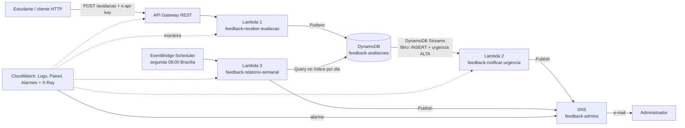
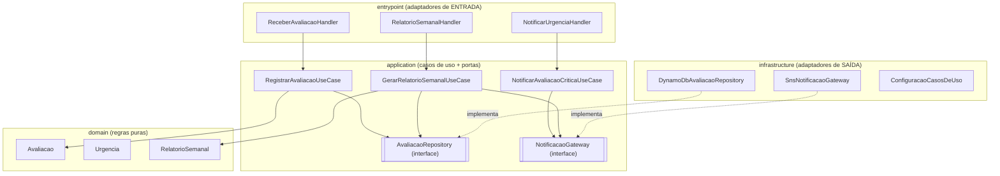

# Tech Challenge Fase 4 (PosTech) — Guia clique a clique: AWS pelo console + Quarkus (Clean Architecture + SOLID)

**Plataforma de Feedback de Aulas · Java 25 · Quarkus · AWS Serverless (Lambda) · Clean Architecture · SOLID**

> Este guia **substitui todos os anteriores**. O que mudou em relação à versão de 26/10/2026:
> 1. **O código da aplicação foi reescrito em Clean Architecture e SOLID** (seção 5 inteira, nova seção 0.7). Agora há camadas (`domain`, `application`, `infrastructure`, `entrypoint`), interfaces (portas) para DynamoDB e SNS, casos de uso testáveis, entidade sempre válida e um teste que impede quebrar a arquitetura.
> 2. Ajustes nas seções que citavam o código: 0, 7.5, 9.5, 10 (README), 11 (vídeo), 12 (checklist) e 14 (problemas).
> 3. **Na AWS nada muda**: mesmos recursos, nomes, permissões, variáveis e handler. Se você já criou os recursos, só precisa recompilar e reenviar o código.
>
> Siga **na ordem**. Data de referência: **27/10/2026**.
>
> ⚠️ **Aviso honesto sobre a confiabilidade deste guia**
> - Eu **não consigo ver a sua tela** nem acessar a sua conta AWS. Descrevi os consoles com base na estrutura atual deles. Os consoles da AWS mudam de vez em quando: se um nome de botão for diferente, procure o equivalente. Se travar, **me diga exatamente o que aparece na tela** e eu ajusto.
> - **O que eu testei de verdade** (aqui, com JDK 21): **todo o código da seção 5 compilou sem nenhum aviso e os 37 testes passaram**, inclusive os dos handlers e o de arquitetura. Também confirmei que o teste de arquitetura **falha** quando alguém coloca um import da AWS no domínio.
> - **O que eu não consegui testar:** o ambiente em que trabalho não acessa o Maven Central nem a AWS. Por isso, as classes que usam AWS SDK, Quarkus e Lambda foram compiladas contra **versões simplificadas** dessas bibliotecas, escritas por mim com os mesmos nomes de métodos. **Não rodei o build Maven completo nem implantei na AWS.** É possível aparecer algum erro de versão/dependência na sua primeira compilação; a seção 14 traz as correções mais prováveis. Me mande a mensagem de erro completa que eu corrijo.

### Convenções usadas

| Símbolo | Significado |
|---|---|
| ▶ | Uma ação para você fazer (clicar, digitar) |
| 👀 | O que você deve ver na tela |
| ✅ | Como saber que deu certo |
| ⚠️ | Cuidado / pegadinha |
| `código` | Texto para digitar ou colar exatamente |

---

## Índice

0. [Visão geral](#0-visão-geral)
1. [Antes de criar a conta: verificações e plano B](#1-antes-de-criar-a-conta-verificações-e-plano-b)
2. [Criar a conta AWS](#2-criar-a-conta-aws)
3. [Segurança e governança de acesso](#3-segurança-e-governança-de-acesso)
4. [Instalar as ferramentas no computador](#4-instalar-as-ferramentas-no-computador)
5. [Criar o projeto Quarkus e o código (Clean Architecture + SOLID)](#5-criar-o-projeto-quarkus-e-o-código-clean-architecture--solid)
6. [Criar os recursos na AWS pelo console](#6-criar-os-recursos-na-aws-pelo-console)
7. [Testar tudo na nuvem](#7-testar-tudo-na-nuvem)
8. [Monitoramento](#8-monitoramento)
9. [Deploy automatizado (GitHub Actions)](#9-deploy-automatizado-github-actions)
10. [README do repositório (modelo)](#10-readme-do-repositório-modelo)
11. [Vídeo: preparação e roteiro](#11-vídeo-preparação-e-roteiro)
12. [Checklist final de entrega](#12-checklist-final-de-entrega)
13. [Desligar tudo e controlar custos](#13-desligar-tudo-e-controlar-custos)
14. [Problemas comuns e soluções](#14-problemas-comuns-e-soluções)
15. [Plano de execução em produção (30/10 a 15/11/2026)](#15-plano-de-execução-em-produção-3010-a-15112026)

---

## 0. Visão geral

### 0.1 O que o enunciado pede e onde cada coisa é atendida

| Requisito do PDF | Como atendemos | Seção |
|---|---|---|
| Nuvem com segurança de dados e governança de acesso | MFA, usuário IAM (sem usar o root), grupos, **uma role IAM por função com menor privilégio**, API protegida por chave, tabela criptografada, CloudTrail | 3 e 6 |
| Componentes de suporte (bancos etc.) | **DynamoDB** (dados), **SNS** (e-mail), **EventBridge Scheduler** (agenda), **CloudWatch** (monitoramento) | 6 |
| Deploy automatizado dos componentes atualizáveis (ex.: funções) | **GitHub Actions** compila, testa e atualiza as 3 funções Lambda a cada `git push` | 9 |
| Aplicação monitorada | Logs com retenção, painel, alarmes, X-Ray | 8 |
| Notificações automáticas ao admin para problemas críticos | Nota baixa → e-mail ao admin; alarmes de erro → e-mail ao admin | 6 e 8 |
| Relatório semanal com média | Função agendada toda segunda 08:00 (Brasília) | 6 |
| Mínimo 2 funções serverless, com **responsabilidade única** | **3 funções**: receber, notificar, relatar | 5 e 6 |
| (Boa prática, além do pedido) Código bem projetado | **Clean Architecture + SOLID**, com teste que garante a regra de dependência | 0.7 e 5 |
| `POST /avaliação` com `descricao` e `nota` (0 a 10) | `POST /avaliacao` (sem acento na URL, boa prática) | 6 |
| Repositório aberto + vídeo | GitHub público + vídeo (roteiro na seção 11) | 9 e 11 |

> O JSON do PDF tem uma vírgula sobrando após `"nota": int (0 a 10),`. É só erro de digitação do enunciado; JSON válido não tem vírgula depois do último campo.

### 0.2 Arquitetura



### 0.3 As 3 funções (responsabilidade única)

| Função Lambda | Gatilho | Única responsabilidade |
|---|---|---|
| `feedback-receber-avaliacao` | HTTP `POST /avaliacao` | Validar a entrada, calcular a urgência e **gravar** |
| `feedback-notificar-urgencia` | DynamoDB Streams (só itens novos com urgência ALTA) | **Avisar** o admin por e-mail sobre avaliação crítica |
| `feedback-relatorio-semanal` | EventBridge Scheduler (semanal) | **Consolidar** a semana e enviar o relatório |

Cada uma tem: **handler próprio, gatilho próprio, role IAM própria (só com as permissões necessárias), log próprio e alarme próprio**. Este é o argumento central para a banca.

> **Como isso funciona no Quarkus:** o código é **um projeto só**, organizado em camadas (seção 0.7), com **um handler e um caso de uso por função**. O mesmo `function.zip` é enviado para as 3 funções, e uma **variável de ambiente** (`QUARKUS_LAMBDA_HANDLER`) diz a cada função qual dos 3 handlers executar. Na AWS elas são 3 recursos independentes.

### 0.4 Regra de urgência (nossa decisão; documentar no README)

O enunciado fala em "urgência" mas não define a regra:

| Nota | Urgência | Ação |
|---|---|---|
| 0 a 3 | **ALTA** (crítica) | E-mail imediato ao admin |
| 4 a 6 | **MEDIA** | Só entra no relatório |
| 7 a 10 | **BAIXA** | Só entra no relatório |

### 0.5 Modelo de cloud (a banca pede isso explicado)

- **Implantação:** nuvem **pública** (AWS).
- **Serviço:** **Serverless**: FaaS (AWS Lambda) + serviços gerenciados (API Gateway, DynamoDB, SNS, EventBridge, CloudWatch). Não gerenciamos servidor, sistema operacional nem escalabilidade.
- **Arquitetura:** **orientada a eventos** (requisição HTTP, gravação no banco e relógio disparam funções).
- **Por que serverless aqui:** carga irregular (pico logo após as aulas, quase nada de madrugada), pagamento só pelo uso, escala automática, custo ocioso zero (importante com créditos limitados), menos operação.
- **Responsabilidade compartilhada:** a AWS cuida da segurança **da** nuvem (hardware, hipervisor, runtime); nós cuidamos da segurança **na** nuvem (IAM, código, dados, configuração).
- **Observação sobre infraestrutura como código:** criamos os recursos **manualmente pelo console** (didático). Em produção usaríamos IaC (SAM/Terraform/CDK) para reproduzir o ambiente por código; vale citar como evolução. O **código das funções** é implantado de forma **automatizada** (seção 9).

### 0.6 Nomes padronizados (use **exatamente** estes)

Usar os mesmos nomes deste guia evita erros em permissões e variáveis.

| Recurso | Nome |
|---|---|
| Região | `us-east-1` (N. Virginia) |
| Tabela DynamoDB | `feedback-avaliacoes` (chave de partição `id`, texto) |
| Índice da tabela | `indice-dia` (partição `dia`, ordenação `dataEnvio`) |
| Tópico SNS | `feedback-admins` |
| Roles IAM | `feedback-role-receber`, `feedback-role-notificar`, `feedback-role-relatorio` |
| Funções Lambda | `feedback-receber-avaliacao`, `feedback-notificar-urgencia`, `feedback-relatorio-semanal` |
| API Gateway | `feedback-api` · recurso `/avaliacao` · stage `prod` |
| Plano de uso / chave de API | `feedback-plano-de-uso` / `feedback-chave-demo` |
| Agenda | `feedback-relatorio-semanal-agenda` |
| Painel | `feedback-painel` |
| Alarmes | `feedback-erros-receber`, `feedback-erros-notificar`, `feedback-erros-relatorio`, `feedback-api-5xx` |

### 0.7 Arquitetura de software: Clean Architecture + SOLID

A seção 0.2 mostra a arquitetura **de nuvem** (quais serviços da AWS conversam entre si). Esta mostra a arquitetura **do código**.

| Camada | O que guarda | Exemplos |
|---|---|---|
| `domain` | Regras de negócio puras (só Java) | `Avaliacao`, `Urgencia`, `RelatorioSemanal` |
| `application` | Casos de uso e **portas** (interfaces) | `RegistrarAvaliacaoUseCase`, `AvaliacaoRepository` |
| `infrastructure` | Implementações técnicas das portas | `DynamoDbAvaliacaoRepository`, `SnsNotificacaoGateway` |
| `entrypoint` | Os 3 handlers Lambda (traduzem evento ↔ caso de uso) | `ReceberAvaliacaoHandler` |

- **Regra de dependência:** as camadas de fora conhecem as de dentro; **nunca o contrário**. O domínio e os casos de uso não sabem que existem AWS, Quarkus ou JSON.
- **Inversão de dependência:** o caso de uso pede uma **interface** (`AvaliacaoRepository`); a infraestrutura entrega a implementação com DynamoDB.
- **Garantia automática:** o teste `ArquiteturaTest` falha o build se a regra for quebrada, e aí o pipeline não faz deploy.
- **Testabilidade:** 37 testes rodam sem AWS, trocando DynamoDB e SNS por implementações em memória.

Explicação completa, com a tabela "onde está cada princípio SOLID": **seção 5.3**.

---

## 1. Antes de criar a conta: verificações e plano B

Faça isto **antes** de abrir o site da AWS. Evita perder tempo ou ter surpresa de cobrança.

### 1.1 Checklist

| Item | Como conferir | Se não tiver |
|---|---|---|
| **E-mail que você acessa** | Pode ser Gmail etc. | Crie um e-mail novo |
| **Celular** para SMS/ligação | — | Peça emprestado ao colega só para o código |
| **Cartão** de crédito ou débito | A AWS exige uma forma de pagamento mesmo no plano gratuito (validação). Em geral o cartão precisa **aceitar compras internacionais online** (não precisa ter "internacional" escrito). Cartões virtuais de bancos digitais costumam funcionar, **mas não consegui confirmar isso em fonte oficial** | Veja 1.3 (plano B) |
| **Nunca ter tido conta com esse e-mail/cartão** | Se já teve conta que expirou, veja 1.2 | Veja 1.2 e 1.3 |

### 1.2 Se você já teve uma conta AWS que expirou

- Uma conta **fechada** não pode ser reaberta para ganhar o Free Tier de novo; a AWS usa histórico e forma de pagamento para evitar abuso. Já houve relato de pessoa que fechou a conta, criou outra e foi oferecida **só o plano Paid**, sem créditos.
- **Não tente contornar** as verificações (pode violar os termos e fazer você perder o acesso).
- Se a conta expirou há pouco, veja no próprio console se ainda dá para reativá-la; provavelmente só migrando para o **Paid plan**, o que **pode gerar cobrança**.
- **Regra de ouro:** ao se cadastrar, a tela precisa oferecer o **Free plan**. **Se só oferecer Paid, pare** e use o plano B.

### 1.3 Plano B (sem cartão, ou sem direito ao Free plan)

1. **Um colega do grupo que nunca teve conta AWS** cria a conta (seção 2) e adiciona os outros como **usuários IAM** (seção 3.3). Cada um faz seus testes com seu login. Só uma pessoa precisa de cartão.
2. **Pergunte aos professores/PosTech** se existe ambiente AWS educacional para o curso (AWS Academy/Educate). Eu não sei se a sua turma tem acesso; vale perguntar.
3. Se mesmo assim só houver Paid plan: o projeto consome muito pouco (Lambda, DynamoDB sob demanda e SNS têm cota gratuita permanente), mas **não posso prometer cobrança zero**. Nesse caso: crie o alerta de orçamento (3.6) **antes de qualquer recurso**, faça tudo em 1 ou 2 dias e apague tudo (seção 13) logo após gravar o vídeo.

### 1.4 O que o Free plan garante (e o que não)

- Você recebe **US$ 100 em créditos** ao criar a conta e pode ganhar **até US$ 100 a mais** completando atividades (Lambda, EC2, RDS, Bedrock, Budgets). O plano dura **até 6 meses ou até acabar o crédito**; depois a conta **fecha sozinha** (não cobra).
- Todos os serviços que usamos estão na lista do Free plan: Lambda, API Gateway, DynamoDB, SNS, EventBridge, CloudWatch, X-Ray, CloudTrail, IAM, KMS e Budgets.
- **Não existe garantia absoluta de "zero".** O Free plan protege você; este guia ainda cria um alerta de orçamento e ensina a apagar tudo.

---

## 2. Criar a conta AWS

> A AWS está liberando uma nova experiência de cadastro; a **ordem das telas pode variar**. O conteúdo pedido é o mesmo.

### 2.1 Passo a passo

1. ▶ Abra o navegador e acesse **https://aws.amazon.com/free**.
2. ▶ Clique em **Create a Free Account** (Criar uma conta gratuita).
3. 👀 Tela **"Sign up for AWS"**. ▶ Preencha:
   - **Root user email address**: seu e-mail.
   - **AWS account name**: `techchallenge-fase4`.
   - ▶ Clique em **Verify email address**.
4. 👀 Chega um e-mail com um **código de 6 dígitos** (olhe o spam). ▶ Digite o código e clique em **Verify**.
5. ▶ Crie a **senha do root** (12+ caracteres, letras, números e símbolo). Guarde em um gerenciador de senhas. **Continue**.
6. 👀 Tela **"Choose a plan"** com **Free plan** e **Paid plan**. ▶ Selecione **Free plan**.
   - ⚠️ **Se não aparecer o Free plan, pare** (volte à seção 1.3).
7. ▶ **Contact information**: tipo **Personal**; nome completo, telefone (com +55), país **Brazil**, endereço. Marque o aceite do contrato do cliente AWS e continue.
8. ▶ **Billing information**: dados do cartão (número, validade, nome, CVV). A AWS pode fazer uma **pré-autorização de poucos dólares** só para validar; ela é estornada.
9. ▶ **Confirm your identity**: informe o celular, escolha **Text message (SMS)** ou **Voice call**, resolva o desafio visual, digite o código recebido.
10. ▶ **Select a support plan**: **Basic support – Free**.
11. ▶ Clique em **Complete sign up**. A ativação leva de minutos a 24 h; chega um e-mail de confirmação.
12. ▶ Acesse **https://console.aws.amazon.com** → **Sign in** → **Root user** → e-mail → senha.

✅ **Pronto quando** você vê o **Console Home** da AWS.

### 2.2 Escolher a região (faça isso **toda vez** que abrir o console)

▶ No **canto superior direito** há o nome de uma região (por exemplo "N. Virginia"). Clique e selecione **US East (N. Virginia) us-east-1**.

⚠️ **Esse é o erro mais comum de iniciante**: se a região estiver errada, seus recursos "somem". **Sempre confira.** Tudo neste guia usa `us-east-1`.

> Para a banca: em produção real, por causa da LGPD, avaliaríamos `sa-east-1` (São Paulo). Aqui os dados são **anônimos** (não coletamos nome, e-mail ou CPF do aluno).

### 2.3 Descobrir o número da sua conta (você vai precisar)

▶ Clique no **seu nome/conta (canto superior direito)**. 👀 Aparece **Account ID** com **12 dígitos**. ▶ Copie e anote. Neste guia ele aparece como `SEU_ACCOUNT_ID`.

---

## 3. Segurança e governança de acesso

Atende o requisito "configurações de segurança relacionadas aos dados de clientes e governança de acesso". **Mostre tudo isso no vídeo.**

### 3.1 MFA no usuário root

Você precisa de um app autenticador no celular: **Google Authenticator**, **Microsoft Authenticator** ou **Authy**.

1. ▶ Clique no seu nome (canto superior direito) → **Security credentials**.
2. 👀 Seção **Multi-factor authentication (MFA)**. ▶ **Assign MFA device**.
3. ▶ **Device name**: `root-celular`. Selecione **Authenticator app** → **Next**.
4. ▶ No celular: app → adicionar conta → **escanear o QR code** na tela.
5. ▶ Digite **dois códigos consecutivos** (espere o primeiro mudar) → **Add MFA**.

✅ **Pronto quando** o dispositivo aparece em "Multi-factor authentication (MFA)".

### 3.2 Alias da conta (URL de login amigável)

1. ▶ Na barra de busca do console (topo), digite **IAM** → clique em **IAM**.
2. 👀 No painel direito, em **AWS Account**, há **Account Alias**. ▶ **Create**.
3. ▶ Digite algo único, por exemplo `techchallenge-seunome` → **Save changes**.
4. Anote: `https://techchallenge-seunome.signin.aws.amazon.com/console`

### 3.3 Grupos e usuários (nunca use o root no dia a dia)

**A) Grupo de administradores**
1. ▶ IAM → menu esquerdo **User groups** → **Create group**.
2. ▶ **User group name**: `Administradores`.
3. ▶ Em *Attach permissions policies*, busque `AdministratorAccess` → marque → **Create user group**.

**B) Grupo somente-leitura (para colegas que só vão olhar)**
1. ▶ **Create group** → nome `Observadores`.
2. ▶ Busque e marque `ReadOnlyAccess` → **Create user group**.

> Governança: **quem mexe é admin; quem só olha é observador.** É o princípio do menor privilégio aplicado às pessoas.

**C) Seu usuário**
1. ▶ IAM → **Users** → **Create user**.
2. ▶ **User name**: `admin-techchallenge`.
3. ▶ Marque **Provide user access to the AWS Management Console**. 👀 Aparece uma pergunta "Are you providing console access to a person?". ▶ Escolha **I want to create an IAM user**.
4. ▶ **Console password** → **Custom password**: defina uma senha forte. **Desmarque** "Users must create a new password at next sign-in" (se quiser facilitar). **Next**.
5. ▶ **Set permissions** → **Add user to group** → marque `Administradores` → **Next** → **Create user**.
6. ▶ 👀 Tela final com a URL de login: anote.

**D) Colegas (opcional, vale nota de governança)**
Repita C para cada colega (`colega-maria` etc.), mas marcando o grupo **Observadores** (ou `Administradores`, se for mexer).

### 3.4 MFA no usuário IAM

1. ▶ IAM → **Users** → clique em `admin-techchallenge` → aba **Security credentials**.
2. ▶ **Assigned MFA device** → **Assign MFA device** → mesmo processo de 3.1 (nome `admin-celular`).

### 3.5 Sair do root e entrar como usuário IAM

1. ▶ Clique no seu nome (canto superior direito) → **Sign out**.
2. ▶ Abra a URL do alias (3.2). Preencha **IAM user name** = `admin-techchallenge`, senha e código do MFA.
3. ▶ Confirme **us-east-1** no canto superior direito.

A partir de agora **só use esse usuário**. O root fica guardado para emergências.

### 3.6 Alerta de orçamento (para nunca ter surpresa)

1. ▶ Busque **Billing and Cost Management** (ou **Budgets**) na barra de busca.
2. ▶ Menu esquerdo → **Budgets** → **Create budget**.
3. ▶ Escolha **Use a template (simplified)** → **Zero spend budget** (avisa assim que algum gasto for detectado) → **Budget name** `alerta-techchallenge`, **Email recipients** = seu e-mail → **Create budget**.

> ⚠️ Se o usuário IAM não enxergar "Billing": entre como **root** → clique no seu nome → **Account** → seção **IAM user and role access to Billing information** → **Edit** → **Activate IAM access** → **Update**. Depois volte ao usuário IAM.

### 3.7 CloudTrail (auditoria)

O **CloudTrail** registra por 90 dias todas as ações da conta. Para mostrar no vídeo: busque **CloudTrail** → **Event history**. 👀 Você vê quem fez o quê (por exemplo `CreateFunction`). Isso é **rastreabilidade**.

### 3.8 O que ainda vamos configurar (lembrete para o vídeo)

- **Uma role IAM por função**, só com o necessário (6.3).
- API com **chave de API (x-api-key)**, **limite de taxa e cota** (6.8) e **HTTPS**.
- Tabela DynamoDB **criptografada em repouso** (6.1).
- Logs **sem dados sensíveis** (o texto da avaliação não vai para o log).
- Deploy via **OIDC** (sem guardar chaves da AWS no GitHub) (9.2).
- **Retenção de logs** de 30 dias (8.1).

---

## 4. Instalar as ferramentas no computador

### 4.1 O que precisamos (e o que **não** precisamos)

| Ferramenta | Para quê | Obrigatório? |
|---|---|---|
| **JDK 25** (Temurin) | Compilar Java | Sim |
| **Git** | Enviar o código ao GitHub | Sim |
| **IDE** (IntelliJ IDEA Community **ou** VS Code + *Extension Pack for Java*) | Editar código | Sim |
| **Postman** | Testar a API com cliques | Recomendado |
| Maven | Já vem **dentro do projeto** (`mvnw`) | **Não** precisa instalar |
| AWS CLI / SAM CLI | — | **Não** precisamos (tudo pelo console e pelo GitHub Actions) |

Isso significa **que você não precisa criar chaves de acesso da AWS no seu computador**. Menos risco de vazar credencial.

### 4.2 Windows

▶ Menu Iniciar → digite **PowerShell** → botão direito → **Executar como administrador**:

```powershell
winget install --id EclipseAdoptium.Temurin.25.JDK -e
winget install --id Git.Git -e
```
IDE: https://www.jetbrains.com/idea/download (versão **Community**). Postman: https://www.postman.com/downloads/ (pode usar sem conta, "Skip and go to the app").

⚠️ **Feche e reabra o terminal** depois de instalar.

### 4.3 macOS

```bash
brew install --cask temurin@25
brew install git
```
(Sem Homebrew? Veja https://brew.sh.)

### 4.4 Linux (Ubuntu/Debian)

```bash
sudo apt update && sudo apt install -y git curl zip unzip
curl -s "https://get.sdkman.io" | bash
source "$HOME/.sdkman/bin/sdkman-init.sh"
sdk install java 25-tem
```

### 4.5 Verificar

Abra um **novo** terminal:
```bash
java -version     # deve mostrar 25.x
git --version
```
✅ Se `java -version` não mostrar 25: Windows → "Editar as variáveis de ambiente do sistema" → crie `JAVA_HOME` apontando para a pasta do JDK (por exemplo `C:\Program Files\Eclipse Adoptium\jdk-25...`) e reabra o terminal.

---

## 5. Criar o projeto Quarkus e o código (Clean Architecture + SOLID)

**Quarkus** é um framework Java feito para a nuvem: inicia rápido e tem extensões prontas para Lambda, DynamoDB e SNS. Versão atual na data deste guia: **3.40** (LTS, lançada em 30/09/2026), com suporte a **Java 25**.

Esta seção é a mais longa do guia. Faça **na ordem**: 5.1 → 5.12. Cada arquivo traz o código completo para colar e, logo antes, **o que ele faz e por que está naquela camada** (isso é o que você vai explicar na banca).

### 5.0 Já criou o projeto pelo guia anterior? Faça isto primeiro

Se você **ainda não criou** o projeto, pule para a 5.1.

Se você **já criou** (com as pastas `comum`, `receber`, `notificar` e `relatorio`), não precisa gerar tudo de novo. O `pom.xml`, o `mvnw` e o `application.properties` continuam valendo. Só o código Java muda:

1. ▶ Abra a pasta do projeto no **VS Code** (**File → Open Folder...** → escolha `feedback-platform` → **Selecionar pasta**).
2. ▶ Abra o **Explorer** (ícone de duas folhas no canto superior esquerdo, ou `Ctrl + Shift + E`).
3. ▶ Expanda `src/main/java/br/com/techchallenge/feedback`. 👀 Você vê as pastas `comum`, `receber`, `notificar`, `relatorio`.
4. ▶ Clique com o **botão direito** em `comum` → **Delete** → 👀 aparece "Are you sure you want to delete 'comum'..." → **Move to Recycle Bin**. Repita para `receber`, `notificar` e `relatorio`.
5. ▶ Faça o mesmo dentro de `src/test/java/br/com/techchallenge/feedback`.

Ou, no terminal **Git Bash** aberto na pasta do projeto:
```bash
rm -rf src/main/java/br/com/techchallenge/feedback/{comum,receber,notificar,relatorio}
rm -rf src/test/java/br/com/techchallenge/feedback/{comum,receber,notificar,relatorio}
```

✅ **Pronto quando** a pasta `feedback` (em `src/main/java` e em `src/test/java`) está **vazia**. Pule para a **5.3**.

> Na AWS **nada muda**: nomes das funções, `@Named`, variáveis de ambiente, roles e handler continuam iguais. Depois de terminar esta seção é só recompilar e reenviar o `function.zip` (ou dar `git push`, se o pipeline da seção 9 já estiver pronto).

### 5.1 Gerar o projeto base (site oficial, só clicando)

1. ▶ Abra **https://code.quarkus.io**.
2. 👀 Página com o título "Quarkus - Start coding with code.quarkus.io", um formulário no topo e uma lista enorme de extensões embaixo.
3. ▶ Preencha (se não achar algum campo, clique em **More options** / **Configure more options**, ao lado do campo Artifact):
   - **Group**: `br.com.techchallenge`
   - **Artifact**: `feedback-platform`
   - **Build Tool**: **Maven**
   - **Java Version**: **25**
   - **Starter Code**: **No** (desmarque; não queremos exemplos)
4. ▶ Na caixa **Search extensions** (ou "Pick extensions"), digite e **clique em cada uma** para selecionar. 👀 A extensão selecionada ganha um ✓ e aparece no topo, na lista de selecionadas:
   - `lambda` → **AWS Lambda** (`quarkus-amazon-lambda`)
   - `dynamodb` → **Amazon DynamoDB client** (`quarkus-amazon-dynamodb`)
   - `sns` → **Amazon SNS client** (`quarkus-amazon-sns`)
5. ▶ Clique no botão azul **Generate your application** → 👀 abre uma janela → **Download as a ZIP**.
6. ▶ Extraia o ZIP em uma pasta fácil. No Windows: clique com o botão direito no arquivo baixado → **Extrair tudo...** → destino `C:\projetos` → **Extrair**. Resultado: `C:\projetos\feedback-platform`.
7. ▶ Abra essa pasta no **VS Code**: **File → Open Folder...** → selecione `C:\projetos\feedback-platform` → **Selecionar pasta**. 👀 Se aparecer "Do you trust the authors of the files in this folder?", clique em **Yes, I trust the authors**.
   - IntelliJ: **File → Open** → selecione a pasta → **OK** → **Trust Project**.
8. 👀 Se você tem o **Extension Pack for Java** instalado, aparece no canto inferior direito "Java: Importing projects..." por alguns minutos. **Espere terminar** antes de continuar.

👀 No Explorer você verá: `.mvn/`, `src/`, `.gitignore`, `mvnw`, `mvnw.cmd`, `pom.xml`, `README.md`.

### 5.2 Conferir e ajustar o `pom.xml`

▶ No Explorer, clique em `pom.xml` para abrir. Use `Ctrl + F` para procurar cada item:

- `<maven.compiler.release>25</maven.compiler.release>`. Se estiver `21`, troque para `25`.
- Dentro de `<dependencies>`: `quarkus-amazon-lambda`, `quarkus-amazon-dynamodb` e `quarkus-amazon-sns`.
  - ⚠️ **Confira o `groupId` do `quarkus-amazon-lambda`: tem de ser `io.quarkus`.** Existem dois artefatos com esse mesmo nome. O de `io.quarkiverse.amazonservices` é só o **cliente** do SDK (serve para *chamar* outras Lambdas) e não traz `RequestStreamHandler`/`Context` nem gera o `target/function.zip`. Se ele estiver lá, o build falha com `package com.amazonaws.services.lambda.runtime does not exist`. O correto:

    ```xml
            <dependency>
                <groupId>io.quarkus</groupId>
                <artifactId>quarkus-amazon-lambda</artifactId>
            </dependency>
    ```
  - Já `quarkus-amazon-dynamodb` e `quarkus-amazon-sns` são mesmo `io.quarkiverse.amazonservices`.
- Uma dependência de teste chamada `quarkus-junit5` (nas versões mais novas o nome pode ser `quarkus-junit`). É ela que traz o **JUnit 5** usado nos testes.
- Dentro de `<dependencyManagement>`: **BOMs** (listas de versões), incluindo um com `quarkus-amazon-services-bom`. Eles garantem as versões; por isso geramos pelo site em vez de escrever o pom do zero.

▶ **Adicione** estas duas dependências **dentro de `<dependencies>`**, logo antes da linha `</dependencies>`:

```xml
        <!-- Cliente HTTP leve para o AWS SDK (partida a frio mais rápida) -->
        <dependency>
            <groupId>software.amazon.awssdk</groupId>
            <artifactId>url-connection-client</artifactId>
        </dependency>
        <!-- JSON (ObjectMapper injetável) -->
        <dependency>
            <groupId>io.quarkus</groupId>
            <artifactId>quarkus-jackson</artifactId>
        </dependency>
```

▶ Salve (`Ctrl + S`). 👀 Se o VS Code perguntar "A build file was modified. Do you want to synchronize the Java classpath/configuration?", clique em **Always** (ou **Yes**).

> Se o Maven reclamar de "version missing" para `url-connection-client`, veja a seção 14.

### 5.3 Entenda a arquitetura antes de digitar

Vale ler esta parte com calma: é o que diferencia o projeto na banca.

#### A ideia central: camadas e a "regra de dependência"

O código é dividido em **4 camadas**. As de dentro guardam as **regras de negócio**; as de fora guardam os **detalhes técnicos** (AWS, HTTP, JSON, Quarkus).



**Regra de dependência:** as setas só apontam **para dentro**.

| Camada | Pasta | Pode usar | Não pode usar |
|---|---|---|---|
| **Domínio** | `domain/` | só o Java | nada do projeto fora dela, nenhum framework |
| **Aplicação** | `application/` | Java + domínio | AWS, Quarkus, Jackson, HTTP |
| **Infraestrutura** | `infrastructure/` | tudo de dentro + AWS SDK + Quarkus | os handlers |
| **Entrada** | `entrypoint/` | tudo | — |

O truque que permite isso são as **portas** (`AvaliacaoRepository` e `NotificacaoGateway`): são **interfaces** que ficam na camada de aplicação. O caso de uso diz "preciso de algo que salve avaliações", e a infraestrutura entrega a implementação com DynamoDB. A dependência fica **invertida**: o DynamoDB depende da interface, não o contrário.

> **Para a banca:** *"A regra de negócio não sabe que existe AWS. Trocar DynamoDB por outro banco é escrever uma classe nova na infraestrutura; domínio, casos de uso e testes não mudam."*

Isso não fica só na promessa: o teste `ArquiteturaTest` (5.10) **falha o build** se alguém colocar um `import` proibido em uma camada de dentro. Como o pipeline (seção 9) roda os testes antes do deploy, uma violação **nunca chega à AWS**.

#### O caminho de uma avaliação, passo a passo

1. O API Gateway chama a Lambda → o **`ReceberAvaliacaoHandler`** (entrada) lê o JSON e monta um `RegistrarAvaliacaoCommand`.
2. O **`RegistrarAvaliacaoUseCase`** (aplicação) pede um id, pega a hora do relógio e cria a `Avaliacao`.
3. A **`Avaliacao`** (domínio) valida tudo e calcula a urgência. Se algo estiver errado, lança `AvaliacaoInvalidaException`.
4. O caso de uso chama `repositorio.salvar(...)`. Quem atende é o **`DynamoDbAvaliacaoRepository`** (infraestrutura).
5. O handler transforma o resultado em resposta HTTP **201** (ou **400**, se veio exceção de validação).

#### Onde está cada princípio SOLID (decore esta tabela)

| Princípio | Significado | Onde aparece no código |
|---|---|---|
| **S** — Responsabilidade única | Cada classe tem **um** motivo para mudar | Cada handler só traduz entrada/saída; cada caso de uso faz **uma** operação; `RelatorioSemanal` só **calcula** e `RelatorioFormatter` só **formata**; `AvaliacaoItemMapper` é o único que conhece o formato do DynamoDB; `AssuntoSns` é o único que conhece a regra do assunto do SNS |
| **O** — Aberto/fechado | Estender sem modificar | Para avisar também pelo Slack, basta criar uma nova implementação de `NotificacaoGateway`; casos de uso não mudam |
| **L** — Substituição de Liskov | Qualquer implementação serve no lugar da interface | Os testes usam `RepositorioEmMemoria` e `NotificacaoGatewayFalso` no lugar do DynamoDB e do SNS, e os casos de uso funcionam igual |
| **I** — Segregação de interfaces | Interfaces pequenas e focadas | `AvaliacaoRepository` (2 métodos), `NotificacaoGateway` (1), `GeradorDeId` (1) |
| **D** — Inversão de dependência | Depender de abstrações | Casos de uso recebem **interfaces** pelo construtor; `ConfiguracaoCasosDeUso` liga cada interface à implementação concreta |

E mais algumas boas práticas que valem citar:
- **Entidade sempre válida:** o construtor de `Avaliacao` valida tudo; não existe avaliação com nota 15 ou urgência incoerente em memória.
- **Regra em um lugar só:** a faixa 0 a 10 existe apenas em `Urgencia`.
- **Tipos certos:** datas são `Instant`/`LocalDate`, não `String`.
- **Injeção por construtor** com campos `final` (nada de `@Inject` em campo).
- **Tempo e id injetáveis** (`Clock`, `GeradorDeId`): os testes controlam "agora" e o id gerado.
- **Casos de uso sem anotações do Quarkus:** são Java puro, criados em `ConfiguracaoCasosDeUso` (o "ponto de montagem" da aplicação).

### 5.4 Estrutura de pastas e arquivos

```
feedback-platform/
├── pom.xml
├── mvnw / mvnw.cmd
├── src/main/resources/application.properties
├── src/main/java/br/com/techchallenge/feedback/
│   ├── domain/                              <- REGRAS PURAS (só Java)
│   │   ├── AvaliacaoInvalidaException.java
│   │   ├── Urgencia.java
│   │   ├── Avaliacao.java
│   │   ├── PeriodoRelatorio.java
│   │   └── RelatorioSemanal.java
│   ├── application/                         <- CASOS DE USO (só Java + domínio)
│   │   ├── port/
│   │   │   ├── AvaliacaoRepository.java         (interface)
│   │   │   ├── NotificacaoGateway.java          (interface)
│   │   │   ├── Notificacao.java
│   │   │   └── GeradorDeId.java                 (interface)
│   │   ├── usecase/
│   │   │   ├── RegistrarAvaliacaoCommand.java
│   │   │   ├── AvaliacaoRegistrada.java
│   │   │   ├── RegistrarAvaliacaoUseCase.java       <- Função 1
│   │   │   ├── NotificarAvaliacaoCriticaUseCase.java <- Função 2
│   │   │   └── GerarRelatorioSemanalUseCase.java     <- Função 3
│   │   └── formatacao/
│   │       ├── MensagemUrgenciaFormatter.java
│   │       └── RelatorioFormatter.java
│   ├── infrastructure/                      <- DETALHES TÉCNICOS DE SAÍDA
│   │   ├── dynamodb/
│   │   │   ├── AvaliacaoItemMapper.java
│   │   │   └── DynamoDbAvaliacaoRepository.java
│   │   ├── sns/
│   │   │   ├── AssuntoSns.java
│   │   │   └── SnsNotificacaoGateway.java
│   │   ├── id/
│   │   │   └── UuidGeradorDeId.java
│   │   └── config/
│   │       └── ConfiguracaoCasosDeUso.java
│   └── entrypoint/lambda/                   <- ADAPTADORES DE ENTRADA (as 3 Lambdas)
│       ├── http/RespostaApiGateway.java
│       ├── receber/ReceberAvaliacaoHandler.java
│       ├── notificar/ImagemStreamDynamoDb.java
│       ├── notificar/NotificarUrgenciaHandler.java
│       └── relatorio/RelatorioSemanalHandler.java
└── src/test/java/br/com/techchallenge/feedback/
    ├── domain/            UrgenciaTest, AvaliacaoTest, PeriodoRelatorioTest, RelatorioSemanalTest
    ├── application/
    │   ├── fakes/         RepositorioEmMemoria, NotificacaoGatewayFalso
    │   ├── usecase/       RegistrarAvaliacaoUseCaseTest, NotificarAvaliacaoCriticaUseCaseTest, GerarRelatorioSemanalUseCaseTest
    │   └── formatacao/    MensagemUrgenciaFormatterTest, RelatorioFormatterTest
    ├── infrastructure/sns/ AssuntoSnsTest
    ├── entrypoint/lambda/  receber/ReceberAvaliacaoHandlerTest, notificar/NotificarUrgenciaHandlerTest
    └── arquitetura/       ArquiteturaTest
```

São **27 arquivos de código** e **15 de teste**.

#### A) Criar todas as pastas de uma vez (recomendado)

▶ No VS Code, abra o terminal: menu **Terminal → New Terminal** (ou `` Ctrl + ` ``). 👀 Aparece um painel embaixo. No canto direito do painel há uma setinha **˅** ao lado do **+**: clique e escolha **Git Bash**. (Se o terminal já estiver em Git Bash, a linha termina com `$`.)

▶ Confira que está **na pasta do projeto** (o caminho mostrado termina em `feedback-platform`) e cole:

```bash
M=src/main/java/br/com/techchallenge/feedback
T=src/test/java/br/com/techchallenge/feedback
mkdir -p $M/domain \
         $M/application/{port,usecase,formatacao} \
         $M/infrastructure/{dynamodb,sns,id,config} \
         $M/entrypoint/lambda/{http,receber,notificar,relatorio}
mkdir -p $T/domain \
         $T/application/{fakes,usecase,formatacao} \
         $T/infrastructure/sns \
         $T/entrypoint/lambda/{receber,notificar} \
         $T/arquitetura
find src -type d | sort
```
👀 A última linha lista todas as pastas criadas. ✅ Confira que aparecem `domain`, `application/port`, `infrastructure/config`, `entrypoint/lambda/receber` etc.

PowerShell (se preferir):
```powershell
$m = "src\main\java\br\com\techchallenge\feedback"
$t = "src\test\java\br\com\techchallenge\feedback"
"domain","application\port","application\usecase","application\formatacao","infrastructure\dynamodb","infrastructure\sns","infrastructure\id","infrastructure\config","entrypoint\lambda\http","entrypoint\lambda\receber","entrypoint\lambda\notificar","entrypoint\lambda\relatorio" | ForEach-Object { New-Item -ItemType Directory -Force -Path "$m\$_" | Out-Null }
"domain","application\fakes","application\usecase","application\formatacao","infrastructure\sns","entrypoint\lambda\receber","entrypoint\lambda\notificar","arquitetura" | ForEach-Object { New-Item -ItemType Directory -Force -Path "$t\$_" | Out-Null }
```

#### B) Como criar cada arquivo no VS Code (repita para os 42 arquivos)

1. ▶ No Explorer, clique com o **botão direito** na pasta onde o arquivo vai ficar (ex.: `domain`) → **New File...**
2. ▶ Digite o nome **exatamente** como no guia, com `.java` (ex.: `Urgencia.java`) → `Enter`.
3. 👀 Abre uma aba com o arquivo. Com o Extension Pack for Java, ele às vezes já vem com `package ...;` ou um esqueleto de classe.
4. ▶ **Selecione tudo** (`Ctrl + A`), **apague**, **cole** o código do guia (`Ctrl + V`) e **salve** (`Ctrl + S`).
5. 👀 O nome do arquivo na aba deixa de ter a bolinha ● (sinal de não salvo).

> ⚠️ A primeira linha (`package br.com.techchallenge.feedback.xxx;`) **precisa bater com a pasta**. Se o VS Code sublinhar em vermelho o `package`, o arquivo está na pasta errada: arraste-o para a pasta certa no Explorer.
>
> ⚠️ Enquanto você não terminar todos os arquivos, é **normal** aparecerem sublinhados vermelhos de "cannot be resolved" (o arquivo usa outro que ainda não existe). Só se preocupe com erros **depois** de criar todos e rodar a 5.11.

IntelliJ: botão direito na pasta → **New → Java Class** → digite o nome **sem** `.java` → `Enter` → apague o conteúdo gerado e cole.

### 5.5 Configuração: `src/main/resources/application.properties`

▶ No Explorer, abra `src/main/resources/application.properties` (pode estar vazio), **substitua todo o conteúdo** por:

```properties
# --- Qual função Lambda este pacote executa -----------------------------------
# Padrão para testes locais. Na AWS, cada função define a variável de ambiente
# QUARKUS_LAMBDA_HANDLER (receberAvaliacao, notificarUrgencia ou relatorioSemanal),
# que tem prioridade sobre esta linha.
quarkus.lambda.handler=receberAvaliacao

# --- Clientes AWS (cliente HTTP leve = partida a frio mais rápida) -------------
quarkus.dynamodb.sync-client.type=url
quarkus.sns.sync-client.type=url

# --- Configurações da aplicação (vêm de variáveis de ambiente da função) -------
app.tabela=${TABELA_AVALIACOES:feedback-avaliacoes}
app.topico-arn=${TOPICO_ARN:nao-configurado}
app.zona=${ZONA:America/Sao_Paulo}
```

**O que cada linha faz:**
- `quarkus.lambda.handler` escolhe qual dos 3 handlers essa função executa. Na AWS, a variável `QUARKUS_LAMBDA_HANDLER` de cada função **tem prioridade** sobre esta linha.
- `quarkus.dynamodb... = url` e `quarkus.sns... = url` usam o cliente HTTP leve que adicionamos no pom.
- `app.*` lê as variáveis de ambiente da função (nome da tabela, ARN do tópico, fuso horário). O texto depois de `:` é o valor padrão.

> Só a camada de **infraestrutura** lê essas configurações. O domínio e os casos de uso recebem os valores prontos (por exemplo, um `ZoneId`) pelo construtor.

### 5.6 Camada `domain`: as regras de negócio puras

Pasta: `src/main/java/br/com/techchallenge/feedback/domain/`. **Nenhum** arquivo daqui importa AWS, Quarkus ou JSON.

**`domain/AvaliacaoInvalidaException.java`** — o erro de regra de negócio. A mensagem é a que o usuário vai receber na resposta 400:

```java
package br.com.techchallenge.feedback.domain;

/**
 * Erro de regra de negócio: os dados da avaliação não respeitam as regras do domínio.
 * A mensagem é escrita para ser mostrada ao usuário da API.
 */
public class AvaliacaoInvalidaException extends RuntimeException {

    private static final long serialVersionUID = 1L;

    public AvaliacaoInvalidaException(String mensagem) {
        super(mensagem);
    }
}
```

**`domain/Urgencia.java`** — a regra de urgência (0 a 3 ALTA, 4 a 6 MEDIA, 7 a 10 BAIXA). É o **único** lugar que conhece a faixa válida de notas:

```java
package br.com.techchallenge.feedback.domain;

/**
 * Nível de urgência de uma avaliação, calculado a partir da nota.
 * É o ÚNICO lugar do sistema que conhece a faixa válida de notas (0 a 10).
 */
public enum Urgencia {
    ALTA, MEDIA, BAIXA;

    public static final int NOTA_MINIMA = 0;
    public static final int NOTA_MAXIMA = 10;

    /** 0 a 3 = ALTA, 4 a 6 = MEDIA, 7 a 10 = BAIXA. */
    public static Urgencia deNota(int nota) {
        if (nota < NOTA_MINIMA || nota > NOTA_MAXIMA) {
            throw new AvaliacaoInvalidaException(
                    "O campo 'nota' deve estar entre " + NOTA_MINIMA + " e " + NOTA_MAXIMA);
        }
        if (nota <= 3) {
            return ALTA;
        }
        if (nota <= 6) {
            return MEDIA;
        }
        return BAIXA;
    }

    public boolean ehCritica() {
        return this == ALTA;
    }
}
```

**`domain/Avaliacao.java`** — a entidade principal. Pontos-chave:
- O bloco `public Avaliacao { ... }` é o **construtor compacto** do `record`: roda toda vez que uma `Avaliacao` é criada, de qualquer lugar (inclusive quando lemos do banco). Por isso **não existe avaliação inválida em memória**.
- `nova(...)` é a "fábrica" para avaliações que acabaram de chegar: limpa espaços, calcula urgência, corta frações de segundo e calcula o **dia local** (em São Paulo).
- Ela **não** gera o id nem lê o relógio sozinha: recebe os dois de fora. Assim os testes controlam esses valores.

```java
package br.com.techchallenge.feedback.domain;

import java.time.Instant;
import java.time.LocalDate;
import java.time.ZoneId;
import java.time.temporal.ChronoUnit;
import java.util.Objects;

/**
 * Entidade central: uma avaliação de aula.
 *
 * O construtor valida tudo, então NÃO EXISTE Avaliacao inválida em memória
 * (nota fora da faixa, descrição vazia ou urgência que não bate com a nota).
 *
 * @param dataEnvio instante do envio (UTC)
 * @param dia       data local do envio (ex.: no fuso de São Paulo); usada para agrupar por dia
 */
public record Avaliacao(String id, String descricao, int nota, Urgencia urgencia,
                        Instant dataEnvio, LocalDate dia) {

    public static final int MAX_DESCRICAO = 1000;

    public Avaliacao {
        if (id == null || id.isBlank()) {
            throw new AvaliacaoInvalidaException("A avaliação precisa de um id");
        }
        if (descricao == null || descricao.isBlank()) {
            throw new AvaliacaoInvalidaException("O campo 'descricao' é obrigatório e deve ser um texto");
        }
        if (descricao.length() > MAX_DESCRICAO) {
            throw new AvaliacaoInvalidaException(
                    "O campo 'descricao' deve ter no máximo " + MAX_DESCRICAO + " caracteres");
        }
        Urgencia esperada = Urgencia.deNota(nota); // também valida a faixa 0 a 10
        if (urgencia != esperada) {
            throw new AvaliacaoInvalidaException(
                    "Urgência " + urgencia + " não corresponde à nota " + nota + " (esperado " + esperada + ")");
        }
        Objects.requireNonNull(dataEnvio, "dataEnvio é obrigatória");
        Objects.requireNonNull(dia, "dia é obrigatório");
    }

    /**
     * Cria uma avaliação nova: remove espaços da descrição, calcula a urgência
     * e registra data de envio (precisão de segundos) e dia local.
     */
    public static Avaliacao nova(String id, String descricao, int nota, Instant agora, ZoneId zona) {
        if (descricao == null) {
            throw new AvaliacaoInvalidaException("O campo 'descricao' é obrigatório e deve ser um texto");
        }
        Instant envio = agora.truncatedTo(ChronoUnit.SECONDS);
        return new Avaliacao(id, descricao.trim(), nota, Urgencia.deNota(nota),
                envio, LocalDate.ofInstant(envio, zona));
    }
}
```

**`domain/PeriodoRelatorio.java`** — qual semana o relatório cobre. Na segunda às 08:00 são os 7 dias anteriores; na demonstração (`incluirHoje`), os 6 anteriores + hoje:

```java
package br.com.techchallenge.feedback.domain;

import java.time.LocalDate;
import java.util.ArrayList;
import java.util.List;
import java.util.Objects;

/** Intervalo de dias (inclusive) coberto por um relatório. */
public record PeriodoRelatorio(LocalDate inicio, LocalDate fim) {

    public static final int DIAS_DA_SEMANA = 7;

    public PeriodoRelatorio {
        Objects.requireNonNull(inicio, "inicio é obrigatório");
        Objects.requireNonNull(fim, "fim é obrigatório");
        if (inicio.isAfter(fim)) {
            throw new IllegalArgumentException("inicio não pode ser depois de fim");
        }
    }

    /**
     * Semana do relatório a partir de "hoje".
     * Execução agendada (segunda): os 7 dias anteriores (segunda a domingo).
     * Demonstração (incluirHoje = true): os 6 dias anteriores + hoje.
     */
    public static PeriodoRelatorio semana(LocalDate hoje, boolean incluirHoje) {
        LocalDate fim = incluirHoje ? hoje : hoje.minusDays(1);
        return new PeriodoRelatorio(fim.minusDays(DIAS_DA_SEMANA - 1), fim);
    }

    /** Todos os dias do período, em ordem. */
    public List<LocalDate> dias() {
        List<LocalDate> dias = new ArrayList<>();
        for (LocalDate d = inicio; !d.isAfter(fim); d = d.plusDays(1)) {
            dias.add(d);
        }
        return dias;
    }

    public boolean contem(LocalDate dia) {
        return !dia.isBefore(inicio) && !dia.isAfter(fim);
    }
}
```

**`domain/RelatorioSemanal.java`** — o **cálculo** do relatório (total, média, quantidade por dia e por urgência). O texto do e-mail fica em outra classe (5.7):

```java
package br.com.techchallenge.feedback.domain;

import java.time.LocalDate;
import java.util.ArrayList;
import java.util.Collections;
import java.util.Comparator;
import java.util.EnumMap;
import java.util.LinkedHashMap;
import java.util.List;
import java.util.Map;

/**
 * Resultado consolidado da semana: total, média, quantidade por dia e por urgência.
 * Só faz CÁLCULO; a formatação do e-mail fica em outra classe (application/formatacao).
 */
public record RelatorioSemanal(PeriodoRelatorio periodo, int total, double media,
                               Map<LocalDate, Integer> porDia, Map<Urgencia, Integer> porUrgencia,
                               List<Avaliacao> avaliacoes) {

    public RelatorioSemanal {
        porDia = Collections.unmodifiableMap(new LinkedHashMap<>(porDia));
        porUrgencia = Collections.unmodifiableMap(new EnumMap<>(porUrgencia));
        avaliacoes = List.copyOf(avaliacoes);
    }

    /** Consolida as avaliações do período. Avaliações fora do período são ignoradas. */
    public static RelatorioSemanal consolidar(List<Avaliacao> avaliacoes, PeriodoRelatorio periodo) {
        Map<LocalDate, Integer> porDia = new LinkedHashMap<>();
        for (LocalDate dia : periodo.dias()) {
            porDia.put(dia, 0); // dias sem avaliação aparecem com 0
        }
        Map<Urgencia, Integer> porUrgencia = new EnumMap<>(Urgencia.class);
        for (Urgencia u : Urgencia.values()) {
            porUrgencia.put(u, 0);
        }

        List<Avaliacao> doPeriodo = new ArrayList<>();
        for (Avaliacao a : avaliacoes) {
            if (periodo.contem(a.dia())) {
                doPeriodo.add(a);
            }
        }
        doPeriodo.sort(Comparator.comparing(Avaliacao::dataEnvio));

        double soma = 0;
        for (Avaliacao a : doPeriodo) {
            porDia.merge(a.dia(), 1, Integer::sum);
            porUrgencia.merge(a.urgencia(), 1, Integer::sum);
            soma += a.nota();
        }
        double media = doPeriodo.isEmpty() ? 0 : soma / doPeriodo.size();

        return new RelatorioSemanal(periodo, doPeriodo.size(), media, porDia, porUrgencia, doPeriodo);
    }
}
```

### 5.7 Camada `application`: portas, casos de uso e formatação

Pasta: `src/main/java/br/com/techchallenge/feedback/application/`. Usa só Java e o domínio.

#### A) Portas (`application/port/`) — o que os casos de uso precisam do "mundo de fora"

**`port/AvaliacaoRepository.java`** — interface para guardar e buscar avaliações. Repare: **não existe a palavra DynamoDB aqui**.

```java
package br.com.techchallenge.feedback.application.port;

import java.time.LocalDate;
import java.util.List;

import br.com.techchallenge.feedback.domain.Avaliacao;

/**
 * PORTA de saída: o que os casos de uso precisam de um "lugar para guardar avaliações".
 * Não diz COMO (DynamoDB, banco relacional, memória...). Quem implementa é a infraestrutura.
 */
public interface AvaliacaoRepository {

    void salvar(Avaliacao avaliacao);

    /** Todas as avaliações cujo dia local é {@code dia}. */
    List<Avaliacao> buscarPorDia(LocalDate dia);
}
```

**`port/NotificacaoGateway.java`** — interface para avisar os administradores:

```java
package br.com.techchallenge.feedback.application.port;

/**
 * PORTA de saída: "avisar os administradores".
 * Não diz COMO (SNS, SES, Slack...). Quem implementa é a infraestrutura.
 */
public interface NotificacaoGateway {

    void enviar(Notificacao notificacao);
}
```

**`port/Notificacao.java`** — a mensagem que viaja pela porta (assunto + texto):

```java
package br.com.techchallenge.feedback.application.port;

/** Mensagem a ser enviada aos administradores (assunto + texto). */
public record Notificacao(String assunto, String mensagem) {

    public Notificacao {
        if (assunto == null || assunto.isBlank()) {
            throw new IllegalArgumentException("assunto é obrigatório");
        }
        if (mensagem == null || mensagem.isBlank()) {
            throw new IllegalArgumentException("mensagem é obrigatória");
        }
    }
}
```

**`port/GeradorDeId.java`** — interface para gerar ids. Nos testes usamos `() -> "id-fixo"`; na AWS, um UUID:

```java
package br.com.techchallenge.feedback.application.port;

/** PORTA de saída: gera identificadores únicos (nos testes, usamos um gerador fixo). */
@FunctionalInterface
public interface GeradorDeId {

    String novoId();
}
```

#### B) Casos de uso (`application/usecase/`) — uma classe por operação do sistema

**`usecase/RegistrarAvaliacaoCommand.java`** — os dados de **entrada** da Função 1. Os campos podem vir `null` (ausentes ou com tipo errado); quem decide se isso é erro é o caso de uso:

```java
package br.com.techchallenge.feedback.application.usecase;

/**
 * Dados de ENTRADA do caso de uso "registrar avaliação".
 * Os campos podem vir nulos (ausentes ou com tipo errado na requisição);
 * quem decide se isso é válido é o caso de uso/domínio, não o handler.
 */
public record RegistrarAvaliacaoCommand(String descricao, Integer nota) {
}
```

**`usecase/AvaliacaoRegistrada.java`** — os dados de **saída** da Função 1:

```java
package br.com.techchallenge.feedback.application.usecase;

import java.time.Instant;

import br.com.techchallenge.feedback.domain.Urgencia;

/** Dados de SAÍDA do caso de uso "registrar avaliação" (sem a descrição, por privacidade). */
public record AvaliacaoRegistrada(String id, int nota, Urgencia urgencia, Instant dataEnvio) {
}
```

**`usecase/RegistrarAvaliacaoUseCase.java`** — **Função 1**: cria a avaliação (o domínio valida) e grava pela porta. Repare que o construtor recebe **interfaces** (`AvaliacaoRepository`, `GeradorDeId`) e tipos do Java (`Clock`, `ZoneId`):

```java
package br.com.techchallenge.feedback.application.usecase;

import java.time.Clock;
import java.time.ZoneId;
import java.util.Objects;

import br.com.techchallenge.feedback.application.port.AvaliacaoRepository;
import br.com.techchallenge.feedback.application.port.GeradorDeId;
import br.com.techchallenge.feedback.domain.Avaliacao;
import br.com.techchallenge.feedback.domain.AvaliacaoInvalidaException;

/**
 * CASO DE USO da Função 1: registrar uma avaliação recebida.
 *
 * Depende apenas de interfaces (portas) e de tipos do Java. Não sabe que existe
 * HTTP, API Gateway, Lambda nem DynamoDB.
 */
public class RegistrarAvaliacaoUseCase {

    private final AvaliacaoRepository repositorio;
    private final GeradorDeId geradorDeId;
    private final Clock relogio;
    private final ZoneId zona;

    public RegistrarAvaliacaoUseCase(AvaliacaoRepository repositorio, GeradorDeId geradorDeId,
                                     Clock relogio, ZoneId zona) {
        this.repositorio = Objects.requireNonNull(repositorio);
        this.geradorDeId = Objects.requireNonNull(geradorDeId);
        this.relogio = Objects.requireNonNull(relogio);
        this.zona = Objects.requireNonNull(zona);
    }

    /** @throws AvaliacaoInvalidaException se os dados não respeitarem as regras */
    public AvaliacaoRegistrada executar(RegistrarAvaliacaoCommand comando) {
        if (comando.nota() == null) {
            throw new AvaliacaoInvalidaException(
                    "O campo 'nota' é obrigatório e deve ser um número inteiro de 0 a 10");
        }
        Avaliacao avaliacao = Avaliacao.nova(geradorDeId.novoId(), comando.descricao(),
                comando.nota(), relogio.instant(), zona);

        repositorio.salvar(avaliacao);

        return new AvaliacaoRegistrada(avaliacao.id(), avaliacao.nota(),
                avaliacao.urgencia(), avaliacao.dataEnvio());
    }
}
```

**`usecase/NotificarAvaliacaoCriticaUseCase.java`** — **Função 2**: se a avaliação for crítica, envia o aviso. A regra "só ALTA" fica aqui, no código testável, e não apenas no filtro do gatilho da AWS:

```java
package br.com.techchallenge.feedback.application.usecase;

import java.util.Objects;

import br.com.techchallenge.feedback.application.formatacao.MensagemUrgenciaFormatter;
import br.com.techchallenge.feedback.application.port.NotificacaoGateway;
import br.com.techchallenge.feedback.domain.Avaliacao;

/**
 * CASO DE USO da Função 2: avisar os administradores sobre uma avaliação crítica.
 *
 * A regra "só avisa se a urgência for ALTA" está AQUI, no código, e não só
 * no filtro do gatilho da AWS. Assim ela é testável e não depende da configuração.
 */
public class NotificarAvaliacaoCriticaUseCase {

    private final NotificacaoGateway notificacao;
    private final MensagemUrgenciaFormatter formatador;

    public NotificarAvaliacaoCriticaUseCase(NotificacaoGateway notificacao,
                                            MensagemUrgenciaFormatter formatador) {
        this.notificacao = Objects.requireNonNull(notificacao);
        this.formatador = Objects.requireNonNull(formatador);
    }

    /** @return true se o aviso foi enviado; false se a avaliação não era crítica */
    public boolean executar(Avaliacao avaliacao) {
        if (!avaliacao.urgencia().ehCritica()) {
            return false;
        }
        notificacao.enviar(formatador.formatar(avaliacao));
        return true;
    }
}
```

**`usecase/GerarRelatorioSemanalUseCase.java`** — **Função 3**: descobre a semana, busca dia a dia, consolida e envia:

```java
package br.com.techchallenge.feedback.application.usecase;

import java.time.Clock;
import java.time.LocalDate;
import java.time.ZoneId;
import java.util.ArrayList;
import java.util.List;
import java.util.Objects;

import br.com.techchallenge.feedback.application.formatacao.RelatorioFormatter;
import br.com.techchallenge.feedback.application.port.AvaliacaoRepository;
import br.com.techchallenge.feedback.application.port.NotificacaoGateway;
import br.com.techchallenge.feedback.domain.Avaliacao;
import br.com.techchallenge.feedback.domain.PeriodoRelatorio;
import br.com.techchallenge.feedback.domain.RelatorioSemanal;

/**
 * CASO DE USO da Função 3: consolidar a semana e enviar o relatório aos administradores.
 */
public class GerarRelatorioSemanalUseCase {

    private final AvaliacaoRepository repositorio;
    private final NotificacaoGateway notificacao;
    private final RelatorioFormatter formatador;
    private final Clock relogio;
    private final ZoneId zona;

    public GerarRelatorioSemanalUseCase(AvaliacaoRepository repositorio, NotificacaoGateway notificacao,
                                        RelatorioFormatter formatador, Clock relogio, ZoneId zona) {
        this.repositorio = Objects.requireNonNull(repositorio);
        this.notificacao = Objects.requireNonNull(notificacao);
        this.formatador = Objects.requireNonNull(formatador);
        this.relogio = Objects.requireNonNull(relogio);
        this.zona = Objects.requireNonNull(zona);
    }

    /**
     * @param incluirHoje false = 7 dias anteriores (execução agendada);
     *                    true = 6 dias anteriores + hoje (demonstração)
     */
    public RelatorioSemanal executar(boolean incluirHoje) {
        LocalDate hoje = LocalDate.ofInstant(relogio.instant(), zona);
        PeriodoRelatorio periodo = PeriodoRelatorio.semana(hoje, incluirHoje);

        List<Avaliacao> avaliacoes = new ArrayList<>();
        for (LocalDate dia : periodo.dias()) {
            avaliacoes.addAll(repositorio.buscarPorDia(dia));
        }

        RelatorioSemanal relatorio = RelatorioSemanal.consolidar(avaliacoes, periodo);
        notificacao.enviar(formatador.formatar(relatorio));
        return relatorio;
    }
}
```

#### C) Formatação (`application/formatacao/`) — o texto dos e-mails

Separar **cálculo** (domínio) de **apresentação** (formatação) é o "S" do SOLID: mudar o layout do e-mail não mexe no cálculo da média.

**`formatacao/MensagemUrgenciaFormatter.java`** — e-mail de alerta com **Descrição, Urgência e Data de envio** (o que o enunciado pede):

```java
package br.com.techchallenge.feedback.application.formatacao;

import java.time.ZoneId;
import java.time.format.DateTimeFormatter;
import java.util.Objects;

import br.com.techchallenge.feedback.application.port.Notificacao;
import br.com.techchallenge.feedback.domain.Avaliacao;

/** Monta o e-mail de aviso de urgência (Descrição, Urgência e Data de envio). */
public class MensagemUrgenciaFormatter {

    public static final String ASSUNTO = "[URGENTE] Nova avaliação crítica recebida";
    private static final DateTimeFormatter DATA_HORA = DateTimeFormatter.ofPattern("dd/MM/yyyy HH:mm:ss");

    private final ZoneId zona;

    public MensagemUrgenciaFormatter(ZoneId zona) {
        this.zona = Objects.requireNonNull(zona);
    }

    public Notificacao formatar(Avaliacao a) {
        String texto = """
                ALERTA: AVALIAÇÃO CRÍTICA RECEBIDA

                Descrição: %s
                Urgência: %s
                Data de envio: %s

                Ação recomendada: entrar em contato com a turma ou o professor responsável.
                """.formatted(a.descricao(), a.urgencia().name(), DATA_HORA.format(a.dataEnvio().atZone(zona)));
        return new Notificacao(ASSUNTO, texto);
    }
}
```

**`formatacao/RelatorioFormatter.java`** — e-mail do relatório semanal:

```java
package br.com.techchallenge.feedback.application.formatacao;

import java.time.ZoneId;
import java.time.format.DateTimeFormatter;
import java.util.Locale;
import java.util.Objects;

import br.com.techchallenge.feedback.application.port.Notificacao;
import br.com.techchallenge.feedback.domain.Avaliacao;
import br.com.techchallenge.feedback.domain.RelatorioSemanal;

/** Transforma o RelatorioSemanal (cálculo) no texto do e-mail (apresentação). */
public class RelatorioFormatter {

    public static final int LIMITE_LISTA = 100; // o e-mail do SNS tem limite de 256 KB
    private static final Locale PT_BR = Locale.forLanguageTag("pt-BR");
    private static final DateTimeFormatter DATA = DateTimeFormatter.ofPattern("dd/MM/yyyy");
    private static final DateTimeFormatter DATA_HORA = DateTimeFormatter.ofPattern("dd/MM/yyyy HH:mm:ss");

    private final ZoneId zona;

    public RelatorioFormatter(ZoneId zona) {
        this.zona = Objects.requireNonNull(zona);
    }

    public Notificacao formatar(RelatorioSemanal r) {
        String inicio = DATA.format(r.periodo().inicio());
        String fim = DATA.format(r.periodo().fim());
        String assunto = "Relatório semanal de feedbacks - " + inicio + " a " + fim;

        StringBuilder sb = new StringBuilder();
        sb.append("RELATÓRIO SEMANAL DE FEEDBACKS\n");
        sb.append("Período: ").append(inicio).append(" a ").append(fim).append("\n\n");
        sb.append("Total de avaliações: ").append(r.total()).append("\n");
        sb.append("Média das notas: ").append(String.format(PT_BR, "%.2f", r.media())).append("\n\n");

        sb.append("QUANTIDADE DE AVALIAÇÕES POR DIA\n");
        r.porDia().forEach((dia, qtd) -> sb.append("- ").append(DATA.format(dia)).append(": ").append(qtd).append("\n"));

        sb.append("\nQUANTIDADE DE AVALIAÇÕES POR URGÊNCIA\n");
        r.porUrgencia().forEach((urg, qtd) -> sb.append("- ").append(urg.name()).append(": ").append(qtd).append("\n"));

        sb.append("\nAVALIAÇÕES DO PERÍODO\n");
        if (r.avaliacoes().isEmpty()) {
            sb.append("Nenhuma avaliação recebida no período.\n");
        }
        int mostradas = 0;
        for (Avaliacao a : r.avaliacoes()) {
            if (mostradas == LIMITE_LISTA) {
                sb.append("\n... e mais ").append(r.avaliacoes().size() - LIMITE_LISTA)
                        .append(" avaliações (lista limitada a ").append(LIMITE_LISTA).append(").\n");
                break;
            }
            sb.append("\nDescrição: ").append(a.descricao()).append("\n")
                    .append("Urgência: ").append(a.urgencia().name()).append("\n")
                    .append("Data de envio: ").append(DATA_HORA.format(a.dataEnvio().atZone(zona))).append("\n");
            mostradas++;
        }
        return new Notificacao(assunto, sb.toString());
    }
}
```

> Os assuntos têm acento ("Relatório", "crítica"). O SNS não aceita acento no assunto, mas isso é problema **da infraestrutura**: o adaptador do SNS remove os acentos antes de enviar (5.8 B).

### 5.8 Camada `infrastructure`: as implementações com AWS

Pasta: `src/main/java/br/com/techchallenge/feedback/infrastructure/`. Aqui (e só aqui, além dos handlers) aparecem AWS SDK e Quarkus.

Sobre as anotações usadas:
- `@Singleton`: o Quarkus cria **um** objeto dessa classe e reaproveita.
- `@Inject` no **construtor**: o Quarkus entrega as dependências pelo construtor (os campos ficam `final`).
- `@ConfigProperty(name = "app.tabela")`: lê o valor do `application.properties` (que por sua vez lê a variável de ambiente).
- As credenciais da AWS **não aparecem no código**: vêm da role IAM da função.

#### A) DynamoDB (`infrastructure/dynamodb/`)

**`dynamodb/AvaliacaoItemMapper.java`** — o **único** lugar que conhece o formato do item no DynamoDB (nomes dos campos e tipos `S`/`N`). É usado pelo repositório **e** pela Função 2, então o mapeamento não fica duplicado:

```java
package br.com.techchallenge.feedback.infrastructure.dynamodb;

import java.time.Instant;
import java.time.LocalDate;
import java.util.Map;

import br.com.techchallenge.feedback.domain.Avaliacao;
import br.com.techchallenge.feedback.domain.Urgencia;
import software.amazon.awssdk.services.dynamodb.model.AttributeValue;

/**
 * ÚNICO lugar que conhece o formato do item no DynamoDB (nomes dos campos, tipos S e N).
 * Usado pelo repositório e também pela Função 2 (que recebe o item pelo DynamoDB Streams).
 */
public final class AvaliacaoItemMapper {

    public static final String ID = "id";
    public static final String DESCRICAO = "descricao";
    public static final String NOTA = "nota";
    public static final String URGENCIA = "urgencia";
    public static final String DATA_ENVIO = "dataEnvio";
    public static final String DIA = "dia";

    private AvaliacaoItemMapper() {
    }

    public static Map<String, AttributeValue> paraItem(Avaliacao a) {
        return Map.of(
                ID, AttributeValue.fromS(a.id()),
                DESCRICAO, AttributeValue.fromS(a.descricao()),
                NOTA, AttributeValue.fromN(String.valueOf(a.nota())),
                URGENCIA, AttributeValue.fromS(a.urgencia().name()),
                DATA_ENVIO, AttributeValue.fromS(a.dataEnvio().toString()),
                DIA, AttributeValue.fromS(a.dia().toString()));
    }

    public static Avaliacao deItem(Map<String, AttributeValue> item) {
        return new Avaliacao(
                texto(item, ID),
                texto(item, DESCRICAO),
                Integer.parseInt(numero(item, NOTA)),
                Urgencia.valueOf(texto(item, URGENCIA)),
                Instant.parse(texto(item, DATA_ENVIO)),
                LocalDate.parse(texto(item, DIA)));
    }

    private static String texto(Map<String, AttributeValue> item, String campo) {
        AttributeValue valor = item.get(campo);
        if (valor == null || valor.s() == null) {
            throw new IllegalStateException("Campo de texto ausente no item do DynamoDB: " + campo);
        }
        return valor.s();
    }

    private static String numero(Map<String, AttributeValue> item, String campo) {
        AttributeValue valor = item.get(campo);
        if (valor == null || valor.n() == null) {
            throw new IllegalStateException("Campo numérico ausente no item do DynamoDB: " + campo);
        }
        return valor.n();
    }
}
```

**`dynamodb/DynamoDbAvaliacaoRepository.java`** — implementa a porta `AvaliacaoRepository` (repare no `implements`):

```java
package br.com.techchallenge.feedback.infrastructure.dynamodb;

import java.time.LocalDate;
import java.util.ArrayList;
import java.util.List;
import java.util.Map;

import org.eclipse.microprofile.config.inject.ConfigProperty;

import br.com.techchallenge.feedback.application.port.AvaliacaoRepository;
import br.com.techchallenge.feedback.domain.Avaliacao;
import jakarta.inject.Inject;
import jakarta.inject.Singleton;
import software.amazon.awssdk.services.dynamodb.DynamoDbClient;
import software.amazon.awssdk.services.dynamodb.model.AttributeValue;
import software.amazon.awssdk.services.dynamodb.model.PutItemRequest;
import software.amazon.awssdk.services.dynamodb.model.QueryRequest;
import software.amazon.awssdk.services.dynamodb.model.QueryResponse;

/**
 * ADAPTADOR: implementa a porta AvaliacaoRepository usando o DynamoDB.
 * Trocar de banco = escrever outra classe que implementa a mesma interface.
 */
@Singleton
public class DynamoDbAvaliacaoRepository implements AvaliacaoRepository {

    public static final String INDICE_DIA = "indice-dia";

    private final DynamoDbClient dynamo;
    private final String tabela;

    @Inject
    public DynamoDbAvaliacaoRepository(DynamoDbClient dynamo,
                                       @ConfigProperty(name = "app.tabela") String tabela) {
        this.dynamo = dynamo;
        this.tabela = tabela;
    }

    @Override
    public void salvar(Avaliacao avaliacao) {
        dynamo.putItem(PutItemRequest.builder()
                .tableName(tabela)
                .item(AvaliacaoItemMapper.paraItem(avaliacao))
                .build());
    }

    /** Consulta o índice por dia (sem varrer a tabela inteira). */
    @Override
    public List<Avaliacao> buscarPorDia(LocalDate dia) {
        QueryRequest consulta = QueryRequest.builder()
                .tableName(tabela)
                .indexName(INDICE_DIA)
                .keyConditionExpression("#d = :dia")
                .expressionAttributeNames(Map.of("#d", AvaliacaoItemMapper.DIA))
                .expressionAttributeValues(Map.of(":dia", AttributeValue.fromS(dia.toString())))
                .build();

        List<Avaliacao> resultado = new ArrayList<>();
        for (QueryResponse pagina : dynamo.queryPaginator(consulta)) {
            for (Map<String, AttributeValue> item : pagina.items()) {
                resultado.add(AvaliacaoItemMapper.deItem(item));
            }
        }
        return resultado;
    }
}
```

#### B) SNS (`infrastructure/sns/`)

**`sns/AssuntoSns.java`** — regra específica do SNS (assunto só ASCII, sem quebra de linha, até 100 caracteres):

```java
package br.com.techchallenge.feedback.infrastructure.sns;

import java.text.Normalizer;

/**
 * Regra ESPECÍFICA do SNS: o assunto do e-mail só aceita ASCII, sem quebra de linha,
 * com até 100 caracteres. Por isso ela fica na infraestrutura, e não no domínio:
 * o resto do sistema pode escrever "Relatório" com acento normalmente.
 */
public final class AssuntoSns {

    public static final int MAX = 100;

    private AssuntoSns() {
    }

    public static String normalizar(String assunto) {
        String semAcento = Normalizer.normalize(assunto, Normalizer.Form.NFD).replaceAll("\\p{M}", "");
        String ascii = semAcento.replaceAll("[\\r\\n\\t]+", " ").replaceAll("[^\\x20-\\x7E]", "").trim();
        if (ascii.isEmpty()) {
            return "Notificacao";
        }
        return ascii.length() > MAX ? ascii.substring(0, MAX).trim() : ascii;
    }
}
```

**`sns/SnsNotificacaoGateway.java`** — implementa a porta `NotificacaoGateway` publicando no tópico:

```java
package br.com.techchallenge.feedback.infrastructure.sns;

import org.eclipse.microprofile.config.inject.ConfigProperty;

import br.com.techchallenge.feedback.application.port.Notificacao;
import br.com.techchallenge.feedback.application.port.NotificacaoGateway;
import jakarta.inject.Inject;
import jakarta.inject.Singleton;
import software.amazon.awssdk.services.sns.SnsClient;
import software.amazon.awssdk.services.sns.model.PublishRequest;

/** ADAPTADOR: implementa a porta NotificacaoGateway publicando no tópico SNS (e-mail). */
@Singleton
public class SnsNotificacaoGateway implements NotificacaoGateway {

    private final SnsClient sns;
    private final String topicoArn;

    @Inject
    public SnsNotificacaoGateway(SnsClient sns, @ConfigProperty(name = "app.topico-arn") String topicoArn) {
        this.sns = sns;
        this.topicoArn = topicoArn;
    }

    @Override
    public void enviar(Notificacao notificacao) {
        sns.publish(PublishRequest.builder()
                .topicArn(topicoArn)
                .subject(AssuntoSns.normalizar(notificacao.assunto()))
                .message(notificacao.mensagem())
                .build());
    }
}
```

#### C) Gerador de id (`infrastructure/id/`)

**`id/UuidGeradorDeId.java`**:

```java
package br.com.techchallenge.feedback.infrastructure.id;

import java.util.UUID;

import br.com.techchallenge.feedback.application.port.GeradorDeId;
import jakarta.inject.Singleton;

/** ADAPTADOR: gera ids aleatórios (UUID). */
@Singleton
public class UuidGeradorDeId implements GeradorDeId {

    @Override
    public String novoId() {
        return UUID.randomUUID().toString();
    }
}
```

#### D) Montagem da aplicação (`infrastructure/config/`)

**`config/ConfiguracaoCasosDeUso.java`** — o "ponto de montagem" (em inglês, *composition root*). Os casos de uso são Java puro, sem anotações; aqui ensinamos o Quarkus a criá-los. Cada método `@Produces` diz: "quando alguém pedir um X, crie assim". O Quarkus vê que `registrarAvaliacao(...)` pede um `AvaliacaoRepository`, encontra a única classe que implementa essa interface (`DynamoDbAvaliacaoRepository`) e a entrega. Isso é a **Inversão de Dependência** funcionando.

```java
package br.com.techchallenge.feedback.infrastructure.config;

import java.time.Clock;
import java.time.ZoneId;

import org.eclipse.microprofile.config.inject.ConfigProperty;

import br.com.techchallenge.feedback.application.formatacao.MensagemUrgenciaFormatter;
import br.com.techchallenge.feedback.application.formatacao.RelatorioFormatter;
import br.com.techchallenge.feedback.application.port.AvaliacaoRepository;
import br.com.techchallenge.feedback.application.port.GeradorDeId;
import br.com.techchallenge.feedback.application.port.NotificacaoGateway;
import br.com.techchallenge.feedback.application.usecase.GerarRelatorioSemanalUseCase;
import br.com.techchallenge.feedback.application.usecase.NotificarAvaliacaoCriticaUseCase;
import br.com.techchallenge.feedback.application.usecase.RegistrarAvaliacaoUseCase;
import jakarta.enterprise.inject.Produces;
import jakarta.inject.Singleton;

/**
 * "MONTAGEM" da aplicação (composition root).
 *
 * Os casos de uso são classes Java puras, sem anotações do Quarkus. É aqui que o Quarkus
 * aprende a criá-los, entregando as implementações concretas (DynamoDB, SNS, UUID) para as
 * interfaces que eles pedem. É a Inversão de Dependência na prática.
 */
@Singleton
public class ConfiguracaoCasosDeUso {

    @Produces
    @Singleton
    Clock relogio() {
        return Clock.systemUTC();
    }

    @Produces
    @Singleton
    ZoneId zona(@ConfigProperty(name = "app.zona") String zona) {
        return ZoneId.of(zona);
    }

    @Produces
    @Singleton
    RegistrarAvaliacaoUseCase registrarAvaliacao(AvaliacaoRepository repositorio, GeradorDeId geradorDeId,
                                                 Clock relogio, ZoneId zona) {
        return new RegistrarAvaliacaoUseCase(repositorio, geradorDeId, relogio, zona);
    }

    @Produces
    @Singleton
    NotificarAvaliacaoCriticaUseCase notificarAvaliacaoCritica(NotificacaoGateway notificacao, ZoneId zona) {
        return new NotificarAvaliacaoCriticaUseCase(notificacao, new MensagemUrgenciaFormatter(zona));
    }

    @Produces
    @Singleton
    GerarRelatorioSemanalUseCase gerarRelatorioSemanal(AvaliacaoRepository repositorio,
                                                       NotificacaoGateway notificacao,
                                                       Clock relogio, ZoneId zona) {
        return new GerarRelatorioSemanalUseCase(repositorio, notificacao,
                new RelatorioFormatter(zona), relogio, zona);
    }
}
```

> ⚠️ O `@Produces` é o de **`jakarta.enterprise.inject.Produces`**. Se a IDE sugerir importar `jakarta.ws.rs.Produces`, **não aceite** (é outra coisa, de APIs REST).

### 5.9 Camada `entrypoint`: as 3 funções Lambda

Pasta: `src/main/java/br/com/techchallenge/feedback/entrypoint/lambda/`. Cada handler é um **tradutor**: recebe o evento da AWS, chama **um** caso de uso e devolve a resposta. Nenhuma regra de negócio aqui.

- `@Named("receberAvaliacao")` etc. dá o **nome** usado na variável `QUARKUS_LAMBDA_HANDLER` (seção 6.4). **Não mude esses nomes.**
- `RequestStreamHandler` entrega o JSON **bruto** do evento.

**`http/RespostaApiGateway.java`** — conhece o formato de resposta que o API Gateway espera (`statusCode`, `headers`, `body`):

```java
package br.com.techchallenge.feedback.entrypoint.lambda.http;

import java.io.IOException;
import java.io.OutputStream;

import com.fasterxml.jackson.databind.ObjectMapper;
import com.fasterxml.jackson.databind.node.ObjectNode;

/**
 * Conhece o formato de resposta que o API Gateway (integração proxy) espera:
 * {"statusCode": ..., "headers": {...}, "body": "<json em texto>"}.
 */
public final class RespostaApiGateway {

    private RespostaApiGateway() {
    }

    public static void escrever(ObjectMapper mapper, OutputStream saida, int status, ObjectNode corpo)
            throws IOException {
        ObjectNode resposta = mapper.createObjectNode();
        resposta.put("statusCode", status);
        resposta.putObject("headers").put("Content-Type", "application/json; charset=utf-8");
        resposta.put("body", mapper.writeValueAsString(corpo));
        mapper.writeValue(saida, resposta);
    }

    public static void erro(ObjectMapper mapper, OutputStream saida, int status, String mensagem)
            throws IOException {
        ObjectNode corpo = mapper.createObjectNode();
        corpo.put("erro", mensagem);
        escrever(mapper, saida, status, corpo);
    }
}
```

**`receber/ReceberAvaliacaoHandler.java`** — **Função 1**. Repare que ela:
- aceita `nota` **só** se for inteiro de verdade (`9`); `"9"` entre aspas ou `9.5` viram `null`, e o caso de uso responde 400;
- transforma `AvaliacaoInvalidaException` em **400**, JSON quebrado em **400** e qualquer outro erro em **500**;
- **não** registra a descrição no log (privacidade).

```java
package br.com.techchallenge.feedback.entrypoint.lambda.receber;

import java.io.IOException;
import java.io.InputStream;
import java.io.OutputStream;

import org.jboss.logging.Logger;

import com.amazonaws.services.lambda.runtime.Context;
import com.amazonaws.services.lambda.runtime.RequestStreamHandler;
import com.fasterxml.jackson.core.JsonProcessingException;
import com.fasterxml.jackson.databind.JsonNode;
import com.fasterxml.jackson.databind.ObjectMapper;
import com.fasterxml.jackson.databind.node.ObjectNode;

import br.com.techchallenge.feedback.application.usecase.AvaliacaoRegistrada;
import br.com.techchallenge.feedback.application.usecase.RegistrarAvaliacaoCommand;
import br.com.techchallenge.feedback.application.usecase.RegistrarAvaliacaoUseCase;
import br.com.techchallenge.feedback.domain.AvaliacaoInvalidaException;
import br.com.techchallenge.feedback.entrypoint.lambda.http.RespostaApiGateway;
import jakarta.inject.Inject;
import jakarta.inject.Named;

/**
 * FUNÇÃO 1 (feedback-receber-avaliacao) — ADAPTADOR DE ENTRADA HTTP.
 *
 * Só traduz: evento do API Gateway → comando → caso de uso → resposta HTTP.
 * Nenhuma regra de negócio aqui (validação, urgência e gravação estão no caso de uso/domínio).
 */
@Named("receberAvaliacao")
public class ReceberAvaliacaoHandler implements RequestStreamHandler {

    private static final Logger LOG = Logger.getLogger(ReceberAvaliacaoHandler.class);

    private final RegistrarAvaliacaoUseCase registrarAvaliacao;
    private final ObjectMapper mapper;

    @Inject
    public ReceberAvaliacaoHandler(RegistrarAvaliacaoUseCase registrarAvaliacao, ObjectMapper mapper) {
        this.registrarAvaliacao = registrarAvaliacao;
        this.mapper = mapper;
    }

    @Override
    public void handleRequest(InputStream entrada, OutputStream saida, Context contexto) throws IOException {
        try {
            JsonNode evento = mapper.readTree(entrada);
            JsonNode body = evento.path("body");
            if (!body.isTextual() || body.asText().isBlank()) {
                RespostaApiGateway.erro(mapper, saida, 400, "Corpo da requisição ausente");
                return;
            }

            JsonNode corpo = mapper.readTree(body.asText());
            RegistrarAvaliacaoCommand comando = new RegistrarAvaliacaoCommand(
                    textoOuNulo(corpo.get("descricao")),
                    inteiroOuNulo(corpo.get("nota")));

            AvaliacaoRegistrada registrada = registrarAvaliacao.executar(comando);

            // Por privacidade, o texto da descrição NÃO vai para o log.
            LOG.info("Avaliação salva id=" + registrada.id()
                    + " nota=" + registrada.nota() + " urgencia=" + registrada.urgencia());

            ObjectNode resposta = mapper.createObjectNode();
            resposta.put("id", registrada.id());
            resposta.put("urgencia", registrada.urgencia().name());
            resposta.put("dataEnvio", registrada.dataEnvio().toString());
            resposta.put("mensagem", "Avaliação recebida com sucesso");
            RespostaApiGateway.escrever(mapper, saida, 201, resposta);

        } catch (AvaliacaoInvalidaException e) {
            LOG.warn("Requisição inválida: " + e.getMessage());
            RespostaApiGateway.erro(mapper, saida, 400, e.getMessage());
        } catch (JsonProcessingException e) {
            LOG.warn("JSON inválido: " + e.getOriginalMessage());
            RespostaApiGateway.erro(mapper, saida, 400,
                    "Corpo inválido. Envie um JSON com 'descricao' (texto) e 'nota' (inteiro de 0 a 10)");
        } catch (Exception e) {
            LOG.error("Erro inesperado ao salvar avaliação", e);
            RespostaApiGateway.erro(mapper, saida, 500, "Erro interno ao processar a avaliação");
        }
    }

    /** Aceita só texto de verdade ("abc"); número, lista etc. viram null (= inválido). */
    private static String textoOuNulo(JsonNode campo) {
        return (campo != null && campo.isTextual()) ? campo.asText() : null;
    }

    /** Aceita só inteiro de verdade (9); "9" entre aspas ou 9.5 viram null (= inválido). */
    private static Integer inteiroOuNulo(JsonNode campo) {
        return (campo != null && campo.isInt()) ? campo.intValue() : null;
    }
}
```

**`notificar/ImagemStreamDynamoDb.java`** — converte o item que chega pelo DynamoDB Streams (`{"nota": {"N": "1"}}`) usando o **mesmo** `AvaliacaoItemMapper` do repositório:

```java
package br.com.techchallenge.feedback.entrypoint.lambda.notificar;

import java.util.HashMap;
import java.util.Map;

import com.fasterxml.jackson.databind.JsonNode;

import br.com.techchallenge.feedback.domain.Avaliacao;
import br.com.techchallenge.feedback.infrastructure.dynamodb.AvaliacaoItemMapper;
import software.amazon.awssdk.services.dynamodb.model.AttributeValue;

/**
 * Converte a "NewImage" que chega pelo DynamoDB Streams (JSON no formato
 * {"campo": {"S": "texto"}} / {"campo": {"N": "1"}}) em uma Avaliacao,
 * reaproveitando o MESMO mapeamento usado pelo repositório.
 */
public final class ImagemStreamDynamoDb {

    private ImagemStreamDynamoDb() {
    }

    public static Avaliacao paraAvaliacao(JsonNode novaImagem) {
        Map<String, AttributeValue> item = new HashMap<>();
        for (Map.Entry<String, JsonNode> campo : novaImagem.properties()) {
            JsonNode valor = campo.getValue();
            if (valor.has("S")) {
                item.put(campo.getKey(), AttributeValue.fromS(valor.get("S").asText()));
            } else if (valor.has("N")) {
                item.put(campo.getKey(), AttributeValue.fromN(valor.get("N").asText()));
            }
        }
        return AvaliacaoItemMapper.deItem(item);
    }
}
```

**`notificar/NotificarUrgenciaHandler.java`** — **Função 2**:

```java
package br.com.techchallenge.feedback.entrypoint.lambda.notificar;

import java.io.IOException;
import java.io.InputStream;
import java.io.OutputStream;

import org.jboss.logging.Logger;

import com.amazonaws.services.lambda.runtime.Context;
import com.amazonaws.services.lambda.runtime.RequestStreamHandler;
import com.fasterxml.jackson.databind.JsonNode;
import com.fasterxml.jackson.databind.ObjectMapper;

import br.com.techchallenge.feedback.application.usecase.NotificarAvaliacaoCriticaUseCase;
import br.com.techchallenge.feedback.domain.Avaliacao;
import jakarta.inject.Inject;
import jakarta.inject.Named;

/**
 * FUNÇÃO 2 (feedback-notificar-urgencia) — ADAPTADOR DE ENTRADA do DynamoDB Streams.
 *
 * Só traduz: registro do stream → Avaliacao → caso de uso.
 * A decisão "é crítica? então avisa" é do caso de uso.
 */
@Named("notificarUrgencia")
public class NotificarUrgenciaHandler implements RequestStreamHandler {

    private static final Logger LOG = Logger.getLogger(NotificarUrgenciaHandler.class);

    private final NotificarAvaliacaoCriticaUseCase notificarAvaliacaoCritica;
    private final ObjectMapper mapper;

    @Inject
    public NotificarUrgenciaHandler(NotificarAvaliacaoCriticaUseCase notificarAvaliacaoCritica,
                                    ObjectMapper mapper) {
        this.notificarAvaliacaoCritica = notificarAvaliacaoCritica;
        this.mapper = mapper;
    }

    @Override
    public void handleRequest(InputStream entrada, OutputStream saida, Context contexto) throws IOException {
        JsonNode evento = mapper.readTree(entrada);

        for (JsonNode registro : evento.path("Records")) {
            // Só itens NOVOS interessam (o filtro do gatilho já faz isso; aqui é defesa extra).
            if (!"INSERT".equals(registro.path("eventName").asText())) {
                continue;
            }
            Avaliacao avaliacao = ImagemStreamDynamoDb.paraAvaliacao(registro.path("dynamodb").path("NewImage"));

            boolean enviado = notificarAvaliacaoCritica.executar(avaliacao);

            LOG.info((enviado ? "Alerta de urgência enviado" : "Avaliação não crítica, sem alerta")
                    + " para avaliação id=" + avaliacao.id());
        }
    }
}
```

**`relatorio/RelatorioSemanalHandler.java`** — **Função 3**. Aceita `{}` (agenda) ou `{"incluirHoje": true}` (demonstração):

```java
package br.com.techchallenge.feedback.entrypoint.lambda.relatorio;

import java.io.IOException;
import java.io.InputStream;
import java.io.OutputStream;
import java.util.Map;

import org.jboss.logging.Logger;

import com.amazonaws.services.lambda.runtime.Context;
import com.amazonaws.services.lambda.runtime.RequestStreamHandler;
import com.fasterxml.jackson.databind.JsonNode;
import com.fasterxml.jackson.databind.ObjectMapper;

import br.com.techchallenge.feedback.application.usecase.GerarRelatorioSemanalUseCase;
import br.com.techchallenge.feedback.domain.RelatorioSemanal;
import jakarta.inject.Inject;
import jakarta.inject.Named;

/**
 * FUNÇÃO 3 (feedback-relatorio-semanal) — ADAPTADOR DE ENTRADA do EventBridge Scheduler.
 *
 * Só traduz: evento ({} ou {"incluirHoje": true}) → caso de uso → resumo de saída.
 */
@Named("relatorioSemanal")
public class RelatorioSemanalHandler implements RequestStreamHandler {

    private static final Logger LOG = Logger.getLogger(RelatorioSemanalHandler.class);

    private final GerarRelatorioSemanalUseCase gerarRelatorioSemanal;
    private final ObjectMapper mapper;

    @Inject
    public RelatorioSemanalHandler(GerarRelatorioSemanalUseCase gerarRelatorioSemanal, ObjectMapper mapper) {
        this.gerarRelatorioSemanal = gerarRelatorioSemanal;
        this.mapper = mapper;
    }

    @Override
    public void handleRequest(InputStream entrada, OutputStream saida, Context contexto) throws IOException {
        JsonNode evento = mapper.readTree(entrada);
        boolean incluirHoje = evento.path("incluirHoje").asBoolean(false);

        RelatorioSemanal relatorio = gerarRelatorioSemanal.executar(incluirHoje);

        LOG.info("Relatório enviado: " + relatorio.total() + " avaliações, média " + relatorio.media());
        mapper.writeValue(saida, Map.of("total", relatorio.total(), "media", relatorio.media()));
    }
}
```

### 5.10 Testes

Pasta: `src/test/java/br/com/techchallenge/feedback/`. Os testes **não precisam da AWS**: no lugar do DynamoDB e do SNS usamos implementações falsas das portas (o "L" e o "D" do SOLID na prática).

| Grupo | O que prova |
|---|---|
| `domain/*Test` | Regras de urgência, validações da avaliação, período da semana, cálculo do relatório |
| `application/usecase/*Test` | Cada caso de uso, com repositório e notificação falsos |
| `application/formatacao/*Test` | Texto dos e-mails tem tudo que o enunciado pede |
| `infrastructure/sns/AssuntoSnsTest` | Remoção de acentos e limite do assunto do SNS |
| `entrypoint/lambda/*HandlerTest` | Os handlers de ponta a ponta: JSON de entrada → status HTTP / e-mail |
| `arquitetura/ArquiteturaTest` | **Ninguém quebrou a regra de dependência** |

#### A) Implementações falsas (`application/fakes/`)

**`fakes/RepositorioEmMemoria.java`**:

```java
package br.com.techchallenge.feedback.application.fakes;

import java.time.LocalDate;
import java.util.ArrayList;
import java.util.List;

import br.com.techchallenge.feedback.application.port.AvaliacaoRepository;
import br.com.techchallenge.feedback.domain.Avaliacao;

/** Implementação FALSA da porta, guardando em memória. Substitui o DynamoDB nos testes. */
public class RepositorioEmMemoria implements AvaliacaoRepository {

    public final List<Avaliacao> salvas = new ArrayList<>();
    public final List<LocalDate> diasConsultados = new ArrayList<>();

    @Override
    public void salvar(Avaliacao avaliacao) {
        salvas.add(avaliacao);
    }

    @Override
    public List<Avaliacao> buscarPorDia(LocalDate dia) {
        diasConsultados.add(dia);
        return salvas.stream().filter(a -> a.dia().equals(dia)).toList();
    }
}
```

**`fakes/NotificacaoGatewayFalso.java`**:

```java
package br.com.techchallenge.feedback.application.fakes;

import java.util.ArrayList;
import java.util.List;

import br.com.techchallenge.feedback.application.port.Notificacao;
import br.com.techchallenge.feedback.application.port.NotificacaoGateway;

/** Implementação FALSA da porta: em vez de mandar e-mail, guarda o que seria enviado. */
public class NotificacaoGatewayFalso implements NotificacaoGateway {

    public final List<Notificacao> enviadas = new ArrayList<>();

    @Override
    public void enviar(Notificacao notificacao) {
        enviadas.add(notificacao);
    }
}
```

#### B) Testes do domínio (`domain/`)

**`domain/UrgenciaTest.java`**:

```java
package br.com.techchallenge.feedback.domain;

import static org.junit.jupiter.api.Assertions.assertEquals;
import static org.junit.jupiter.api.Assertions.assertFalse;
import static org.junit.jupiter.api.Assertions.assertThrows;
import static org.junit.jupiter.api.Assertions.assertTrue;

import org.junit.jupiter.api.Test;

class UrgenciaTest {

    @Test
    void notasDe0a3SaoUrgenciaAlta() {
        assertEquals(Urgencia.ALTA, Urgencia.deNota(0));
        assertEquals(Urgencia.ALTA, Urgencia.deNota(3));
    }

    @Test
    void notasDe4a6SaoUrgenciaMedia() {
        assertEquals(Urgencia.MEDIA, Urgencia.deNota(4));
        assertEquals(Urgencia.MEDIA, Urgencia.deNota(6));
    }

    @Test
    void notasDe7a10SaoUrgenciaBaixa() {
        assertEquals(Urgencia.BAIXA, Urgencia.deNota(7));
        assertEquals(Urgencia.BAIXA, Urgencia.deNota(10));
    }

    @Test
    void notaForaDaFaixaEhInvalida() {
        assertThrows(AvaliacaoInvalidaException.class, () -> Urgencia.deNota(-1));
        assertThrows(AvaliacaoInvalidaException.class, () -> Urgencia.deNota(11));
    }

    @Test
    void somenteAltaEhCritica() {
        assertTrue(Urgencia.ALTA.ehCritica());
        assertFalse(Urgencia.MEDIA.ehCritica());
        assertFalse(Urgencia.BAIXA.ehCritica());
    }
}
```

**`domain/AvaliacaoTest.java`**:

```java
package br.com.techchallenge.feedback.domain;

import static org.junit.jupiter.api.Assertions.assertEquals;
import static org.junit.jupiter.api.Assertions.assertThrows;

import java.time.Instant;
import java.time.LocalDate;
import java.time.ZoneId;

import org.junit.jupiter.api.Test;

class AvaliacaoTest {

    private static final ZoneId SP = ZoneId.of("America/Sao_Paulo");
    private static final Instant AGORA = Instant.parse("2026-10-26T01:30:00.987654Z");

    @Test
    void novaCalculaUrgenciaDiaLocalERemoveEspacos() {
        // 26/10/2026 01:30 UTC ainda é dia 25 em São Paulo (UTC-3)
        Avaliacao a = Avaliacao.nova("id-1", "  Aula péssima  ", 1, AGORA, SP);

        assertEquals("id-1", a.id());
        assertEquals("Aula péssima", a.descricao());
        assertEquals(Urgencia.ALTA, a.urgencia());
        assertEquals(Instant.parse("2026-10-26T01:30:00Z"), a.dataEnvio()); // precisão de segundos
        assertEquals(LocalDate.parse("2026-10-25"), a.dia());
    }

    @Test
    void descricaoAusenteOuEmBrancoEhInvalida() {
        assertThrows(AvaliacaoInvalidaException.class, () -> Avaliacao.nova("1", null, 5, AGORA, SP));
        assertThrows(AvaliacaoInvalidaException.class, () -> Avaliacao.nova("1", "   ", 5, AGORA, SP));
    }

    @Test
    void descricaoTemLimiteDeMilCaracteres() {
        assertEquals(1000, Avaliacao.nova("1", "a".repeat(1000), 5, AGORA, SP).descricao().length());
        assertThrows(AvaliacaoInvalidaException.class,
                () -> Avaliacao.nova("1", "a".repeat(1001), 5, AGORA, SP));
    }

    @Test
    void notaForaDaFaixaEhInvalida() {
        assertThrows(AvaliacaoInvalidaException.class, () -> Avaliacao.nova("1", "ok", 11, AGORA, SP));
        assertThrows(AvaliacaoInvalidaException.class, () -> Avaliacao.nova("1", "ok", -1, AGORA, SP));
    }

    @Test
    void naoExisteAvaliacaoComUrgenciaIncoerenteComANota() {
        assertThrows(AvaliacaoInvalidaException.class, () -> new Avaliacao(
                "1", "ok", 2, Urgencia.BAIXA, AGORA, LocalDate.parse("2026-10-25")));
    }

    @Test
    void idEhObrigatorio() {
        assertThrows(AvaliacaoInvalidaException.class, () -> Avaliacao.nova(" ", "ok", 5, AGORA, SP));
    }
}
```

**`domain/PeriodoRelatorioTest.java`**:

```java
package br.com.techchallenge.feedback.domain;

import static org.junit.jupiter.api.Assertions.assertEquals;
import static org.junit.jupiter.api.Assertions.assertFalse;
import static org.junit.jupiter.api.Assertions.assertThrows;
import static org.junit.jupiter.api.Assertions.assertTrue;

import java.time.LocalDate;

import org.junit.jupiter.api.Test;

class PeriodoRelatorioTest {

    private static final LocalDate SEGUNDA = LocalDate.parse("2026-10-26");

    @Test
    void execucaoAgendadaCobreOsSeteDiasAnteriores() {
        PeriodoRelatorio p = PeriodoRelatorio.semana(SEGUNDA, false);

        assertEquals(LocalDate.parse("2026-10-19"), p.inicio());
        assertEquals(LocalDate.parse("2026-10-25"), p.fim());
        assertEquals(7, p.dias().size());
    }

    @Test
    void demonstracaoIncluiHoje() {
        PeriodoRelatorio p = PeriodoRelatorio.semana(SEGUNDA, true);

        assertEquals(LocalDate.parse("2026-10-20"), p.inicio());
        assertEquals(SEGUNDA, p.fim());
        assertTrue(p.contem(SEGUNDA));
        assertFalse(p.contem(LocalDate.parse("2026-10-19")));
    }

    @Test
    void inicioDepoisDoFimEhInvalido() {
        assertThrows(IllegalArgumentException.class, () -> new PeriodoRelatorio(SEGUNDA, SEGUNDA.minusDays(1)));
    }
}
```

**`domain/RelatorioSemanalTest.java`**:

```java
package br.com.techchallenge.feedback.domain;

import static org.junit.jupiter.api.Assertions.assertEquals;

import java.time.Instant;
import java.time.LocalDate;
import java.util.List;

import org.junit.jupiter.api.Test;

class RelatorioSemanalTest {

    private static final PeriodoRelatorio SEMANA =
            new PeriodoRelatorio(LocalDate.parse("2026-10-19"), LocalDate.parse("2026-10-25"));

    static Avaliacao av(String descricao, int nota, String dataUtc, String dia) {
        return new Avaliacao("id-" + descricao, descricao, nota, Urgencia.deNota(nota),
                Instant.parse(dataUtc), LocalDate.parse(dia));
    }

    @Test
    void calculaTotalMediaEContagens() {
        var r = RelatorioSemanal.consolidar(List.of(
                av("otima", 10, "2026-10-19T13:00:00Z", "2026-10-19"),
                av("ruim", 2, "2026-10-19T14:00:00Z", "2026-10-19"),
                av("media", 5, "2026-10-21T13:00:00Z", "2026-10-21")), SEMANA);

        assertEquals(3, r.total());
        assertEquals(5.67, r.media(), 0.01);
        assertEquals(2, r.porDia().get(LocalDate.parse("2026-10-19")));
        assertEquals(0, r.porDia().get(LocalDate.parse("2026-10-20")));
        assertEquals(7, r.porDia().size());
        assertEquals(1, r.porUrgencia().get(Urgencia.ALTA));
        assertEquals(1, r.porUrgencia().get(Urgencia.MEDIA));
        assertEquals(1, r.porUrgencia().get(Urgencia.BAIXA));
    }

    @Test
    void semAvaliacoesMediaEhZero() {
        var r = RelatorioSemanal.consolidar(List.of(), SEMANA);

        assertEquals(0, r.total());
        assertEquals(0.0, r.media(), 0.0001);
    }

    @Test
    void ignoraAvaliacoesForaDoPeriodoEOrdenaPorDataDeEnvio() {
        var r = RelatorioSemanal.consolidar(List.of(
                av("depois", 8, "2026-10-22T13:00:00Z", "2026-10-22"),
                av("fora", 1, "2026-10-26T13:00:00Z", "2026-10-26"),
                av("antes", 9, "2026-10-20T13:00:00Z", "2026-10-20")), SEMANA);

        assertEquals(2, r.total());
        assertEquals("antes", r.avaliacoes().get(0).descricao());
        assertEquals("depois", r.avaliacoes().get(1).descricao());
    }
}
```

#### C) Testes dos casos de uso (`application/usecase/`)

**`usecase/RegistrarAvaliacaoUseCaseTest.java`**:

```java
package br.com.techchallenge.feedback.application.usecase;

import static org.junit.jupiter.api.Assertions.assertEquals;
import static org.junit.jupiter.api.Assertions.assertThrows;
import static org.junit.jupiter.api.Assertions.assertTrue;

import java.time.Clock;
import java.time.Instant;
import java.time.LocalDate;
import java.time.ZoneId;
import java.time.ZoneOffset;

import org.junit.jupiter.api.Test;

import br.com.techchallenge.feedback.application.fakes.RepositorioEmMemoria;
import br.com.techchallenge.feedback.domain.AvaliacaoInvalidaException;
import br.com.techchallenge.feedback.domain.Urgencia;

class RegistrarAvaliacaoUseCaseTest {

    private final RepositorioEmMemoria repositorio = new RepositorioEmMemoria();
    private final RegistrarAvaliacaoUseCase useCase = new RegistrarAvaliacaoUseCase(
            repositorio,
            () -> "id-fixo",
            Clock.fixed(Instant.parse("2026-10-26T17:32:10Z"), ZoneOffset.UTC),
            ZoneId.of("America/Sao_Paulo"));

    @Test
    void registraAvaliacaoValidaEDevolveUrgencia() {
        AvaliacaoRegistrada r = useCase.executar(new RegistrarAvaliacaoCommand("Aula excelente", 9));

        assertEquals("id-fixo", r.id());
        assertEquals(Urgencia.BAIXA, r.urgencia());
        assertEquals(Instant.parse("2026-10-26T17:32:10Z"), r.dataEnvio());
        assertEquals(1, repositorio.salvas.size());
        assertEquals(LocalDate.parse("2026-10-26"), repositorio.salvas.get(0).dia());
    }

    @Test
    void notaAusenteNaoGravaNada() {
        var e = assertThrows(AvaliacaoInvalidaException.class,
                () -> useCase.executar(new RegistrarAvaliacaoCommand("ok", null)));

        assertTrue(e.getMessage().contains("'nota' é obrigatório"));
        assertTrue(repositorio.salvas.isEmpty());
    }

    @Test
    void dadosInvalidosNaoGravamNada() {
        assertThrows(AvaliacaoInvalidaException.class,
                () -> useCase.executar(new RegistrarAvaliacaoCommand(null, 5)));
        assertThrows(AvaliacaoInvalidaException.class,
                () -> useCase.executar(new RegistrarAvaliacaoCommand("ok", 11)));
        assertTrue(repositorio.salvas.isEmpty());
    }
}
```

**`usecase/NotificarAvaliacaoCriticaUseCaseTest.java`**:

```java
package br.com.techchallenge.feedback.application.usecase;

import static org.junit.jupiter.api.Assertions.assertEquals;
import static org.junit.jupiter.api.Assertions.assertFalse;
import static org.junit.jupiter.api.Assertions.assertTrue;

import java.time.Instant;
import java.time.LocalDate;
import java.time.ZoneId;

import org.junit.jupiter.api.Test;

import br.com.techchallenge.feedback.application.fakes.NotificacaoGatewayFalso;
import br.com.techchallenge.feedback.application.formatacao.MensagemUrgenciaFormatter;
import br.com.techchallenge.feedback.domain.Avaliacao;
import br.com.techchallenge.feedback.domain.Urgencia;

class NotificarAvaliacaoCriticaUseCaseTest {

    private final NotificacaoGatewayFalso gateway = new NotificacaoGatewayFalso();
    private final NotificarAvaliacaoCriticaUseCase useCase = new NotificarAvaliacaoCriticaUseCase(
            gateway, new MensagemUrgenciaFormatter(ZoneId.of("America/Sao_Paulo")));

    private static Avaliacao avaliacao(int nota) {
        return new Avaliacao("id-1", "Áudio péssimo", nota, Urgencia.deNota(nota),
                Instant.parse("2026-10-26T17:32:10Z"), LocalDate.parse("2026-10-26"));
    }

    @Test
    void avaliacaoCriticaGeraUmAviso() {
        assertTrue(useCase.executar(avaliacao(1)));
        assertEquals(1, gateway.enviadas.size());
    }

    @Test
    void avaliacaoNaoCriticaNaoGeraAviso() {
        assertFalse(useCase.executar(avaliacao(5)));
        assertFalse(useCase.executar(avaliacao(9)));
        assertTrue(gateway.enviadas.isEmpty());
    }
}
```

**`usecase/GerarRelatorioSemanalUseCaseTest.java`**:

```java
package br.com.techchallenge.feedback.application.usecase;

import static org.junit.jupiter.api.Assertions.assertEquals;
import static org.junit.jupiter.api.Assertions.assertTrue;

import java.time.Clock;
import java.time.Instant;
import java.time.LocalDate;
import java.time.ZoneId;
import java.time.ZoneOffset;

import org.junit.jupiter.api.Test;

import br.com.techchallenge.feedback.application.fakes.NotificacaoGatewayFalso;
import br.com.techchallenge.feedback.application.fakes.RepositorioEmMemoria;
import br.com.techchallenge.feedback.application.formatacao.RelatorioFormatter;
import br.com.techchallenge.feedback.domain.Avaliacao;
import br.com.techchallenge.feedback.domain.RelatorioSemanal;

class GerarRelatorioSemanalUseCaseTest {

    private static final ZoneId SP = ZoneId.of("America/Sao_Paulo");
    // Segunda-feira, 26/10/2026, 08:00 em São Paulo (= 11:00 UTC)
    private static final Clock SEGUNDA_8H = Clock.fixed(Instant.parse("2026-10-26T11:00:00Z"), ZoneOffset.UTC);

    private final RepositorioEmMemoria repositorio = new RepositorioEmMemoria();
    private final NotificacaoGatewayFalso gateway = new NotificacaoGatewayFalso();
    private final GerarRelatorioSemanalUseCase useCase = new GerarRelatorioSemanalUseCase(
            repositorio, gateway, new RelatorioFormatter(SP), SEGUNDA_8H, SP);

    @Test
    void execucaoAgendadaConsultaOsSeteDiasAnterioresEEnviaUmEmail() {
        repositorio.salvar(Avaliacao.nova("1", "boa", 8, Instant.parse("2026-10-20T13:00:00Z"), SP));
        repositorio.salvar(Avaliacao.nova("2", "ruim", 2, Instant.parse("2026-10-25T13:00:00Z"), SP));
        repositorio.salvar(Avaliacao.nova("3", "hoje", 10, Instant.parse("2026-10-26T10:00:00Z"), SP));

        RelatorioSemanal r = useCase.executar(false);

        assertEquals(7, repositorio.diasConsultados.size());
        assertEquals(LocalDate.parse("2026-10-19"), repositorio.diasConsultados.get(0));
        assertEquals(LocalDate.parse("2026-10-25"), repositorio.diasConsultados.get(6));
        assertEquals(2, r.total());           // a de hoje fica de fora
        assertEquals(5.0, r.media(), 0.0001);
        assertEquals(1, gateway.enviadas.size());
        assertTrue(gateway.enviadas.get(0).assunto().contains("19/10/2026 a 25/10/2026"));
    }

    @Test
    void demonstracaoIncluiHoje() {
        repositorio.salvar(Avaliacao.nova("3", "hoje", 10, Instant.parse("2026-10-26T10:00:00Z"), SP));

        RelatorioSemanal r = useCase.executar(true);

        assertEquals(1, r.total());
        assertEquals(LocalDate.parse("2026-10-26"), r.periodo().fim());
    }
}
```

#### D) Testes da formatação (`application/formatacao/`)

**`formatacao/MensagemUrgenciaFormatterTest.java`**:

```java
package br.com.techchallenge.feedback.application.formatacao;

import static org.junit.jupiter.api.Assertions.assertEquals;
import static org.junit.jupiter.api.Assertions.assertTrue;

import java.time.Instant;
import java.time.LocalDate;
import java.time.ZoneId;

import org.junit.jupiter.api.Test;

import br.com.techchallenge.feedback.application.port.Notificacao;
import br.com.techchallenge.feedback.domain.Avaliacao;
import br.com.techchallenge.feedback.domain.Urgencia;

class MensagemUrgenciaFormatterTest {

    @Test
    void emailTemDescricaoUrgenciaEDataDeEnvioNoHorarioLocal() {
        Avaliacao a = new Avaliacao("1", "Áudio péssimo", 1, Urgencia.ALTA,
                Instant.parse("2026-10-26T17:32:10Z"), LocalDate.parse("2026-10-26"));

        Notificacao n = new MensagemUrgenciaFormatter(ZoneId.of("America/Sao_Paulo")).formatar(a);

        assertEquals(MensagemUrgenciaFormatter.ASSUNTO, n.assunto());
        assertTrue(n.mensagem().contains("Descrição: Áudio péssimo"));
        assertTrue(n.mensagem().contains("Urgência: ALTA"));
        assertTrue(n.mensagem().contains("Data de envio: 26/10/2026 14:32:10"));
    }
}
```

**`formatacao/RelatorioFormatterTest.java`**:

```java
package br.com.techchallenge.feedback.application.formatacao;

import static org.junit.jupiter.api.Assertions.assertEquals;
import static org.junit.jupiter.api.Assertions.assertTrue;

import java.time.Instant;
import java.time.LocalDate;
import java.time.ZoneId;
import java.util.ArrayList;
import java.util.List;

import org.junit.jupiter.api.Test;

import br.com.techchallenge.feedback.application.port.Notificacao;
import br.com.techchallenge.feedback.domain.Avaliacao;
import br.com.techchallenge.feedback.domain.PeriodoRelatorio;
import br.com.techchallenge.feedback.domain.RelatorioSemanal;
import br.com.techchallenge.feedback.domain.Urgencia;

class RelatorioFormatterTest {

    private static final ZoneId SP = ZoneId.of("America/Sao_Paulo");
    private static final PeriodoRelatorio SEMANA =
            new PeriodoRelatorio(LocalDate.parse("2026-10-19"), LocalDate.parse("2026-10-25"));
    private final RelatorioFormatter formatador = new RelatorioFormatter(SP);

    private static Avaliacao av(String descricao, int nota) {
        return new Avaliacao("id-" + descricao, descricao, nota, Urgencia.deNota(nota),
                Instant.parse("2026-10-19T13:00:00Z"), LocalDate.parse("2026-10-19"));
    }

    @Test
    void textoTemTodosOsCamposExigidosPeloEnunciado() {
        Notificacao n = formatador.formatar(RelatorioSemanal.consolidar(List.of(av("aula boa", 8)), SEMANA));

        assertEquals("Relatório semanal de feedbacks - 19/10/2026 a 25/10/2026", n.assunto());
        String texto = n.mensagem();
        assertTrue(texto.contains("Média das notas: 8,00"));
        assertTrue(texto.contains("QUANTIDADE DE AVALIAÇÕES POR DIA"));
        assertTrue(texto.contains("- 19/10/2026: 1"));
        assertTrue(texto.contains("QUANTIDADE DE AVALIAÇÕES POR URGÊNCIA"));
        assertTrue(texto.contains("- BAIXA: 1"));
        assertTrue(texto.contains("Descrição: aula boa"));
        assertTrue(texto.contains("Urgência: BAIXA"));
        assertTrue(texto.contains("Data de envio: 19/10/2026 10:00:00"));
    }

    @Test
    void semAvaliacoesMostraMensagemClara() {
        Notificacao n = formatador.formatar(RelatorioSemanal.consolidar(List.of(), SEMANA));

        assertTrue(n.mensagem().contains("Nenhuma avaliação recebida no período."));
    }

    @Test
    void listaEhLimitadaACemAvaliacoes() {
        List<Avaliacao> muitas = new ArrayList<>();
        for (int i = 0; i < 105; i++) {
            muitas.add(av("a" + i, 9));
        }

        Notificacao n = formatador.formatar(RelatorioSemanal.consolidar(muitas, SEMANA));

        assertTrue(n.mensagem().contains("e mais 5 avaliações"));
    }
}
```

#### E) Teste da infraestrutura (`infrastructure/sns/`)

**`infrastructure/sns/AssuntoSnsTest.java`**:

```java
package br.com.techchallenge.feedback.infrastructure.sns;

import static org.junit.jupiter.api.Assertions.assertEquals;

import org.junit.jupiter.api.Test;

class AssuntoSnsTest {

    @Test
    void removeAcentosParaAtenderARegraDoSns() {
        assertEquals("[URGENTE] Nova avaliacao critica recebida",
                AssuntoSns.normalizar("[URGENTE] Nova avaliação crítica recebida"));
    }

    @Test
    void removeQuebrasDeLinhaELimitaA100Caracteres() {
        assertEquals("linha 1 linha 2", AssuntoSns.normalizar("linha 1\nlinha 2"));
        assertEquals(100, AssuntoSns.normalizar("x".repeat(150)).length());
    }
}
```

#### F) Testes dos handlers (`entrypoint/lambda/`)

Simulam o evento que a AWS manda (o mesmo JSON que você vai usar no console na seção 6.5). O `Context` da Lambda é passado como `null` porque nossos handlers não o usam.

**`entrypoint/lambda/receber/ReceberAvaliacaoHandlerTest.java`**:

```java
package br.com.techchallenge.feedback.entrypoint.lambda.receber;

import static org.junit.jupiter.api.Assertions.assertEquals;
import static org.junit.jupiter.api.Assertions.assertTrue;

import java.io.ByteArrayInputStream;
import java.io.ByteArrayOutputStream;
import java.io.IOException;
import java.nio.charset.StandardCharsets;
import java.time.Clock;
import java.time.Instant;
import java.time.ZoneId;
import java.time.ZoneOffset;

import org.junit.jupiter.api.Test;

import com.fasterxml.jackson.databind.JsonNode;
import com.fasterxml.jackson.databind.ObjectMapper;

import br.com.techchallenge.feedback.application.fakes.RepositorioEmMemoria;
import br.com.techchallenge.feedback.application.usecase.RegistrarAvaliacaoUseCase;

/** Testa o adaptador HTTP de ponta a ponta, com o caso de uso real e o repositório falso. */
class ReceberAvaliacaoHandlerTest {

    private final ObjectMapper mapper = new ObjectMapper();
    private final RepositorioEmMemoria repositorio = new RepositorioEmMemoria();
    private final ReceberAvaliacaoHandler handler = new ReceberAvaliacaoHandler(
            new RegistrarAvaliacaoUseCase(repositorio, () -> "id-fixo",
                    Clock.fixed(Instant.parse("2026-10-26T17:32:10Z"), ZoneOffset.UTC),
                    ZoneId.of("America/Sao_Paulo")),
            mapper);

    /** Simula o evento do API Gateway: {"body": "<corpo em texto>"}. */
    private JsonNode chamar(String corpo) throws IOException {
        String evento = corpo == null ? "{}" : mapper.writeValueAsString(mapper.createObjectNode().put("body", corpo));
        ByteArrayOutputStream saida = new ByteArrayOutputStream();
        handler.handleRequest(new ByteArrayInputStream(evento.getBytes(StandardCharsets.UTF_8)), saida, null);
        return mapper.readTree(saida.toByteArray());
    }

    @Test
    void avaliacaoValidaDevolve201() throws IOException {
        JsonNode resposta = chamar("{\"descricao\":\"Aula excelente\",\"nota\":9}");

        assertEquals(201, resposta.get("statusCode").asInt());
        JsonNode corpo = mapper.readTree(resposta.get("body").asText());
        assertEquals("id-fixo", corpo.get("id").asText());
        assertEquals("BAIXA", corpo.get("urgencia").asText());
        assertEquals("2026-10-26T17:32:10Z", corpo.get("dataEnvio").asText());
        assertEquals(1, repositorio.salvas.size());
    }

    @Test
    void notaComoTextoOuForaDaFaixaDevolve400() throws IOException {
        assertEquals(400, chamar("{\"descricao\":\"ok\",\"nota\":\"9\"}").get("statusCode").asInt());
        assertEquals(400, chamar("{\"descricao\":\"ok\",\"nota\":9.5}").get("statusCode").asInt());
        assertEquals(400, chamar("{\"descricao\":\"ok\",\"nota\":11}").get("statusCode").asInt());
        assertTrue(repositorio.salvas.isEmpty());
    }

    @Test
    void corpoAusenteOuJsonQuebradoDevolve400() throws IOException {
        assertEquals(400, chamar(null).get("statusCode").asInt());
        assertEquals(400, chamar("{isso nao e json").get("statusCode").asInt());
    }
}
```

**`entrypoint/lambda/notificar/NotificarUrgenciaHandlerTest.java`**:

```java
package br.com.techchallenge.feedback.entrypoint.lambda.notificar;

import static org.junit.jupiter.api.Assertions.assertEquals;
import static org.junit.jupiter.api.Assertions.assertTrue;

import java.io.ByteArrayInputStream;
import java.io.ByteArrayOutputStream;
import java.io.IOException;
import java.nio.charset.StandardCharsets;
import java.time.ZoneId;

import org.junit.jupiter.api.Test;

import com.fasterxml.jackson.databind.ObjectMapper;

import br.com.techchallenge.feedback.application.fakes.NotificacaoGatewayFalso;
import br.com.techchallenge.feedback.application.formatacao.MensagemUrgenciaFormatter;
import br.com.techchallenge.feedback.application.usecase.NotificarAvaliacaoCriticaUseCase;

/** Testa o adaptador do DynamoDB Streams com um evento no formato real. */
class NotificarUrgenciaHandlerTest {

    private final NotificacaoGatewayFalso gateway = new NotificacaoGatewayFalso();
    private final NotificarUrgenciaHandler handler = new NotificarUrgenciaHandler(
            new NotificarAvaliacaoCriticaUseCase(gateway, new MensagemUrgenciaFormatter(ZoneId.of("America/Sao_Paulo"))),
            new ObjectMapper());

    private static String registro(String evento, int nota, String urgencia) {
        return """
                {"eventName":"%s","dynamodb":{"NewImage":{
                  "id":{"S":"teste-%d"},"descricao":{"S":"Teste"},"nota":{"N":"%d"},
                  "urgencia":{"S":"%s"},"dataEnvio":{"S":"2026-10-26T17:00:00Z"},"dia":{"S":"2026-10-26"}}}}
                """.formatted(evento, nota, nota, urgencia);
    }

    private void chamar(String... registros) throws IOException {
        String evento = "{\"Records\":[" + String.join(",", registros) + "]}";
        handler.handleRequest(new ByteArrayInputStream(evento.getBytes(StandardCharsets.UTF_8)),
                new ByteArrayOutputStream(), null);
    }

    @Test
    void enviaAvisoSoParaInsercaoDeAvaliacaoCritica() throws IOException {
        chamar(registro("INSERT", 1, "ALTA"),
               registro("INSERT", 9, "BAIXA"),
               registro("MODIFY", 0, "ALTA"));

        assertEquals(1, gateway.enviadas.size());
        assertTrue(gateway.enviadas.get(0).mensagem().contains("Data de envio: 26/10/2026 14:00:00"));
    }
}
```

#### G) Teste de arquitetura (`arquitetura/`)

**`arquitetura/ArquiteturaTest.java`** — lê os `import` de cada arquivo e falha se uma camada usar algo proibido (tabela da 5.3). É o "guarda" da Clean Architecture:

```java
package br.com.techchallenge.feedback.arquitetura;

import static org.junit.jupiter.api.Assertions.assertTrue;

import java.io.IOException;
import java.nio.file.Files;
import java.nio.file.Path;
import java.util.ArrayList;
import java.util.List;
import java.util.stream.Stream;

import org.junit.jupiter.api.Test;

/**
 * Garante a REGRA DE DEPENDÊNCIA da Clean Architecture lendo os "import" do código:
 * camadas de dentro (domain, application) não podem conhecer as de fora
 * (infrastructure, entrypoint) nem frameworks (Quarkus, AWS, Jackson...).
 * Se alguém quebrar a regra no futuro, o build falha (e o deploy não acontece).
 */
class ArquiteturaTest {

    private static final Path RAIZ = Path.of("src/main/java/br/com/techchallenge/feedback");
    private static final String BASE = "br.com.techchallenge.feedback.";

    private static final List<String> FRAMEWORKS = List.of(
            "jakarta.", "javax.inject", "io.quarkus", "org.eclipse.microprofile", "org.jboss",
            "software.amazon", "com.amazonaws", "com.fasterxml");

    @Test
    void dominioNaoDependeDeNenhumaOutraCamadaNemDeFramework() throws IOException {
        List<String> proibidos = new ArrayList<>(FRAMEWORKS);
        proibidos.add(BASE + "application");
        proibidos.add(BASE + "infrastructure");
        proibidos.add(BASE + "entrypoint");
        verificar("domain", proibidos);
    }

    @Test
    void aplicacaoSoDependeDoDominio() throws IOException {
        List<String> proibidos = new ArrayList<>(FRAMEWORKS);
        proibidos.add(BASE + "infrastructure");
        proibidos.add(BASE + "entrypoint");
        verificar("application", proibidos);
    }

    @Test
    void infraestruturaNaoDependeDosHandlers() throws IOException {
        verificar("infrastructure", List.of(BASE + "entrypoint"));
    }

    private static void verificar(String camada, List<String> proibidos) throws IOException {
        Path pasta = RAIZ.resolve(camada);
        assertTrue(Files.isDirectory(pasta), "Pasta não encontrada: " + pasta.toAbsolutePath());

        List<String> violacoes = new ArrayList<>();
        try (Stream<Path> arquivos = Files.walk(pasta)) {
            for (Path arquivo : arquivos.filter(p -> p.toString().endsWith(".java")).toList()) {
                for (String linha : Files.readAllLines(arquivo)) {
                    String l = linha.trim();
                    if (!l.startsWith("import ")) {
                        continue;
                    }
                    String importado = l.replace("import static ", "").replace("import ", "");
                    for (String p : proibidos) {
                        if (importado.startsWith(p)) {
                            violacoes.add(arquivo.getFileName() + " -> " + l);
                        }
                    }
                }
            }
        }
        assertTrue(violacoes.isEmpty(), "Camada '" + camada + "' com dependência proibida: " + violacoes);
    }
}
```

> **Para a banca:** *"A regra de dependência é verificada automaticamente. Se alguém importar AWS no domínio, o teste quebra, o pipeline para e o deploy não acontece."*

### 5.11 Compilar, testar e gerar o pacote

▶ No terminal do VS Code (**Terminal → New Terminal**), **dentro da pasta do projeto**:

Git Bash / macOS / Linux:
```bash
./mvnw clean package
```
PowerShell / CMD:
```powershell
.\mvnw.cmd clean package
```

A primeira vez baixa muita coisa (alguns minutos). 👀 Durante o processo aparecem blocos `[INFO] Running br.com.techchallenge.feedback...` (um por classe de teste). No final:
```
[INFO] Tests run: 37, Failures: 0, Errors: 0, Skipped: 0
...
[INFO] BUILD SUCCESS
```

✅ **Confirme que o pacote existe:** Git Bash: `ls -lh target/function.zip` · PowerShell: `dir target\function.zip`. Esse zip é o que vai para a AWS. Ele tem dezenas de MB; o limite do upload direto no console é **50 MB** (se passar, veja a seção 14).

> O total pode diferir de 37 se o gerador criou testes de exemplo; o importante é `Failures: 0`, `Errors: 0` e `BUILD SUCCESS`.

**Ver os testes de forma visual no VS Code (ótimo para o vídeo):**
1. ▶ Clique no ícone de **frasco** (🧪 **Testing**) na barra lateral esquerda.
2. 👀 Aparece a árvore `feedback-platform` → pacotes → classes de teste. ▶ Passe o mouse no topo e clique em **▶ Run Tests**.
3. ✅ Cada teste fica com ✔ verde. Clique em `ArquiteturaTest` para mostrá-lo na banca.

**Se algum teste falhar:** a saída mostra `[ERROR] Tests run: ..., Failures: 1` e, acima, o nome do teste e a mensagem (`expected: <...> but was: <...>`). Na maioria das vezes é código colado pela metade ou em pasta errada. Se for o `ArquiteturaTest`, a mensagem diz **qual arquivo e qual import** quebrou a regra. Outros erros: seção 14.

### 5.12 Resumo do que mudou em relação a uma versão "tudo no handler"

| Antes (código acoplado) | Agora (Clean Architecture + SOLID) |
|---|---|
| Handler validava, criava, gravava e respondia | Handler só traduz; o caso de uso orquestra; o domínio valida |
| Classes concretas de DynamoDB/SNS usadas direto | Interfaces (portas) na aplicação; implementações na infraestrutura |
| Formato do DynamoDB espalhado em 2 lugares | Só em `AvaliacaoItemMapper` |
| `Avaliacao` aceitava estado inválido; datas em `String` | Entidade sempre válida; `Instant` e `LocalDate` |
| Cálculo e texto do relatório na mesma classe | `RelatorioSemanal` (cálculo) + `RelatorioFormatter` (texto) |
| Injeção em campos; relógio fixo no handler | Injeção por construtor; `Clock` e `GeradorDeId` injetáveis |
| Handlers sem teste | Handlers, casos de uso e arquitetura testados |

---

## 6. Criar os recursos na AWS pelo console

**Antes de cada passo desta seção, confira:** você está logado como `admin-techchallenge` (não como root) e a região no canto superior direito é **N. Virginia (us-east-1)**.

Vamos criar na **ordem de dependência**: banco → e-mail → permissões → funções → gatilhos.

### 6.1 DynamoDB: a tabela de avaliações

**A) Criar a tabela**

1. ▶ Na barra de busca do console, digite **DynamoDB** → clique em **DynamoDB**.
2. ▶ Menu esquerdo → **Tables** → botão laranja **Create table**.
3. 👀 Tela **Create table**. ▶ Preencha:
   - **Table name**: `feedback-avaliacoes`
   - **Partition key**: nome `id`, tipo **String**
   - **Sort key**: deixe **vazio**
4. ▶ Em **Table settings**, escolha **Customize settings**.
5. ▶ Desça até **Read/write capacity settings** → **Capacity mode** → **On-demand**.
   - *Por quê:* paga **só pelo uso** (se ninguém avaliar, custa zero). Sem planejar capacidade.
6. ▶ Em **Encryption at rest** (criptografia em repouso) deixe **Owned by Amazon DynamoDB** (sem custo; os dados já ficam criptografados).
   - Para a banca: *"os dados são criptografados em repouso por padrão."*
7. ▶ **Deletion protection**: deixe **desligado** (assim você consegue apagar no fim).
8. ▶ Clique em **Create table** (fim da página).

✅ **Pronto quando** a tabela aparece na lista com **Status: Active** (leva alguns segundos).

**B) Criar o índice por dia** (usado pelo relatório para não varrer a tabela inteira)

1. ▶ Clique no nome da tabela `feedback-avaliacoes`.
2. ▶ Abra a aba **Indexes** → **Create index**.
3. ▶ Preencha:
   - **Partition key**: `dia` · tipo **String**
   - Marque **Add sort key**: `dataEnvio` · tipo **String**
   - **Index name**: `indice-dia` (o console sugere outro nome; **troque**)
   - **Attribute projections**: **All**
4. ▶ **Create index**.

✅ **Pronto quando** o índice `indice-dia` fica **Active** (pode levar alguns minutos).

**C) Ligar o DynamoDB Streams** (é ele que avisa a Função 2 quando chega avaliação nova)

1. ▶ Na página da tabela, abra a aba **Exports and streams**.
2. 👀 Seção **DynamoDB stream details**, com status **Off**. ▶ **Turn on**.
3. ▶ Escolha **New image** → **Turn on stream**.

✅ **Pronto quando** o status do stream mostra **On**.

**D) (Opcional) Backup contínuo:** aba **Backups** → **Point-in-time recovery (PITR)** → **Edit** → **Turn on**. Custa centavos; se não quiser gastar crédito, pule.

### 6.2 SNS: o tópico de e-mail dos administradores

1. ▶ Busque **SNS** (ou **Simple Notification Service**) → abra.
2. ▶ Menu esquerdo → **Topics** → **Create topic**.
3. ▶ **Type**: **Standard** (e-mail só funciona no tipo Standard).
4. ▶ **Name**: `feedback-admins`. **Display name** (opcional): `Feedback Plataforma`.
5. ▶ Deixe o resto padrão → **Create topic**.
6. 👀 Abre a página do tópico. ▶ **Copie o ARN** (parece `arn:aws:sns:us-east-1:123456789012:feedback-admins`) e guarde. Vamos usá-lo.

**Assinar o e-mail do admin:**

7. ▶ Na página do tópico → **Create subscription**.
8. ▶ **Protocol**: **Email**. **Endpoint**: o e-mail que vai receber alertas e relatórios.
9. ▶ **Create subscription**. 👀 Status **Pending confirmation**.
10. ▶ Abra o e-mail (veja o **spam**), assunto **"AWS Notification – Subscription Confirmation"** → clique em **Confirm subscription**.

✅ **Pronto quando** em SNS → **Subscriptions** o status for **Confirmed**.

> ⚠️ **Sem confirmar, nenhum alerta chega.** Esse é o motivo número 1 de "não chegou e-mail".

### 6.3 IAM: uma role para cada função (menor privilégio)

Uma **role** é a "identidade" que a função usa para acessar outros serviços. Criamos **uma por função**, cada uma só com o necessário.

**A) Criar a role da Função 1** (`feedback-role-receber`)

1. ▶ Busque **IAM** → menu esquerdo **Roles** → **Create role**.
2. ▶ **Trusted entity type**: **AWS service**. **Use case**: **Lambda** → **Next**.
3. 👀 Tela **Add permissions**. ▶ Busque e **marque** estas duas políticas:
   - `AWSLambdaBasicExecutionRole` (permite escrever logs)
   - `AWSXRayDaemonWriteAccess` (permite enviar traços do X-Ray)
4. ▶ **Next**. **Role name**: `feedback-role-receber`. **Create role**.

**B) Dar a permissão específica (política inline)**

5. ▶ Em **Roles**, clique em `feedback-role-receber` → aba **Permissions** → **Add permissions** ▾ → **Create inline policy**.
6. ▶ Clique na aba **JSON**, apague o conteúdo e cole (**troque `SEU_ACCOUNT_ID`** pelos 12 dígitos da seção 2.3):

```json
{
  "Version": "2012-10-17",
  "Statement": [
    {
      "Sid": "GravarAvaliacao",
      "Effect": "Allow",
      "Action": "dynamodb:PutItem",
      "Resource": "arn:aws:dynamodb:us-east-1:SEU_ACCOUNT_ID:table/feedback-avaliacoes"
    }
  ]
}
```

<details>
<summary>📖 <b>Entendendo esta política</b> (consulta; não precisa fazer nada)</summary>

É uma **política IAM**: um documento JSON que diz **quem pode fazer o quê, em qual recurso**. Esta libera para a Função 1 uma única coisa: **gravar avaliações na tabela**.

| Campo | Valor | Significado |
|---|---|---|
| `Version` | `"2012-10-17"` | Versão da linguagem de políticas da AWS. É sempre esse valor fixo; não é a data de hoje |
| `Statement` | `[ ... ]` | Lista de regras. Aqui há só uma |
| `Sid` | `"GravarAvaliacao"` | Apelido da regra, só para leitura humana. Não tem efeito |
| `Effect` | `"Allow"` | A regra **permite**. O oposto seria `"Deny"` |
| `Action` | `"dynamodb:PutItem"` | A operação permitida: inserir (ou substituir) um item no DynamoDB |
| `Resource` | `arn:aws:dynamodb:...:table/feedback-avaliacoes` | **Onde** vale a permissão: só nesta tabela, nesta região, nesta conta |

**Como ler o ARN** (o "endereço" único de um recurso na AWS):

```
arn : aws : dynamodb : us-east-1 : SEU_ACCOUNT_ID : table/feedback-avaliacoes
       │       │          │              │                └─ recurso: a tabela
       │       │          │              └─ número da sua conta (12 dígitos)
       │       │          └─ região (N. Virginia)
       │       └─ serviço
       └─ partição (AWS comercial)
```

**Por que tão restrita: menor privilégio.** Na AWS, **tudo o que não está explicitamente permitido é negado**. Com essa política, a Função 1:

- ✅ consegue gravar avaliações em `feedback-avaliacoes`;
- ❌ não consegue **ler** a tabela (`GetItem`, `Query`, `Scan`);
- ❌ não consegue **apagar** nada (`DeleteItem`, `DeleteTable`);
- ❌ não consegue mexer em **outra tabela** nem em outro serviço (SNS, S3…).

Se alguém explorasse uma falha nessa função, o máximo que conseguiria seria inserir itens. Não daria para ler avaliações de outros alunos nem apagar dados.

Isso bate com o código: o caso de uso da Função 1 só chama `salvar`, que faz um `PutItem`. As outras funções (C e D abaixo) recebem políticas diferentes, cada uma com apenas o que precisa: a de notificação pode publicar no SNS e ler o stream, e a do relatório pode fazer `Query` no `indice-dia`.

</details>

7. ▶ **Next**. **Policy name**: `permissao-gravar-avaliacao`. **Create policy**.

✅ A Função 1 **só pode gravar** na tabela. Não lê, não apaga, não envia e-mail.

**C) Role da Função 2** (`feedback-role-notificar`): repita os passos 1 a 4 com o nome `feedback-role-notificar` (mesmas duas políticas gerenciadas) e crie a política inline `permissao-ler-stream-e-publicar`:

```json
{
  "Version": "2012-10-17",
  "Statement": [
    {
      "Sid": "PublicarNoTopico",
      "Effect": "Allow",
      "Action": "sns:Publish",
      "Resource": "arn:aws:sns:us-east-1:SEU_ACCOUNT_ID:feedback-admins"
    },
    {
      "Sid": "LerStreamDaTabela",
      "Effect": "Allow",
      "Action": [
        "dynamodb:DescribeStream",
        "dynamodb:GetRecords",
        "dynamodb:GetShardIterator"
      ],
      "Resource": "arn:aws:dynamodb:us-east-1:SEU_ACCOUNT_ID:table/feedback-avaliacoes/stream/*"
    },
    {
      "Sid": "ListarStreams",
      "Effect": "Allow",
      "Action": "dynamodb:ListStreams",
      "Resource": "*"
    }
  ]
}
```

<details>
<summary>📖 <b>Entendendo esta política</b> (consulta; não precisa fazer nada)</summary>

Esta política tem **3 regras** e libera para a Função 2 duas coisas: **ler o stream da tabela** (para saber que chegou avaliação nova) e **publicar no tópico SNS** (para mandar o e-mail de urgência).

| `Sid` | `Action` | `Resource` | Significado |
|---|---|---|---|
| `PublicarNoTopico` | `sns:Publish` | `arn:aws:sns:...:feedback-admins` | Enviar mensagem **só** para o tópico dos administradores |
| `LerStreamDaTabela` | `DescribeStream`, `GetRecords`, `GetShardIterator` | `arn:aws:dynamodb:...:table/feedback-avaliacoes/stream/*` | Ler os eventos do stream **desta tabela** |
| `ListarStreams` | `dynamodb:ListStreams` | `*` | Descobrir quais streams existem |

**As 3 ações de leitura do stream.** O stream é dividido em pedaços (*shards*), e ler um deles exige três passos:

1. `DescribeStream`: "quais shards este stream tem?"
2. `GetShardIterator`: "me dê um marcador para começar a ler este shard".
3. `GetRecords`: "me dê os eventos a partir desse marcador".

Quem faz essas chamadas é o **serviço Lambda**, não o seu código. Ele lê o stream em nome da função, **usando a role dela**, e entrega os eventos já prontos para o handler. Por isso a role precisa da permissão, mesmo que o código Java nunca chame essas APIs.

**Por que `stream/*` (com asterisco).** O ARN de um stream termina com a data/hora em que ele foi ligado, por exemplo `.../stream/2026-10-28T11:41:00.123`. Se você desligar e religar o stream, esse final muda. O `*` cobre qualquer stream **desta tabela** sem precisar editar a política.

**Por que `ListStreams` usa `"Resource": "*"`.** Essa ação lista streams **da conta**, então não age sobre um recurso específico e a AWS só aceita `*` nela. Ela só revela **nomes** de streams, não o conteúdo, então o risco é baixo.

**O que a Função 2 NÃO consegue fazer:**

- ❌ gravar, alterar ou apagar itens na tabela (só lê o stream);
- ❌ fazer `Query`/`Scan` na tabela;
- ❌ publicar em outro tópico SNS ou mandar SMS/e-mail avulso.

</details>

**D) Role da Função 3** (`feedback-role-relatorio`): repita 1 a 4 com o nome `feedback-role-relatorio` e a política inline `permissao-consultar-e-publicar`:

```json
{
  "Version": "2012-10-17",
  "Statement": [
    {
      "Sid": "ConsultarIndicePorDia",
      "Effect": "Allow",
      "Action": "dynamodb:Query",
      "Resource": "arn:aws:dynamodb:us-east-1:SEU_ACCOUNT_ID:table/feedback-avaliacoes/index/indice-dia"
    },
    {
      "Sid": "PublicarNoTopico",
      "Effect": "Allow",
      "Action": "sns:Publish",
      "Resource": "arn:aws:sns:us-east-1:SEU_ACCOUNT_ID:feedback-admins"
    }
  ]
}
```

<details>
<summary>📖 <b>Entendendo esta política</b> (consulta; não precisa fazer nada)</summary>

Esta política tem **2 regras** e libera para a Função 3 duas coisas: **consultar as avaliações por dia** e **publicar o relatório no tópico SNS**.

| `Sid` | `Action` | `Resource` | Significado |
|---|---|---|---|
| `ConsultarIndicePorDia` | `dynamodb:Query` | `arn:aws:dynamodb:...:table/feedback-avaliacoes/index/indice-dia` | Fazer `Query` **só no índice** `indice-dia` |
| `PublicarNoTopico` | `sns:Publish` | `arn:aws:sns:...:feedback-admins` | Enviar o relatório **só** para o tópico dos administradores |

**Por que o `Resource` aponta para o índice, não para a tabela.** O ARN termina em `/index/indice-dia`. Com isso, a função só consegue consultar **pelo índice**, que é exatamente o que o código faz em `DynamoDbAvaliacaoRepository.buscarPorDia` (`indexName("indice-dia")`, uma `Query` por dia da semana). Uma `Query` direto na tabela principal seria **negada**.

Se o nome do índice no console for diferente de `indice-dia`, a consulta falha com `AccessDeniedException`, porque o ARN não bate. É mais um motivo para usar exatamente esse nome na seção 6.1 B.

**Por que `Query` e não `Scan`.** O `Scan` lê a **tabela inteira** e cobra por tudo o que leu. A `Query` no índice lê só os itens do dia pedido, o que é mais barato e mais rápido. Como a política não libera `Scan`, nem um erro no código conseguiria varrer a tabela.

**O que a Função 3 NÃO consegue fazer:**

- ❌ gravar, alterar ou apagar avaliações;
- ❌ ler item por `id` (`GetItem`) nem varrer a tabela (`Scan`);
- ❌ ler o stream;
- ❌ publicar em outro tópico SNS.

</details>

✅ **Pronto quando** existem 3 roles `feedback-role-*`, cada uma com **2 políticas gerenciadas + 1 inline**.

> **Para o vídeo (governança):** abra uma role e mostre a política inline: *"cada função só tem permissão para o que faz; se a Função 1 for invadida, ela não consegue enviar e-mail nem ler o banco."*
>
> Se aparecer erro de JSON, confira vírgulas, aspas e se trocou `SEU_ACCOUNT_ID`.

### 6.4 Lambda: criar as 3 funções

**Aviso:** o console de Lambda pede o código **depois** de criar a função. Criaremos as 3 e depois enviaremos o `target/function.zip` (seção 5.10) para cada uma.

#### A) Criar a Função 1 (`feedback-receber-avaliacao`)

1. ▶ Busque **Lambda** → abra. O botão de criar depende de a conta já ter funções:
   - **Nenhuma função ainda** (caso da Função 1): 👀 abre a página inicial "AWS Lambda — Run code without managing servers", com os quadros **Lambda Event**, **Lambda Web** e **Lambda microVMs**. ▶ Clique no botão laranja **Create an Event Function**, no quadro **Lambda Event** do canto superior direito.
   - **Já existe alguma função** (Funções 2 e 3): 👀 abre a lista **Functions**. ▶ Clique em **Create function**. Se cair na página inicial, use **Create an Event Function** como acima.
   - *Por que "Event":* as 3 funções são acionadas por eventos (API Gateway, DynamoDB Streams e EventBridge Scheduler), que é o Lambda clássico que o `QuarkusStreamHandler` espera. **Lambda Web** (roda um servidor HTTP inteiro dentro da função) e **Lambda microVMs** não servem aqui.
2. 👀 Tela **Create Event Function**. ▶ No topo, deixe marcado **Author from scratch** (as outras opções são **Use a blueprint** e **Container image**).
3. ▶ No quadro **Basic information**, preencha:
   - **Function name**: `feedback-receber-avaliacao`
   - **Runtime**: **Java 25** (se não aparecer, veja a seção 14)
   - 👀 Logo abaixo, o texto **Permissions** avisa que a AWS cria uma role padrão. **Não é essa que queremos**; a troca é feita no passo 4.
4. ▶ Desça até o quadro **Custom settings** → expanda **▸ Additional settings**. Na parte **General**, ligue duas chaves:
   - **ARM64 architecture**: **ligada** (o padrão é x86_64; ARM é mais barato e rápido, e o Java roda igual).
   - **Custom execution role**: **ligada** → no campo que aparece, selecione a role existente `feedback-role-receber`.
   - **Todo o resto fica desligado**: Durable execution, EC2 capacity provider, Function URL, Tenant isolation mode, VPC, Code signing, Encryption with AWS KMS e Tags.
   - ⚠️ Os itens com o ícone de ferramenta riscada (Durable execution, EC2 capacity provider e Tenant isolation mode) **não podem ser mudados depois** de criar a função. Confira que estão desligados.
5. ▶ Botão laranja **Create Event Function** (fim da página).

👀 Abre a página da função. No quadro **Code source** aparece o aviso azul *"The code editor does not support the Java 25 runtime."* **Isso é normal e não é erro:** o editor do navegador só edita Node.js, Python e Ruby, mas o **runtime** Java 25 funciona. Para Java, o código sempre vai por upload do zip (passo 6). Em **Runtime settings** confira **Runtime: Java 25** e **Architecture: arm64**. **Package size ~2 kB** e **Handler `example.Hello::handleRequest`** são o "Hello World" de exemplo da AWS, que os passos 6 a 10 substituem.

**B) Enviar o código**

6. ▶ Aba **Code** → no quadro **Code source**, botão **Update** ▾ → opção de upload de **.zip** → selecione `target/function.zip` do seu projeto → **Save**.
   - Em versões anteriores do console, esse botão se chamava **Upload from** ▾ → **.zip or .jar file**.
7. 👀 Mensagem verde "Successfully updated the function". Em **Code properties**, o **Package size** passa de ~2 kB para dezenas de MB.

**C) Dizer ao Lambda qual classe iniciar (o "handler")**

8. ▶ Ainda na aba **Code**, role até o painel **Runtime settings** → **Edit**.
9. ▶ No campo **Handler**, **apague** o exemplo `example.Hello::handleRequest` e **digite exatamente** (é igual para as 3 funções):

```
io.quarkus.amazon.lambda.runtime.QuarkusStreamHandler::handleRequest
```
10. ▶ **Save**.
✅ ▶ **Conferir a role:** aba **Configuration** → **Permissions** → **Execution role** deve ser `feedback-role-receber`. Se aparecer um nome gerado (ex.: `feedback-receber-avaliacao-role-xxxx`), a chave **Custom execution role** do passo 4 ficou desligada: clique em **Edit** → **Use an existing role** → `feedback-role-receber` → **Save**.

> **Por quê:** essa classe do Quarkus liga o framework e entrega o evento à classe marcada com `@Named` que escolhemos na variável de ambiente a seguir. **Não troque esse valor** (a documentação do Quarkus avisa que ele deve ficar fixo).

**D) Memória e tempo limite**

11. ▶ Aba **Configuration** → **General configuration** → **Edit**.
12. ▶ **Memory**: `1024` MB · **Timeout**: `0` min `30` sec → **Save**.
    - *Por quê:* Java com Quarkus inicia melhor com 1024 MB; o tempo máximo de 30 s cobre a partida a frio.
    - **Não mexa** nos outros campos da tela **Edit basic settings**:
      - **Ephemeral storage**: deixe `512` MB. É o mínimo e já vem **incluído sem custo**; só se paga o que passar de 512 MB, e o projeto não usa a pasta `/tmp`.
      - **SnapStart**: deixe **None**. Ele reduz a partida a frio, mas exige revisar o código (IDs e conexões guardados no "snapshot") e não é necessário aqui.
      - **Execution role**: aparece aqui também; confira que é a role da função (ex.: `feedback-role-receber`).

**E) Variáveis de ambiente**

13. ▶ **Configuration** → **Environment variables** → **Edit** → **Add environment variable** (uma por linha) → **Save**.

Para a **Função 1**:

| Key | Value |
|---|---|
| `QUARKUS_LAMBDA_HANDLER` | `receberAvaliacao` |
| `TABELA_AVALIACOES` | `feedback-avaliacoes` |
| `JAVA_TOOL_OPTIONS` | `-XX:+TieredCompilation -XX:TieredStopAtLevel=1` |

> `QUARKUS_LAMBDA_HANDLER` **precisa ser idêntico** ao nome do `@Named` no código. Cada função usa o seu (as Funções 2 e 3 estão na seção G):
>
> | Função | Classe | `@Named` = `QUARKUS_LAMBDA_HANDLER` |
> |---|---|---|
> | 1 `feedback-receber-avaliacao` | `ReceberAvaliacaoHandler` | `receberAvaliacao` |
> | 2 `feedback-notificar-urgencia` | `NotificarUrgenciaHandler` | `notificarUrgencia` |
> | 3 `feedback-relatorio-semanal` | `RelatorioSemanalHandler` | `relatorioSemanal` |
>
> O `function.zip` leva as 3 classes juntas; essa variável é o que escolhe qual delas a função executa. A linha `JAVA_TOOL_OPTIONS` acelera o início da JVM.

**F) Rastreamento (X-Ray)**

14. ▶ **Configuration** → **Monitoring and operations tools** → **Edit** → ligue **Active tracing** (AWS X-Ray) → **Save**.

✅ **Pronto quando** você conseguiu salvar tudo sem erro.

#### G) Criar as Funções 2 e 3

Repita os passos de **A) a F)** (mesmo `function.zip`, mesmo Handler, mesma memória/tempo, mesmo `JAVA_TOOL_OPTIONS`, X-Ray ligado) mudando **somente** o que está na tabela:

| | **Função 2** | **Função 3** |
|---|---|---|
| Function name | `feedback-notificar-urgencia` | `feedback-relatorio-semanal` |
| Role existente | `feedback-role-notificar` | `feedback-role-relatorio` |
| `QUARKUS_LAMBDA_HANDLER` | `notificarUrgencia` | `relatorioSemanal` |
| `TOPICO_ARN` | ARN do tópico (6.2, passo 6) | ARN do tópico (6.2, passo 6) |
| `TABELA_AVALIACOES` | *(não precisa)* | `feedback-avaliacoes` |

> **Resumo do que você deve ter:** 3 funções, **mesmo código**, **Handler igual**, mas **`QUARKUS_LAMBDA_HANDLER` diferente em cada uma**. É isso que as transforma em 3 funções com responsabilidades distintas.

### 6.5 Testar cada função direto no console (antes de ligar os gatilhos)

Isso confirma que código, permissões e variáveis estão certos **antes** de mexer na API.

**Função 1 (`feedback-receber-avaliacao`)**

1. ▶ Abra a função → aba **Test**.
2. ▶ **Create new event** → **Event name**: `avaliacao-boa` → no campo **Event JSON** cole:
```json
{ "body": "{\"descricao\":\"Aula excelente, muito didatica\",\"nota\":9}" }
```
3. ▶ **Save** → **Test**.
4. 👀 Painel **Execution result: succeeded**; na resposta aparece `"statusCode": 201` e o corpo com `id` e `urgencia: BAIXA`.

⚠️ A **primeira chamada demora** (partida a frio do Java: veja "Init duration" no log). As seguintes são rápidas.

✅ Confirme: DynamoDB → `feedback-avaliacoes` → **Explore table items** → o item aparece.

**Função 3 (`feedback-relatorio-semanal`)** — teste com o e-mail:

1. ▶ Aba **Test** → evento `relatorio-teste` com `{ "incluirHoje": true }` → **Test**.
2. 👀 `succeeded`; chega e-mail **"Relatorio semanal de feedbacks – ..."** em ~1 minuto.

**Função 2 (`feedback-notificar-urgencia`)** — teste com um evento de exemplo do DynamoDB Streams:

```json
{
  "Records": [
    {
      "eventName": "INSERT",
      "dynamodb": {
        "NewImage": {
          "id": { "S": "teste-1" },
          "descricao": { "S": "Teste de alerta direto pelo console" },
          "nota": { "N": "1" },
          "urgencia": { "S": "ALTA" },
          "dataEnvio": { "S": "2026-10-26T17:00:00Z" },
          "dia": { "S": "2026-10-26" }
        }
      }
    }
  ]
}
```
▶ **Test** → 👀 chega o e-mail **"[URGENTE] Nova avaliacao critica recebida"**.

> **Se falhar:** abra a aba **Monitor** → **View CloudWatch logs** e leia o erro (seção 14 tem os mais comuns). `AccessDenied` = permissão da role (6.3); `Unable to find handler` = `QUARKUS_LAMBDA_HANDLER` errado.

### 6.6 Gatilho: DynamoDB Streams → Função 2

1. ▶ Abra `feedback-notificar-urgencia` → aba **Configuration** → menu esquerdo **Triggers** → **Add trigger**.
2. ▶ **Select a source**: **DynamoDB**.
3. ▶ **DynamoDB table**: `feedback-avaliacoes`.
4. ▶ No quadro **Event poller configuration**:
   - **Activate trigger**: deixe **marcado** (já vem assim). Em versões anteriores do console, essa opção se chamava **Enable trigger**.
   - **Enable EventCount metrics**: deixe **desmarcado** (gera métricas extras no CloudWatch, que são cobradas; não precisamos).
   - **Batch size**: `10` · **Starting position**: **Latest** · **Batch window**: deixe vazio.
5. ▶ Expanda **Additional settings** e configure (o resto fica como está):
   - **Retry attempts**: `3` ⚠️ (o padrão é "infinito"; se a função falhar, ficaria tentando para sempre)
   - **Filter criteria** → **Add** → cole o filtro abaixo. *(O filtro faz o Lambda só ser chamado para itens novos de urgência ALTA, economizando execuções.)*
```json
{"eventName":["INSERT"],"dynamodb":{"NewImage":{"urgencia":{"S":["ALTA"]}}}}
```
6. ▶ **Add** (botão laranja no fim da página).

✅ **Pronto quando** o gatilho aparece na lista com **State: Enabled** (pode levar ~1 minuto até ativar).

> Se aparecer erro de permissão ao salvar, volte à política inline de `feedback-role-notificar` (6.3 C): faltou `DescribeStream`/`GetRecords`/`GetShardIterator`/`ListStreams`.

### 6.7 API Gateway: o endpoint `POST /avaliacao`

Usamos **REST API** (e não "HTTP API") porque só a REST API tem **chave de API** e **plano de uso** (limite de taxa/cota), que fazem parte da nossa segurança.

**A) Criar a API**

1. ▶ Busque **API Gateway** → abra.
2. 👀 A tela depende de a conta já ter APIs:
   - **Nenhuma API ainda:** abre a página inicial "API Gateway — Create and manage APIs at scale". ▶ Desça até **API types** e, no cartão **REST APIs**, clique em **Create REST API**. *(Não use "Create HTTP API" nem "Create WebSocket API"; o botão **Create an API** do quadro "Get started" leva a uma tela com cartões, e nela vale a regra de baixo.)*
   - **Tela com vários cartões:** no cartão **REST API** (não "REST API Private") clique em **Build**.
3. ▶ Selecione **New API**. **API name**: `feedback-api`. **API endpoint type**: **Regional**.
4. ▶ **Create API**.

**B) Criar o recurso `/avaliacao`**

5. 👀 Tela **Resources**. ▶ **Create resource**.
6. ▶ **Resource path**: `/` · **Resource name**: `avaliacao` · deixe CORS desmarcado → **Create resource**.

**C) Criar o método POST**

7. ▶ Clique em `/avaliacao` → **Create method**.
8. ▶ Preencha:
   - **Method type**: **POST**
   - **Integration type**: **Lambda function**
   - ligue **Lambda proxy integration** ✅ *(importante: entrega o corpo da requisição inteiro para a função)*
   - **Lambda function**: região `us-east-1` e escolha `feedback-receber-avaliacao`
9. ▶ Expanda **Method request settings** → marque **API key required**.
10. ▶ **Create method**. (Se aparecer um aviso dizendo que o API Gateway vai receber permissão para chamar a função, confirme/OK.)

**D) Publicar (deploy)**

11. ▶ Botão **Deploy API** (canto superior direito).
12. ▶ **Stage**: *New stage* · **Stage name**: `prod` → **Deploy**.
13. 👀 Tela do stage `prod` com a **Invoke URL**, algo como `https://abc123xyz.execute-api.us-east-1.amazonaws.com/prod`. ▶ **Copie**.
14. ✅ A URL final do endpoint é: **Invoke URL + `/avaliacao`** (por exemplo `https://abc123xyz.execute-api.us-east-1.amazonaws.com/prod/avaliacao`).

**E) Métricas e rastreamento do stage**

15. ▶ No stage `prod`, procure **Logs and tracing** → **Edit** → marque **Detailed metrics** e **X-Ray tracing** → **Save**.

> ⚠️ Toda vez que você **mudar** algo na API (métodos, chaves exigidas), precisa clicar de novo em **Deploy API** → stage `prod`.

### 6.8 Chave de API e plano de uso (limita abuso)

1. ▶ API Gateway → menu esquerdo **Usage plans** → **Create usage plan**.
2. ▶ Preencha:
   - **Name**: `feedback-plano-de-uso`
   - **Throttling** (ligado): **Rate** `10` · **Burst** `20` *(requisições por segundo)*
   - **Quota** (ligado): `1000` requests por **Day**
3. ▶ **Create usage plan** (ou **Next**, conforme a tela).
   - Em algumas versões, a própria tela de criação já pede o stage (**Add stage** → API `feedback-api` · Stage `prod`). Se pedir, preencha ali; aí o passo 4 já estará feito.
   - 👀 Abre a página do plano, com **Usage plan details** (Rate, Burst, Quota) e, embaixo, as **abas** **Associated stages** · **Associated API keys** · **Tags**.
   - Confira o nome no título: deve ser `feedback-plano-de-uso`. Se saiu duplicado ou errado, corrija em **Actions** ▾ → **Edit usage plan**.
4. ▶ Aba **Associated stages**: se `feedback-api` · `prod` **já aparece na lista**, pule. Senão: **Add stage** → API `feedback-api` · Stage `prod` → **Add to usage plan** (ou ✔).
5. ▶ Clique na **aba** **Associated API keys** (ao lado de "Associated stages") → **Add API key** → **Create and add new key** → **Name**: `feedback-chave-demo` → **API key**: **Auto generate** → **Add API key** (ou **Save**).
6. ▶ Para ver o valor: menu esquerdo **API keys** → clique em `feedback-chave-demo` → no campo **API key** clique em **Show** → **copie**.

> ⚠️ **Nunca mostre o valor da chave no vídeo nem coloque no GitHub.** É uma senha de acesso à API.

✅ **Pronto quando** você tem: **URL do endpoint** e **valor da API key** anotados.

### 6.9 EventBridge Scheduler: relatório toda segunda às 08:00

1. ▶ Busque **EventBridge** → abra. No menu esquerdo, procure **Scheduler** → **Schedules** → **Create schedule**.
2. **Passo 1 — Specify schedule detail:**
   - **Schedule name**: `feedback-relatorio-semanal-agenda`
   - **Schedule group**: `default`
   - **Occurrence**: **Recurring schedule**
   - **Time zone**: **America/Sao_Paulo** (aparece como `(UTC-03:00) America/Sao_Paulo`)
   - **Schedule type**: **Cron-based schedule**
   - **Cron expression**, campo a campo: **Minutes** `0` · **Hours** `8` · **Day of month** `?` · **Month** `*` · **Day of the week** `MON` · **Year** `*`
   - 👀 Logo abaixo do cron aparece **Next 10 trigger dates**. Confira: deve começar por segundas às `08:00:00 (UTC-03:00)`, ex.: `Mon, 02 Nov 2026`, `Mon, 09 Nov 2026`, `Mon, 16 Nov 2026`...
   - **Flexible time window**: **Off**
   - Quadro **Timeframe**: deixe **Start date and time** e **End date and time** **vazios** (a agenda vale a partir de agora, sem data de fim).
     - O aviso azul **Daylight saving time** fala de horário de verão; o Brasil não adota hoje, então **não afeta** nada.
   - **Next**
3. **Passo 2 — Select target:**
   - **Templated targets** → **AWS Lambda – Invoke**
   - **Lambda function**: `feedback-relatorio-semanal`
   - **Payload**: `{}`
   - **Next**
4. **Passo 3 — Settings:**
   - **Schedule state**: **Enable**
   - Em **Permissions**: **Create new role for this schedule** (deixe o nome sugerido)
   - **Next** → revise → **Create schedule**.

✅ **Pronto quando** a agenda aparece como **Enabled**. 👀 Para o vídeo: ela mostra *"toda segunda às 08:00 horário de Brasília"*.

> O relatório da segunda cobre os **7 dias anteriores** (segunda a domingo). Para demonstrar ao vivo, execute a função manualmente (6.5) com `{"incluirHoje": true}`.

### 6.10 Conferência geral (checklist da seção 6)

| Recurso | Onde ver | O que deve aparecer |
|---|---|---|
| Tabela + índice + stream | DynamoDB → Tables | `feedback-avaliacoes` Active, `indice-dia` Active, stream On |
| Tópico + assinatura | SNS → Subscriptions | **Confirmed** |
| 3 roles | IAM → Roles | `feedback-role-*` |
| 3 funções | Lambda → Functions | `feedback-*`, runtime Java 25 |
| Gatilho do stream | Lambda → `feedback-notificar-urgencia` → Triggers | DynamoDB **Enabled** |
| API | API Gateway → `feedback-api` | stage `prod`, método POST, **API key required** |
| Plano de uso | API Gateway → Usage plans | limite 10/s e 1000/dia, chave associada |
| Agenda | EventBridge → Scheduler → Schedules | **Enabled**, segunda 08:00 |

---

## 7. Testar tudo na nuvem

Use os valores anotados em 6.7 (URL do endpoint) e 6.8 (API key).

### 7.1 Enviar uma avaliação normal

**Opção A — Postman (cliques):**
1. ▶ Abra o Postman → **New** → **HTTP Request**.
2. ▶ Método **POST** · URL: a URL do endpoint (termina em `/prod/avaliacao`).
3. ▶ Aba **Headers**: adicione `x-api-key` = (sua chave) e `Content-Type` = `application/json`.
4. ▶ Aba **Body** → **raw** → **JSON** → cole:
```json
{ "descricao": "Aula excelente, muito didática", "nota": 9 }
```
5. ▶ **Send**. 👀 Status **201 Created** e JSON com `id`, `urgencia: "BAIXA"`, `dataEnvio`.

**Opção B — terminal (macOS/Linux/Git Bash):**
```bash
URL="COLE_A_URL_DO_ENDPOINT"
KEY="COLE_A_API_KEY"
curl -i -X POST "$URL" -H "Content-Type: application/json" -H "x-api-key: $KEY" \
  -d '{"descricao":"Aula excelente, muito didática","nota":9}'
```

**Opção C — Windows PowerShell:**
```powershell
$url = "COLE_A_URL_DO_ENDPOINT"
$key = "COLE_A_API_KEY"
$json = '{"descricao":"Aula excelente, muito didática","nota":9}'
Invoke-RestMethod -Method Post -Uri $url -Headers @{ "x-api-key" = $key } `
  -ContentType "application/json; charset=utf-8" `
  -Body ([System.Text.Encoding]::UTF8.GetBytes($json))
```

### 7.2 Avaliação **crítica** (dispara e-mail)

No Postman troque o corpo por:
```json
{ "descricao": "Aula cancelada sem aviso e áudio péssimo", "nota": 1 }
```
👀 `201` com `urgencia: "ALTA"`. Em **até ~1 minuto** chega o e-mail **"[URGENTE] Nova avaliacao critica recebida"** com Descrição, Urgência e Data de envio.

### 7.3 Testar os erros (ótimo para o vídeo)

| Teste | Corpo | Esperado |
|---|---|---|
| Nota fora do intervalo | `{"descricao":"teste","nota":11}` | **400** |
| Sem descrição | `{"nota":5}` | **400** |
| Nota como texto | `{"descricao":"teste","nota":"9"}` | **400** |
| **Sem a API Key** (remova o header `x-api-key`) | qualquer | **403 Forbidden** (prova da segurança) |

### 7.4 Ver os dados no DynamoDB

▶ DynamoDB → **Tables** → `feedback-avaliacoes` → **Explore table items**. 👀 Lista com `id`, `descricao`, `nota`, `urgencia`, `dataEnvio`, `dia`.

### 7.5 Carregar dados de exemplo para o relatório

> 💡 **Vai usar dados reais enviados pela API ao longo dos dias?** Siga a **seção 15** (plano de execução em produção) em vez de 7.5 a 7.7.

O relatório precisa de avaliações de dias diferentes. Vamos criar alguns itens **manualmente** (todos MEDIA/BAIXA para **não** disparar e-mails de alerta).

1. ▶ DynamoDB → `feedback-avaliacoes` → **Explore table items** → **Create item**.
2. ▶ No canto superior direito do formulário, mude de **Form** para **JSON view** e deixe a opção **View DynamoDB JSON** **ligada** (os itens abaixo estão nesse formato, com `{"S": ...}` e `{"N": ...}`).
3. ▶ Apague o conteúdo, cole **um** dos itens abaixo → **Create item**. Repita para os outros.

> ⚠️ **A `urgencia` precisa combinar com a `nota`** (0–3 ALTA, 4–6 MEDIA, 7–10 BAIXA). Com a Clean Architecture, a entidade `Avaliacao` **recusa** itens incoerentes: se você criar à mão um item com nota 9 e urgência ALTA, o relatório falha com `AvaliacaoInvalidaException`. Os exemplos abaixo já estão corretos.
>
> ⚠️ **Ajuste as datas** (`dataEnvio` e `dia`) para os **6 dias anteriores ao dia em que você vai gravar**. Os exemplos usam 20 a 25/10/2026 (útil se gravar em 26/10/2026). Mantenha `dia` coerente com `dataEnvio` (o dia em São Paulo).

```json
{ "id": {"S": "seed-001"}, "descricao": {"S": "Aula muito clara e didática"}, "nota": {"N": "9"}, "urgencia": {"S": "BAIXA"}, "dataEnvio": {"S": "2026-10-20T13:10:00Z"}, "dia": {"S": "2026-10-20"} }
```
```json
{ "id": {"S": "seed-002"}, "descricao": {"S": "Conteúdo bom, mas o ritmo foi rápido"}, "nota": {"N": "6"}, "urgencia": {"S": "MEDIA"}, "dataEnvio": {"S": "2026-10-21T14:20:00Z"}, "dia": {"S": "2026-10-21"} }
```
```json
{ "id": {"S": "seed-003"}, "descricao": {"S": "Gostei dos exemplos práticos"}, "nota": {"N": "8"}, "urgencia": {"S": "BAIXA"}, "dataEnvio": {"S": "2026-10-21T22:05:00Z"}, "dia": {"S": "2026-10-21"} }
```
```json
{ "id": {"S": "seed-004"}, "descricao": {"S": "Faltou material de apoio"}, "nota": {"N": "5"}, "urgencia": {"S": "MEDIA"}, "dataEnvio": {"S": "2026-10-23T12:45:00Z"}, "dia": {"S": "2026-10-23"} }
```
```json
{ "id": {"S": "seed-005"}, "descricao": {"S": "Excelente professor"}, "nota": {"N": "10"}, "urgencia": {"S": "BAIXA"}, "dataEnvio": {"S": "2026-10-24T15:30:00Z"}, "dia": {"S": "2026-10-24"} }
```
```json
{ "id": {"S": "seed-006"}, "descricao": {"S": "Aula ok, nada de especial"}, "nota": {"N": "7"}, "urgencia": {"S": "BAIXA"}, "dataEnvio": {"S": "2026-10-25T11:00:00Z"}, "dia": {"S": "2026-10-25"} }
```

### 7.6 Disparar o relatório

1. ▶ Lambda → `feedback-relatorio-semanal` → aba **Test** → evento `{ "incluirHoje": true }` → **Test**.
2. 👀 `succeeded`. Em ~1 minuto chega o e-mail **"Relatorio semanal de feedbacks – dd/MM/aaaa a dd/MM/aaaa"** com: **total**, **média**, **quantidade por dia**, **quantidade por urgência** e a lista (Descrição, Urgência, Data de envio).

> `incluirHoje: true` cobre os **6 dias anteriores + hoje**. Sem ele, a função cobre os 7 dias anteriores (como na segunda de manhã).

### 7.7 Mostrar o agendamento

▶ EventBridge → **Scheduler** → **Schedules** → `feedback-relatorio-semanal-agenda` → 👀 *Cron `0 8 ? * MON *` · America/Sao_Paulo*. Para provar que dispara sozinho, crie temporariamente uma agenda **One-time** para 2 minutos à frente apontando para a mesma função (e apague depois).

---

## 8. Monitoramento

Atende "aplicação monitorada" e "notificações automáticas aos administradores para problemas críticos". **Faça depois dos testes da seção 7**, pois logs e métricas só aparecem depois que as funções rodam.

### 8.1 Logs e retenção de 30 dias

Cada função grava logs automaticamente em um **log group** no CloudWatch.

1. ▶ Busque **CloudWatch** → menu esquerdo **Logs** → **Log groups**.
2. 👀 Aparecem `/aws/lambda/feedback-receber-avaliacao`, `/aws/lambda/feedback-notificar-urgencia` e `/aws/lambda/feedback-relatorio-semanal` (somente as que já rodaram).
3. ▶ Clique em um → **Actions** ▾ → **Edit retention setting(s)** → **1 month (30 days)** → **Save**. Repita para os outros.
   - *Por quê:* por padrão os logs ficam **para sempre** (e custam). 30 dias é suficiente e controla custo.
4. ▶ Para ver o conteúdo: clique no log group → **Log streams** → o mais recente → 👀 linhas como `Avaliação salva id=... nota=1 urgencia=ALTA` (sem o texto da avaliação, por privacidade).

### 8.2 Consultas nos logs (Logs Insights)

1. ▶ CloudWatch → **Logs Insights**.
2. ▶ **Select log group(s)**: marque os 3 `/aws/lambda/feedback-*`.
3. ▶ Cole a consulta → **Run query**:
```
fields @timestamp, @message
| filter @message like /ERROR|Erro|Exception/
| sort @timestamp desc
| limit 50
```

### 8.3 Painel (dashboard)

1. ▶ CloudWatch → **Dashboards** → **Create dashboard** → nome `feedback-painel` → **Create dashboard**.
2. 👀 Abre uma janela "Add widget". ▶ Clique em **Cancel** (vamos colar tudo de uma vez).
3. ▶ No topo, **Actions** ▾ → **View/edit source**.
4. ▶ **Apague** o conteúdo e cole:

```json
{
  "widgets": [
    {
      "type": "metric", "x": 0, "y": 0, "width": 12, "height": 6,
      "properties": {
        "title": "Invocacoes das funcoes", "region": "us-east-1",
        "view": "timeSeries", "stat": "Sum", "period": 300,
        "metrics": [
          ["AWS/Lambda", "Invocations", "FunctionName", "feedback-receber-avaliacao"],
          ["AWS/Lambda", "Invocations", "FunctionName", "feedback-notificar-urgencia"],
          ["AWS/Lambda", "Invocations", "FunctionName", "feedback-relatorio-semanal"]
        ]
      }
    },
    {
      "type": "metric", "x": 12, "y": 0, "width": 12, "height": 6,
      "properties": {
        "title": "Erros das funcoes", "region": "us-east-1",
        "view": "timeSeries", "stat": "Sum", "period": 300,
        "metrics": [
          ["AWS/Lambda", "Errors", "FunctionName", "feedback-receber-avaliacao"],
          ["AWS/Lambda", "Errors", "FunctionName", "feedback-notificar-urgencia"],
          ["AWS/Lambda", "Errors", "FunctionName", "feedback-relatorio-semanal"]
        ]
      }
    },
    {
      "type": "metric", "x": 0, "y": 6, "width": 12, "height": 6,
      "properties": {
        "title": "Duracao media (ms)", "region": "us-east-1",
        "view": "timeSeries", "stat": "Average", "period": 300,
        "metrics": [
          ["AWS/Lambda", "Duration", "FunctionName", "feedback-receber-avaliacao"],
          ["AWS/Lambda", "Duration", "FunctionName", "feedback-notificar-urgencia"],
          ["AWS/Lambda", "Duration", "FunctionName", "feedback-relatorio-semanal"]
        ]
      }
    },
    {
      "type": "metric", "x": 12, "y": 6, "width": 12, "height": 6,
      "properties": {
        "title": "API Gateway: requisicoes e erros", "region": "us-east-1",
        "view": "timeSeries", "stat": "Sum", "period": 300,
        "metrics": [
          ["AWS/ApiGateway", "Count", "ApiName", "feedback-api", "Stage", "prod"],
          ["AWS/ApiGateway", "4XXError", "ApiName", "feedback-api", "Stage", "prod"],
          ["AWS/ApiGateway", "5XXError", "ApiName", "feedback-api", "Stage", "prod"]
        ]
      }
    }
  ]
}
```
5. ▶ **Update** → **Save dashboard** (botão no topo).

✅ 👀 4 gráficos. Se estiverem vazios, envie algumas requisições (seção 7) e aguarde 1 a 5 minutos.

> Se **View/edit source** não aparecer, crie os gráficos manualmente: **Add widget** → **Line** → **Metrics** → **Lambda** → **By Function Name** → marque `Invocations` (e `Errors`, `Duration`) das 3 funções.

### 8.4 Alarmes que avisam o admin por e-mail

Vamos criar **4 alarmes**: erros de cada função (3) e erros 5xx da API (1). **Todos enviam e-mail** pelo tópico SNS `feedback-admins`.

**Alarme 1: `feedback-erros-receber`**

1. ▶ CloudWatch → **Alarms** → **All alarms** → **Create alarm**.
2. ▶ **Select metric** → **Lambda** → **By Function Name** → marque a linha do `feedback-receber-avaliacao` com métrica **Errors** → **Select metric**.
3. ▶ **Specify metric and conditions:**
   - **Statistic**: **Sum** · **Period**: **5 minutes**
   - **Threshold type**: **Static** · **Whenever Errors is…**: **Greater/Equal** · **than…**: `1`
   - Em **Additional configuration** → **Missing data treatment**: **Treat missing data as good (not breaching)**
   - **Next**
4. ▶ **Configure actions:**
   - **Alarm state trigger**: **In alarm**
   - **Send a notification to the following SNS topic**: **Select an existing SNS topic** → `feedback-admins`
   - **Next**
5. ▶ **Alarm name**: `feedback-erros-receber` · **Description**: `Erros na funcao que recebe avaliacoes` → **Next** → **Create alarm**.

**Repita** para os outros três:

| Nome do alarme | Onde escolher a métrica | Métrica |
|---|---|---|
| `feedback-erros-notificar` | Lambda → By Function Name → `feedback-notificar-urgencia` | **Errors** |
| `feedback-erros-relatorio` | Lambda → By Function Name → `feedback-relatorio-semanal` | **Errors** |
| `feedback-api-5xx` | API Gateway → **By Stage** (ou "ApiName, Stage") → `feedback-api` / `prod` | **5XXError** |

(Mesmas condições: **Sum**, 5 minutos, **>= 1**, ação em **In alarm** → `feedback-admins`.)

> ⚠️ A métrica **só aparece na lista depois que a função/API rodou pelo menos uma vez**. Faça os testes da seção 7 primeiro.
>
> Na primeira vez que o alarme muda de estado, o SNS manda e-mail. Alarmes novos começam em **Insufficient data** e passam a **OK** em alguns minutos.

**Provar o alerta crítico no vídeo (sem quebrar nada) — usando o CloudShell da AWS** (não precisa instalar nada nem criar chave):

1. ▶ Na barra superior do console clique no ícone **`>_`** (**CloudShell**). 👀 Abre um terminal no navegador (leva ~1 min na primeira vez).
2. ▶ Cole:
```bash
aws cloudwatch set-alarm-state --alarm-name feedback-erros-receber \
  --state-value ALARM --state-reason "Teste para o video"
```
3. 👀 Em instantes chega o e-mail **"ALARM: feedback-erros-receber"**. O alarme volta ao normal sozinho na próxima avaliação do CloudWatch.

*(Alternativa: provocar um erro real. Em `feedback-relatorio-semanal` troque temporariamente `TOPICO_ARN` por `x`, rode o teste, aguarde alguns minutos e depois **restaure o valor correto**.)*

### 8.5 Rastreamento (X-Ray)

Ativamos **Active tracing** nas funções (6.4 F) e **X-Ray tracing** na API (6.7 E).

▶ CloudWatch → no menu esquerdo procure **X-Ray traces** → **Traces** (ou **Trace Map**; o nome do menu varia). Faça uma chamada na API e atualize. 👀 O mapa mostra **API Gateway → Lambda → DynamoDB** com latências. Clique em um traço para ver o tempo de cada etapa.

### 8.6 Resumo para o README

| O quê | Como |
|---|---|
| Logs | CloudWatch Logs, 1 grupo por função, retenção de 30 dias |
| Métricas | CloudWatch (Lambda, API Gateway, DynamoDB) e painel `feedback-painel` |
| Alarmes | Erros de cada função e 5xx da API → SNS → e-mail do admin |
| Traços | X-Ray em Lambda e API Gateway |
| Auditoria | CloudTrail (histórico de 90 dias) |
| Custos | AWS Budgets com alerta por e-mail |

---

## 9. Deploy automatizado (GitHub Actions)

Objetivo: a cada `git push` na branch `main`, o GitHub **testa, empacota e atualiza as 3 funções Lambda sozinho**. Isso atende **"Deploy automatizado dos componentes atualizáveis (ex.: funções)"**.

> Os recursos (tabela, API, tópico etc.) foram criados uma vez pelo console. O que muda com frequência é o **código**; é ele que o pipeline implanta.

### 9.1 Criar o repositório público no GitHub

1. ▶ Crie conta em https://github.com se não tiver.
2. ▶ Canto superior direito **+** → **New repository**.
3. ▶ **Repository name**: `feedback-platform` · **Public** ✅ (o enunciado exige repositório aberto) · **não** marque "Add a README" → **Create repository**.
4. ▶ No terminal, **dentro da pasta do projeto**:
```bash
git init -b main
git add .
git commit -m "Plataforma de feedback com Quarkus e AWS Lambda"
git remote add origin https://github.com/SEU_USUARIO/feedback-platform.git
git push -u origin main
```
5. 👀 O Git pede login. No Windows/macOS costuma abrir o navegador para você entrar. Se pedir senha, use um **Personal Access Token** (GitHub → Settings → Developer settings → Personal access tokens → Fine-grained tokens → permissão **Contents: Read and write**).

> ⚠️ **Antes do `git add`, confira que não há senhas/chaves nos arquivos.** Não coloque a API key da seção 6.8 em nenhum arquivo. O `.gitignore` do Quarkus já ignora `target/`.

**Colegas do grupo:** repositório → **Settings → Collaborators → Add people**.

### 9.2 Conectar GitHub e AWS **sem chaves** (OIDC)

Em vez de guardar uma senha da AWS no GitHub, a AWS **confia no GitHub** para este repositório específico.

**Passo A — provedor de identidade**
1. ▶ Console AWS → **IAM** → **Identity providers** → **Add provider**.
2. ▶ **Provider type**: **OpenID Connect** · **Provider URL**: `https://token.actions.githubusercontent.com` · **Audience**: `sts.amazonaws.com` → **Add provider**.

**Passo B — role de deploy**
1. ▶ IAM → **Roles** → **Create role** → **Web identity**.
2. ▶ **Identity provider**: `token.actions.githubusercontent.com` · **Audience**: `sts.amazonaws.com`.
3. ▶ **GitHub organization**: seu **usuário** do GitHub · **GitHub repository**: `feedback-platform` · **GitHub branch**: `main` → **Next**.
4. ▶ Não adicione políticas agora → **Next** → **Role name**: `github-actions-deploy-feedback` → **Create role**.
5. ▶ Abra a role e **copie o ARN** (`arn:aws:iam::SEU_ACCOUNT_ID:role/github-actions-deploy-feedback`).
6. ▶ Aba **Trust relationships**: confira a condição `...:sub` = `repo:SEU_USUARIO/feedback-platform:ref:refs/heads/main`. **Só esse repositório e essa branch** conseguem usar a role.

**Passo C — permissão mínima (só atualizar o código das 3 funções)**
1. ▶ Na role → **Add permissions** → **Create inline policy** → aba **JSON** → cole (**troque `SEU_ACCOUNT_ID`**):
```json
{
  "Version": "2012-10-17",
  "Statement": [
    {
      "Sid": "AtualizarCodigoDasFuncoes",
      "Effect": "Allow",
      "Action": [
        "lambda:UpdateFunctionCode",
        "lambda:GetFunction",
        "lambda:GetFunctionConfiguration"
      ],
      "Resource": "arn:aws:lambda:us-east-1:SEU_ACCOUNT_ID:function:feedback-*"
    }
  ]
}
```
2. ▶ **Next** → nome `deploy-codigo-funcoes` → **Create policy**.

> Se o deploy falhar com `AccessDenied ... not authorized to perform: X`, a mensagem diz **qual ação e qual recurso** faltou; adicione e rode de novo.

### 9.3 Guardar o ARN no GitHub

▶ No repositório: **Settings** → **Secrets and variables** → **Actions** → **New repository secret** → **Name** `AWS_ROLE_ARN` · **Secret**: o ARN da role → **Add secret**.

### 9.4 Criar o workflow

▶ No projeto, crie as pastas `.github/workflows` e dentro o arquivo **`deploy.yml`**:

```yaml
name: Build, testes e deploy das funcoes

on:
  push:
    branches: [main]
  workflow_dispatch:

permissions:
  id-token: write   # necessário para o login OIDC na AWS
  contents: read

concurrency:
  group: deploy-funcoes
  cancel-in-progress: false

jobs:
  deploy:
    runs-on: ubuntu-latest
    steps:
      - name: Baixar o codigo
        uses: actions/checkout@v5

      - name: Instalar Java 25
        uses: actions/setup-java@v5
        with:
          distribution: temurin
          java-version: '25'
          cache: maven

      - name: Permitir executar o Maven Wrapper
        run: chmod +x mvnw

      - name: Testes e empacotamento (gera target/function.zip)
        run: ./mvnw -B clean package

      - name: Conferir o pacote
        run: ls -lh target/function.zip

      - name: Autenticar na AWS (OIDC, sem chaves)
        uses: aws-actions/configure-aws-credentials@v5
        with:
          role-to-assume: ${{ secrets.AWS_ROLE_ARN }}
          aws-region: us-east-1

      - name: Atualizar o codigo das 3 funcoes Lambda
        run: |
          for funcao in feedback-receber-avaliacao feedback-notificar-urgencia feedback-relatorio-semanal; do
            echo "Atualizando $funcao ..."
            aws lambda update-function-code \
              --function-name "$funcao" \
              --zip-file fileb://target/function.zip \
              --query 'LastModified' --output text
            aws lambda wait function-updated --function-name "$funcao"
            echo "OK: $funcao"
          done
```

> As versões das *actions* (`@v5`) eram as vigentes quando escrevi; se o GitHub avisar que há uma mais nova, atualize.

### 9.5 Disparar e acompanhar

```bash
git add .
git commit -m "Adiciona pipeline de deploy"
git push
```
▶ No GitHub, aba **Actions** → clique na execução mais recente. 👀 Passos ficam verdes ✅ um a um. **Mostre isso no vídeo.**

> O passo **"Testes e empacotamento"** roda os 37 testes, inclusive o `ArquiteturaTest`. Se algum falhar, o passo fica vermelho ❌ e os passos de deploy **não executam**: nenhum código quebrado (ou que viole a arquitetura) chega à AWS. Clique no passo vermelho para ler qual teste falhou.

**Provar que o deploy automático funciona:** altere algo pequeno (por exemplo, a mensagem `"Avaliação recebida com sucesso"` em `src/main/java/br/com/techchallenge/feedback/entrypoint/lambda/receber/ReceberAvaliacaoHandler.java`), faça commit e push, veja o workflow rodar. Depois, no console: Lambda → `feedback-receber-avaliacao` → aba **Code** → o campo **Last modified** (ou **Configuration → General**) mostra horário recente. Envie uma avaliação e veja a mensagem nova.

---

## 10. README do repositório (modelo)

O enunciado exige no repositório: **arquitetura, instruções de deploy, configuração do monitoramento e documentação das funções**, mais a **explicação do modelo de cloud e das configurações de segurança**. Este modelo também documenta a **arquitetura de software** (Clean Architecture + SOLID).

▶ No VS Code, clique em `README.md` (na raiz do projeto; o Quarkus já criou um) → `Ctrl + A` → apague → cole o modelo abaixo → **troque tudo que estiver entre `< >`** → `Ctrl + S`.

👀 Para ver como vai ficar no GitHub: com o `README.md` aberto, `Ctrl + Shift + V` abre a pré-visualização (o diagrama mermaid só aparece no GitHub).

````markdown
# Plataforma de Feedback de Aulas — Tech Challenge Fase 4 (PosTech)

Aplicação serverless em Java (Quarkus) na AWS: estudantes enviam avaliações das aulas;
administradores recebem alertas de avaliações críticas e um relatório semanal.
O código segue **Clean Architecture** e os princípios **SOLID**.

**Grupo:** <nomes> · **Vídeo de demonstração:** <link>

## 1. Modelo de cloud escolhido
- **Implantação:** nuvem pública (AWS), região `us-east-1`.
- **Serviço:** Serverless — FaaS (AWS Lambda) + serviços gerenciados (API Gateway, DynamoDB, SNS, EventBridge Scheduler, CloudWatch).
- **Arquitetura:** orientada a eventos.
- **Por quê:** carga irregular (picos após as aulas), pagamento só pelo uso, escala automática, sem servidores para operar.
- **Responsabilidade compartilhada:** AWS cuida da infraestrutura; o grupo cuida de IAM, código, dados e configuração.

## 2. Arquitetura de nuvem
<cole o diagrama mermaid da seção 0.2 do guia; o GitHub renderiza>

| Componente | Serviço AWS | Papel |
|---|---|---|
| Entrada HTTP | API Gateway REST (`feedback-api`, stage `prod`) | `POST /avaliacao`, protegido por API Key, plano de uso (10 req/s, 1000/dia) |
| Função 1 | Lambda `feedback-receber-avaliacao` | Valida e grava a avaliação |
| Banco | DynamoDB `feedback-avaliacoes` (+ índice `indice-dia`) | Armazena avaliações; sob demanda; criptografado em repouso |
| Função 2 | Lambda `feedback-notificar-urgencia` | Disparada pelo DynamoDB Streams (só urgência ALTA); envia e-mail |
| Função 3 | Lambda `feedback-relatorio-semanal` | Disparada pelo EventBridge Scheduler (segunda 08:00 BRT); gera e envia o relatório |
| Notificações | SNS `feedback-admins` | E-mail para administradores |
| Monitoramento | CloudWatch + X-Ray | Logs, painel, alarmes, traços |

## 3. Arquitetura de software (Clean Architecture + SOLID)

```
src/main/java/br/com/techchallenge/feedback/
├── domain/           Regras puras: Avaliacao, Urgencia, PeriodoRelatorio, RelatorioSemanal
├── application/
│   ├── port/         Interfaces: AvaliacaoRepository, NotificacaoGateway, GeradorDeId
│   ├── usecase/      RegistrarAvaliacao, NotificarAvaliacaoCritica, GerarRelatorioSemanal
│   └── formatacao/   Texto dos e-mails
├── infrastructure/   DynamoDB, SNS, UUID e a montagem (ConfiguracaoCasosDeUso)
└── entrypoint/lambda Os 3 handlers (só traduzem evento ↔ caso de uso)
```

**Regra de dependência:** `entrypoint` e `infrastructure` → `application` → `domain`. Domínio e aplicação não importam AWS, Quarkus nem Jackson. A regra é **verificada automaticamente** pelo teste `ArquiteturaTest`; se for quebrada, o build e o deploy falham.

| Princípio | Onde |
|---|---|
| Responsabilidade única | Um caso de uso por operação; handlers só traduzem; cálculo (`RelatorioSemanal`) separado da formatação (`RelatorioFormatter`); formato do DynamoDB só em `AvaliacaoItemMapper` |
| Aberto/fechado | Novo canal de aviso = nova implementação de `NotificacaoGateway`, sem mudar casos de uso |
| Substituição de Liskov | Testes trocam DynamoDB/SNS por implementações em memória |
| Segregação de interfaces | Portas pequenas (1 ou 2 métodos) |
| Inversão de dependência | Casos de uso dependem de interfaces; `ConfiguracaoCasosDeUso` liga às implementações |

## 4. Regra de urgência
| Nota | Urgência | Ação |
|---|---|---|
| 0–3 | ALTA | E-mail imediato |
| 4–6 | MEDIA | Entra no relatório |
| 7–10 | BAIXA | Entra no relatório |

## 5. Documentação das funções
Todas usam o mesmo pacote (`function.zip`). A variável `QUARKUS_LAMBDA_HANDLER` escolhe o handler de cada função.
Handler (igual para as 3): `io.quarkus.amazon.lambda.runtime.QuarkusStreamHandler::handleRequest`.

### 5.1 `feedback-receber-avaliacao` (`QUARKUS_LAMBDA_HANDLER=receberAvaliacao`)
- **Classes:** `ReceberAvaliacaoHandler` → `RegistrarAvaliacaoUseCase` → `DynamoDbAvaliacaoRepository`.
- **Gatilho:** `POST /avaliacao` (cabeçalho `x-api-key` obrigatório).
- **Entrada:** `{"descricao": "texto (até 1000 caracteres)", "nota": 0..10 (inteiro)}`
- **Saída:** `201` `{"id","urgencia","dataEnvio","mensagem"}` · `400` entrada inválida · `403` sem API Key · `500` erro interno.
- **Permissão (IAM):** apenas `dynamodb:PutItem` na tabela.

### 5.2 `feedback-notificar-urgencia` (`QUARKUS_LAMBDA_HANDLER=notificarUrgencia`)
- **Classes:** `NotificarUrgenciaHandler` → `NotificarAvaliacaoCriticaUseCase` → `SnsNotificacaoGateway`.
- **Gatilho:** DynamoDB Streams, filtrado para `INSERT` com `urgencia = ALTA`; 3 tentativas.
- **Ação:** envia e-mail com **Descrição, Urgência e Data de envio**.
- **Permissões:** `sns:Publish` no tópico + leitura do stream.

### 5.3 `feedback-relatorio-semanal` (`QUARKUS_LAMBDA_HANDLER=relatorioSemanal`)
- **Classes:** `RelatorioSemanalHandler` → `GerarRelatorioSemanalUseCase` → repositório + gateway.
- **Gatilho:** EventBridge Scheduler `0 8 ? * MON *`, fuso `America/Sao_Paulo`.
- **Ação:** consulta os 7 dias anteriores no índice `indice-dia` e envia: média, quantidade por dia, quantidade por urgência e lista (Descrição, Urgência, Data de envio).
- **Permissões:** `dynamodb:Query` no índice + `sns:Publish`.
- **Execução manual:** teste no console com `{"incluirHoje": true}`.

### 5.4 Variáveis de ambiente
| Variável | Funções | Valor |
|---|---|---|
| `QUARKUS_LAMBDA_HANDLER` | todas | nome do handler (acima) |
| `TABELA_AVALIACOES` | 1 e 3 | `feedback-avaliacoes` |
| `TOPICO_ARN` | 2 e 3 | ARN do tópico `feedback-admins` |
| `JAVA_TOOL_OPTIONS` | todas | `-XX:+TieredCompilation -XX:TieredStopAtLevel=1` |

Configuração das funções: runtime Java 25, arm64, 1024 MB, timeout 30 s, X-Ray ativo.

## 6. Segurança e governança
- Conta com MFA; uso de usuário IAM (não do root); grupos `Administradores` e `Observadores`.
- Uma role IAM por função, com menor privilégio.
- API com API Key, plano de uso e HTTPS.
- DynamoDB com criptografia em repouso.
- Dados anônimos; o texto da avaliação não é registrado em log.
- Deploy via OIDC (sem chaves de acesso no GitHub), role restrita a este repositório/branch `main`.
- CloudTrail para auditoria; AWS Budgets para custos.

## 7. Configuração do ambiente (console AWS)
Recursos criados manualmente pelo console, na ordem: DynamoDB (tabela, índice, stream) → SNS (tópico e assinatura) → IAM (3 roles) → Lambda (3 funções) → gatilho do stream → API Gateway (REST, `/avaliacao`, POST, API key, plano de uso) → EventBridge Scheduler → CloudWatch (painel, alarmes). <opcional: prints do console na pasta docs/>

## 8. Deploy
- **Código:** a cada push na `main`, o GitHub Actions (`.github/workflows/deploy.yml`) roda os testes (incluindo o de arquitetura), empacota (`./mvnw clean package`) e atualiza as 3 funções via `aws lambda update-function-code`. Segredo necessário: `AWS_ROLE_ARN`.
- **Deploy manual:** `./mvnw clean package` e enviar `target/function.zip` em cada função (Lambda → Code → Upload from → .zip).
- **Evolução:** provisionar a infraestrutura com IaC (SAM/Terraform/CDK).

## 9. Monitoramento
- **Logs:** CloudWatch Logs, 1 grupo por função, retenção de 30 dias.
- **Painel:** `feedback-painel` (invocações, erros, duração, API Gateway).
- **Alarmes:** erros de cada função e 5xx da API → SNS → e-mail do admin.
- **Traços:** X-Ray.

## 10. Testes
`./mvnw test` executa 37 testes sem precisar da AWS: domínio, casos de uso (com repositório e notificação em memória), formatação dos e-mails, handlers e regra de dependência entre camadas.

## 11. Como testar a API
```bash
curl -X POST "<URL_DA_API>" -H "Content-Type: application/json" -H "x-api-key: <CHAVE>" \
  -d '{"descricao":"Aula excelente","nota":9}'
```

## 12. Tecnologias
Java 25, Quarkus 3.40, Maven, AWS SDK v2, AWS Lambda (java25, arm64), JUnit 5, GitHub Actions.
````

> Dica: adicione `docs/` com prints do painel do CloudWatch e do e-mail de alerta (sem chaves nem número da conta).

▶ Depois de salvar, envie para o GitHub:
```bash
git add README.md
git commit -m "Atualiza README com arquitetura de software"
git push
```

---

## 11. Vídeo: preparação e roteiro

### 11.1 Preparação (faça no dia anterior)

**Ferramenta de gravação (gratuitas):**
- **OBS Studio** (https://obsproject.com): **Fontes → + → Captura de tela** → **Iniciar gravação**.
- **Teams / Zoom / Google Meet:** reunião só com o grupo → **Gravar** (bom se forem apresentar juntos).
- **Windows:** `Win + G` (Xbox Game Bar). **macOS:** `Shift + Cmd + 5`.

**Ajustes:** 1920x1080; zoom do navegador em **125%**; fechar abas pessoais, notificações e WhatsApp; microfone testado.

**Deixe pronto antes de gravar:**
1. Abas abertas na ordem: Console AWS (logado como usuário IAM, `us-east-1`), GitHub, e-mail, Postman, IDE.
2. Postman com 3 requisições salvas: avaliação boa, avaliação crítica, sem chave. **Cole a API key no Postman, mas não abra a aba de headers na gravação** (ou cubra o valor).
3. **Rode tudo uma vez sem gravar** para "aquecer" as funções (a 1ª chamada de Java demora).
4. Dados de exemplo (7.5) criados e e-mails anteriores apagados (para ver os novos chegando).
5. Combine **quem fala cada parte** (se em grupo).

**Nunca mostrar:** senhas, valor da API key, número da conta (se aparecer no canto, tudo bem).

### 11.2 Roteiro (alvo: 11 a 14 minutos)

| Tempo | Cena | O que mostrar | O que falar (sugestão) |
|---|---|---|---|
| 0:00–0:45 | **1. Abertura** | Slide/README com título e nomes | "Somos o grupo <...>. Este é o Tech Challenge da Fase 4: uma plataforma de feedback de aulas, 100% serverless na AWS, em Java com Quarkus." |
| 0:45–2:00 | **2. Modelo de cloud** | Diagrama do README | Nuvem pública, serverless/FaaS, orientada a eventos; por que serve para carga irregular e créditos limitados (seção 0.5). |
| 2:00–3:30 | **3. Arquitetura e responsabilidade única** | Diagrama + tabela das 3 funções | Uma função recebe, outra notifica, outra relata. "Cada uma tem gatilho, permissão e log próprios." |
| 3:30–5:00 | **4. O código: Clean Architecture + SOLID** | IDE: pastas `domain`, `application`, `infrastructure`, `entrypoint`; abrir `AvaliacaoRepository` (interface) e `DynamoDbAvaliacaoRepository` (implementação); abrir um handler curto; painel **Testing** com os 37 testes verdes e o `ArquiteturaTest` | "O código está em camadas. A regra de negócio não conhece a AWS: o caso de uso depende da interface `AvaliacaoRepository`, e o DynamoDB é só uma implementação. Os handlers só traduzem o evento. Temos 37 testes sem AWS, e o `ArquiteturaTest` quebra o build se alguém violar a regra de dependência." |
| 4:30–6:00 | **5. Segurança e governança** | Console: IAM (grupos, usuários, MFA); uma role com a política inline; DynamoDB (criptografia); API Gateway → Usage plans/API keys; CloudTrail | "Não usamos o root; MFA; grupos com perfis diferentes; role por função com menor privilégio; API protegida por chave com limite; dados criptografados; auditoria no CloudTrail." |
| 6:00–7:00 | **6. Configuração das funções** | Lambda `feedback-receber-avaliacao` → Configuration: runtime, memória, variáveis de ambiente, gatilhos; DynamoDB (índice e stream); EventBridge Scheduler | "Funções ativas, handler do Quarkus, variável que escolhe a classe. O stream com filtro só chama a função de alerta quando a urgência é alta." |
| 7:00–8:30 | **7. Funcionando: recebimento** | Postman: nota 9 → 201; nota 11 → 400; sem chave → 403; item no DynamoDB | Mostrar validação, urgência calculada e o dado salvo. |
| 8:30–9:45 | **8. Funcionando: alerta crítico** | Postman nota 1 → 201 ALTA; e-mail chegando; logs da função 2 | "Nota baixa gera urgência ALTA; o DynamoDB Streams aciona a função de notificação, que envia o e-mail com descrição, urgência e data." |
| 9:45–10:45 | **9. Funcionando: relatório semanal** | Agenda no Scheduler; executar a função com `incluirHoje`; e-mail do relatório | Mostrar média, quantidade por dia e por urgência. "Em produção roda sozinho toda segunda às 8h de Brasília." |
| 10:45–11:45 | **10. Monitoramento** | CloudWatch: painel, logs de uma função, alarmes; disparar alarme no CloudShell e mostrar o e-mail | "Logs com retenção, painel, alarmes que avisam o admin, X-Ray." |
| 11:45–12:45 | **11. Deploy automatizado** | GitHub Actions verde; (opcional) push de mudança pequena | "A cada push na main, o pipeline testa, empacota e atualiza as 3 funções, sem chaves guardadas (OIDC)." |
| 12:45–13:15 | **12. Encerramento** | README / repositório público | "Código aberto no GitHub com README completo. Obrigado!" |

> O enunciado pede: **aplicação funcionando, funções serverless ativas e configurações do projeto**. As cenas 7 a 9 (funcionando), 3 e 6 (funções) e 5 e 6 (configurações) cobrem isso.

### 11.3 Dicas de gravação
- Fale pausado; mova o mouse devagar; use zoom (Ctrl +) em telas pequenas.
- Errou? **Pause e refaça a cena**; junte os trechos em editor gratuito (CapCut, DaVinci Resolve, Clipchamp).
- Na 1ª chamada lenta, comente: *"a primeira chamada de Java é mais lenta (partida a frio); as seguintes são rápidas."*
- O e-mail do SNS pode levar ~1 minuto: **deixe o e-mail aberto**, envie a requisição e explique outra coisa enquanto espera (ou corte a espera na edição).

### 11.4 Perguntas que a banca pode fazer (treine as respostas)
- **Por que serverless?** Carga irregular, pagamento por uso, escala automática, sem operar servidores.
- **Por que 3 funções?** Responsabilidade única: receber, notificar, relatar. Evolução e falha independentes; permissões mínimas por função.
- **Por que Quarkus?** Framework pensado para nuvem, com extensões prontas para Lambda/DynamoDB/SNS, injeção de dependências e boa base de testes. (Honestamente: em Lambda JVM a partida a frio ainda é perceptível; mitigamos com 1024 MB e opções da JVM. Como evolução, SnapStart ou imagem nativa.)
- **Como garantiram segurança?** Seção 5 do README.
- **E se um e-mail falhar?** Alarmes de erro avisam; o gatilho do stream tenta 3 vezes.
- **Por que Clean Architecture?** Para a regra de negócio não depender de detalhes técnicos: dá para testar sem AWS e trocar DynamoDB/SNS sem mexer nos casos de uso.
- **Onde está cada princípio SOLID?** Tabela da seção 5.3 (responsabilidade única nos handlers/casos de uso; inversão de dependência nas portas; Liskov nos testes com implementações falsas).
- **Como garantem que a arquitetura não se degrada?** O `ArquiteturaTest` verifica os imports a cada build, e o pipeline só faz deploy se ele passar.
- **Como seria em produção?** IaC, múltiplos ambientes, KMS gerenciado, região `sa-east-1`, autenticação real dos alunos.

### 11.5 Publicar o vídeo
▶ YouTube → **Criar → Enviar vídeo** → visibilidade **Não listado** → copiar o link → colar no README e na plataforma da PosTech.

---

## 12. Checklist final de entrega

**Ambiente AWS**
- [ ] Conta com MFA e usuário IAM (root fora de uso)
- [ ] Alerta de orçamento criado
- [ ] Tabela, índice e stream no DynamoDB
- [ ] Tópico SNS com assinatura **confirmada**
- [ ] 3 roles com menor privilégio
- [ ] 3 funções Lambda com `QUARKUS_LAMBDA_HANDLER` diferente em cada uma
- [ ] Gatilho do stream **Enabled** com filtro e 3 tentativas
- [ ] API (stage `prod`), chave de API e plano de uso
- [ ] Agenda semanal no EventBridge Scheduler
- [ ] Painel e 4 alarmes no CloudWatch; X-Ray ligado

**Código**
- [ ] `./mvnw clean package` passa (`BUILD SUCCESS`, 37 testes, `Failures: 0`)
- [ ] Pastas `domain`, `application`, `infrastructure`, `entrypoint` criadas; pastas antigas (`comum`, `receber`...) apagadas
- [ ] `ArquiteturaTest` passando
- [ ] `POST /avaliacao` valida `descricao` e `nota` (0 a 10 inteiro)
- [ ] E-mail de alerta com Descrição, Urgência e Data de envio
- [ ] Relatório com média, quantidade por dia e por urgência

**Entregáveis**
- [ ] Repositório **público**, sem senhas/chaves
- [ ] README completo (modelo de cloud, arquitetura, deploy, monitoramento, funções, segurança)
- [ ] Pipeline do GitHub Actions verde
- [ ] Vídeo gravado, com link acessível
- [ ] Todos os integrantes sabem explicar o projeto, inclusive as camadas e a tabela SOLID (5.3)

---

## 13. Desligar tudo e controlar custos

**Só depois** de gravar o vídeo e entregar (e, se possível, a nota sair). Faça na região `us-east-1`.

1. **API Gateway:** **APIs** → marque `feedback-api` → **Actions/Delete** (confirme). Depois **Usage plans** → `feedback-plano-de-uso` → **Delete**; **API keys** → `feedback-chave-demo` → **Delete**.
2. **EventBridge Scheduler:** **Schedules** → `feedback-relatorio-semanal-agenda` → **Delete**.
3. **Lambda:** **Functions** → marque as 3 `feedback-*` → **Actions → Delete** (digite `confirm`/`delete`). O gatilho do stream some junto.
4. **DynamoDB:** **Tables** → `feedback-avaliacoes` → **Delete** (desmarque "Create a backup" se aparecer; confirme digitando `confirm`).
5. **SNS:** **Subscriptions** → delete a assinatura; **Topics** → delete `feedback-admins`.
6. **CloudWatch:** **Alarms** → marque os 4 `feedback-*` → **Actions → Delete**; **Dashboards** → delete `feedback-painel`; **Log groups** → marque `/aws/lambda/feedback-*` → **Actions → Delete log group(s)**.
7. **IAM:** **Roles** → delete `feedback-role-*`, `github-actions-deploy-feedback` e a role criada pelo Scheduler (nome começa com `Amazon_EventBridge_Scheduler_LAMBDA`); **Identity providers** → delete o `token.actions.githubusercontent.com`.
8. **Conferir:** **Billing → Bills** e **Free Tier**: valores zerados.
9. **Encerrar a conta** (opcional, só com o root): clique no nome → **Account** → **Close account**. No plano gratuito a conta fecha sozinha em até 6 meses.

> Se aparecer **qualquer cobrança inesperada**: **Billing → Bills** mostra qual serviço gerou; apague esse serviço e abra um chamado de suporte (o plano Basic permite questões de cobrança).

---

## 14. Problemas comuns e soluções

### 14.1 Computador / compilação

| Sintoma | Causa provável | Solução |
|---|---|---|
| `release version 25 not supported` | JDK diferente de 25 | Instale o JDK 25; confira `java -version` e `JAVA_HOME`; reabra o terminal |
| `mvnw: Permission denied` (macOS/Linux) | Sem permissão de execução | `chmod +x mvnw` |
| `Could not resolve dependencies` / erro de rede | Internet, proxy ou firewall da empresa/faculdade | Tente outra rede; confirme acesso a `repo.maven.apache.org` |
| `'dependencies.dependency.version' for software.amazon.awssdk:url-connection-client is missing` | A lista de versões (BOM) não cobre esse artefato | Rode `./mvnw dependency:tree` e veja a versão do `software.amazon.awssdk:dynamodb`; acrescente `<version>` igual na dependência `url-connection-client` |
| `Unsatisfied dependency for type ObjectMapper` | Faltou `quarkus-jackson` | Adicione a dependência da seção 5.2 |
| `Unsatisfied dependency for type RegistrarAvaliacaoUseCase` (ou `NotificarAvaliacaoCriticaUseCase`, `GerarRelatorioSemanalUseCase`, `Clock`, `ZoneId`) | O Quarkus não achou quem cria o caso de uso | Confira se `ConfiguracaoCasosDeUso.java` existe em `infrastructure/config`, com `@Singleton` na classe e `@Produces` em cada método, e se o import é `jakarta.enterprise.inject.Produces` (**não** `jakarta.ws.rs.Produces`) |
| `Unsatisfied dependency for type AvaliacaoRepository` (ou `NotificacaoGateway`, `GeradorDeId`) | Faltou a implementação ou o `@Singleton` nela | Confira `DynamoDbAvaliacaoRepository`, `SnsNotificacaoGateway` e `UuidGeradorDeId` (cada uma com `@Singleton` e `implements` da interface certa) |
| `Ambiguous dependencies for type ...` | Duas classes implementam a mesma interface | Você deixou uma cópia antiga? Apague as pastas `comum`, `receber`, `notificar`, `relatorio` (seção 5.0) |
| `ArquiteturaTest` falha com "dependência proibida" | Um arquivo de `domain` ou `application` importa AWS/Quarkus/Jackson ou outra camada | A mensagem mostra **arquivo e import**. Confira se o arquivo está na pasta certa e se colou o código do guia |
| `ArquiteturaTest` falha com "Pasta não encontrada" | Teste rodado fora da pasta do projeto | Rode `./mvnw test` na raiz do projeto (onde está o `pom.xml`) |
| `Unsatisfied dependency for type DynamoDbClient` (ou `SnsClient`) | Faltou a extensão | Adicione `quarkus-amazon-dynamodb` / `quarkus-amazon-sns` (seção 5.2) |
| Erro de sintaxe/`package ... does not match` | Arquivo na pasta errada ou colado pela metade | Confira a primeira linha `package ...;` e a pasta (tabela da 5.4) |
| `cannot find symbol` em uma classe do projeto | Faltou criar algum arquivo ou nome digitado diferente | Confira se existem os 27 arquivos de `src/main` e os 15 de `src/test` (árvore da 5.4), com os nomes exatos |
| Testes falham | Código colado incompleto, fuso/locale diferente | Leia o nome do teste e a mensagem `expected ... but was ...`; os testes fixam o fuso `America/Sao_Paulo`. Envie a mensagem completa se não resolver |

### 14.2 AWS: console e funções

| Sintoma | Causa provável | Solução |
|---|---|---|
| Console não mostra meus recursos | Região errada | Canto superior direito → `us-east-1` |
| **Java 25** não aparece como runtime | Runtime não liberado na sua conta/região | Gere o projeto de novo em code.quarkus.io com **Java 21**, ajuste `maven.compiler.release` para 21, recompile e escolha **Java 21** no Lambda; o resto não muda |
| `function.zip` maior que 50 MB | Limite do upload direto | S3 → **Create bucket** (nome único) → **Upload** do zip → Lambda → **Upload from → Amazon S3 location** → cole a URL do objeto |
| `Unable to find handler` / classe não encontrada | `QUARKUS_LAMBDA_HANDLER` errado ou handler fora do padrão | Confira o handler `io.quarkus.amazon.lambda.runtime.QuarkusStreamHandler::handleRequest` e o valor da variável (`receberAvaliacao`, `notificarUrgencia`, `relatorioSemanal`, respeitando maiúsculas) |
| `Task timed out` / `Init timeout` | Partida a frio lenta | Aumente a memória para 1536 ou 2048 MB; rode de novo |
| `AccessDeniedException ... dynamodb:PutItem` | Política da role | Confira a política inline da role (nome da tabela, região, número da conta) e se a função usa a role certa |
| `ResourceNotFoundException` (DynamoDB) | Nome da tabela/região | Variável `TABELA_AVALIACOES` = `feedback-avaliacoes`; região `us-east-1` |
| `AuthorizationError` ou `InvalidParameter` (SNS) | ARN do tópico errado/permissão | Confira `TOPICO_ARN` e a política da role |
| Nenhum e-mail chega | Assinatura SNS não confirmada ou spam | SNS → Subscriptions → **Confirmed**; olhe o spam |
| Gatilho do stream não dispara | Trigger desabilitado, stream desligado ou filtro | Triggers → **Enabled**; DynamoDB → stream **On**; só dispara para **urgência ALTA** e **itens novos** |
| Relatório vazio | Sem dados no período | Crie os itens de exemplo (7.5) com datas dos últimos 6 dias; use `incluirHoje` |
| Relatório falha com `AvaliacaoInvalidaException` ou `Campo ... ausente no item do DynamoDB` | Item criado à mão com `urgencia` incoerente com a `nota`, ou faltando campo | Corrija o item no DynamoDB (Explore table items → clique no item → edite) conforme a regra 0.4 e o formato da 7.5 |
| Acentos quebrados no PowerShell | Codificação | Use o exemplo UTF-8 da seção 7.1 ou o Postman |
| Alarme não encontra a métrica | Ainda não houve execução | Rode os testes da seção 7 e crie o alarme depois |

### 14.3 AWS: API

| Sintoma | Causa provável | Solução |
|---|---|---|
| `403 Forbidden` | Faltou `x-api-key` ou chave errada/fora do plano | Header `x-api-key`; confira a associação chave ↔ plano ↔ stage `prod` |
| `{"message":"Missing Authentication Token"}` | URL sem `/avaliacao`, método errado ou API não publicada | Use `.../prod/avaliacao` com **POST**; clique em **Deploy API** |
| `502 Bad Gateway` | Falha da função ou resposta fora do formato | Veja os logs da função 1; confirme **Lambda proxy integration** ligada |
| `429 Too Many Requests` | Limite do plano de uso | Aguarde; é o limite funcionando |

### 14.4 GitHub Actions

| Sintoma | Causa provável | Solução |
|---|---|---|
| `Could not assume role with OIDC` / `Not authorized to perform sts:AssumeRoleWithWebIdentity` | Trust policy | Confira usuário/repositório/branch **exatos** (maiúsculas contam) e o secret `AWS_ROLE_ARN` |
| `AccessDenied ... lambda:UpdateFunctionCode` | Política do deploy | Confira a política da seção 9.2 C (nome `feedback-*`, região e conta) |
| `ResourceConflictException` | Outra atualização em andamento | Rode o workflow de novo |
| `Resource not accessible by integration` | Faltam `permissions` no workflow | Confira o bloco `permissions` (`id-token: write`) |

**Se algo der errado: copie a mensagem de erro completa (texto ou print sem chaves) e me envie.** Eu ajudo a corrigir.

---

## 15. Plano de execução em produção (30/10 a 15/11/2026)

Em vez de dados criados à mão (7.5) e disparos de teste (7.6 e 7.7), o sistema roda **como em produção real**. De 30/10 a 15/11, você envia avaliações **pelo endpoint**, uma vez por dia. O **agendamento de verdade** (segunda às 08:00, payload `{}`) gera os relatórios sozinho. Nada passa pela aba **Test** do Lambda.

### 15.1 Os arquivos

Ficam na pasta `postman/` do projeto:

| Arquivo | O que é |
|---|---|
| `feedback-platform-plano-execucao.postman_collection.json` | **17 pastas**, uma por dia de 30/10 a 15/11, com **3 avaliações** cada (51 no total, 8 críticas), mais a pasta **Cenários de erro** (9 requisições) |
| `feedback-platform-prod.postman_environment.json` | Variáveis `baseUrl` e `apiKey`, com a chave **vazia** |

Como a collection cobre os cenários:
- **Todas as faixas e limites de nota:** 0, 1, 2, 3 (ALTA) · 4, 5, 6 (MEDIA) · 7, 8, 9, 10 (BAIXA).
- **Casos especiais:** acentos, uma descrição longa (~400 caracteres) e uma com espaços nas pontas (o sistema grava sem eles).
- **Críticas espalhadas** pelos dias, para gerar e-mails **[URGENTE]** reais ao longo do período.
- **Testes automáticos** em cada requisição: status **201**, `urgencia` correta para a nota, presença de `id` e `dataEnvio`. Nos erros: **400**, ou **403** sem chave.

### 15.2 Preparar o Postman (uma vez só)

1. ▶ Postman → **Import** → arraste os **dois** arquivos da pasta `postman/` → **Import**.
2. ▶ Menu esquerdo **Environments** → `Feedback Platform – prod`. Preencha a coluna **Current value** (não a "Initial value"):
   - `baseUrl`: a URL do stage **sem** `/avaliacao` no fim, ex.: `https://abc123.execute-api.us-east-1.amazonaws.com/prod` (6.7 D)
   - `apiKey`: o valor da chave `feedback-chave-demo` (6.8, passo 6)
   - ▶ **Save** (`Ctrl + S`).
3. ▶ No canto superior direito do Postman, selecione o environment **Feedback Platform – prod**.
4. ▶ Teste a configuração com uma requisição da pasta **Cenários de erro**, como "Nota 11 → 400". Se voltar **400** com `{"erro": "..."}`, a URL e a chave estão certas e **nada foi gravado**.

> ⚠️ **A chave fica só no seu Postman.** O "Current value" não é exportado nem sincronizado. **Não** preencha a "Initial value" e **não** coloque a chave nos arquivos da pasta `postman/` (eles vão para o GitHub).

### 15.3 Rotina diária (2 minutos)

1. ▶ Abra a pasta **Dia dd/MM** de **hoje** → **Run** (ou clique em cada requisição → **Send**).
   - Se o plano gratuito do Postman limitar o **Run**, use **Send** nas 3 requisições. O efeito é o mesmo.
2. 👀 Aba **Test Results**: tudo **verde**.
3. 👀 Se a pasta tiver uma nota 🚨 (ALTA), o e-mail **[URGENTE]** chega em até ~1 minuto. **Grave** essa chegada em pelo menos um dos dias, para usar no vídeo.
4. ▶ (Opcional) Anote numa planilha: data, notas enviadas e se o e-mail chegou.

> **A data gravada é a do envio, não o nome da pasta.** Se esquecer um dia, envie a pasta atrasada no dia seguinte: ela conta como o dia seguinte, o que não é problema. Só **não** envie duas pastas de uma vez esperando que caiam em dias diferentes.
>
> Testes extras que você fizer pelo endpoint (inclusive no vídeo) também entram no relatório. Os **cenários de erro não gravam nada**.

### 15.4 Calendário dos relatórios automáticos

O relatório de segunda às 08:00 cobre **de segunda a domingo da semana anterior**. Se você enviar **somente** as pastas da collection, uma por dia, os e-mails devem mostrar:

| Relatório (segunda 08:00) | Cobre | Pastas incluídas | Total | Média | ALTA / MEDIA / BAIXA |
|---|---|---|---|---|---|
| **02/11** | 26/10 a 01/11 | 30/10, 31/10, 01/11 | 9 | 6,00 | 2 / 3 / 4 |
| **09/11** | 02/11 a 08/11 | 02/11 a 08/11 | 21 | ≈ 6,57 | 3 / 5 / 13 |
| **16/11** | 09/11 a 15/11 | 09/11 a 15/11 | 21 | ≈ 6,76 | 3 / 5 / 13 |

- O de **02/11** é o **ensaio**: confira se o e-mail chegou às 08:00 e se os números batem. Se algo falhar, ainda dá tempo de corrigir.
- O de **16/11**, um dia antes da entrega, é o **principal** para o vídeo. O de **09/11** é a reserva.
- Se os números vierem diferentes, provavelmente houve envio extra ou dia trocado. O relatório traz a lista das avaliações para conferir.

### 15.5 O que gravar em cada momento

| Quando | O que gravar |
|---|---|
| Qualquer dia do plano | Postman enviando a pasta do dia (**201**, testes verdes); o item novo em DynamoDB → **Explore table items**; o log da Função 1 no CloudWatch |
| Um dia com nota 🚨 | O e-mail **[URGENTE]** chegando; o log da Função 2 |
| Qualquer dia | Pasta **Cenários de erro**: **403** sem chave e **400** nos dados inválidos (com o header `x-api-key` fora da tela) |
| **Segunda 16/11** (de preferência antes das 08:00) | O schedule `feedback-relatorio-semanal-agenda` (`0 8 ? * MON *`, America/Sao_Paulo) → o e-mail do relatório chegando às 08:00 → o log da Função 3 com o mesmo horário |
| Depois | Painel do CloudWatch (8.3) com as execuções do período e o rastro no X-Ray (8.5) |

> **Para a banca:** *"Os dados foram enviados pelo endpoint público entre 30/10 e 15/11, e o relatório foi gerado pelo próprio agendamento na segunda às 08:00, sem disparo manual."*

### 15.6 Custos e segurança no período

- ~51 requisições + 3 relatórios + alguns e-mails ficam **muito** abaixo das cotas gratuitas (Lambda, SNS, DynamoDB, API Gateway). O custo esperado é de centavos, saindo dos créditos.
- Mantenha o **alerta de orçamento** (3.6) ligado.
- **Nunca** mostre a chave no vídeo nem a coloque no GitHub. Mesmo vazada, o plano de uso limita a 1.000 requisições/dia.
- Depois da entrega (17/11), apague tudo seguindo a **seção 13**.

---

*Fim do guia. Bom trabalho!*
